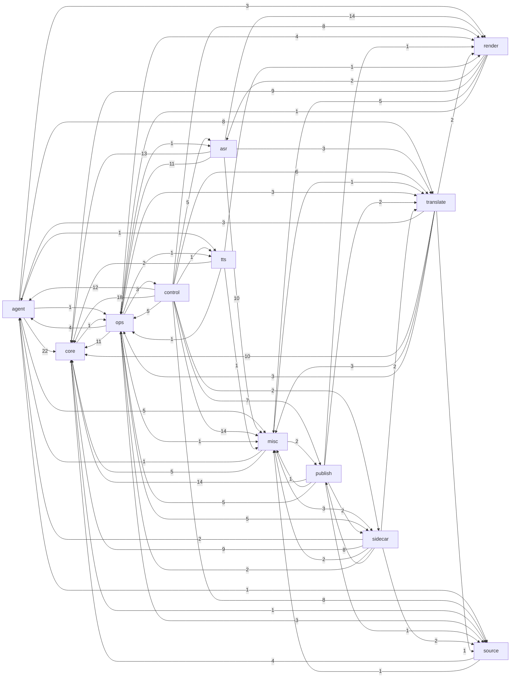

# Phụ thuộc giữa các lớp

_Sinh tự động bởi `scripts/brain_build.py` lúc 2026-11-11 13:00. Đừng sửa tay — chạy lại script._

Cạnh A → B = module lớp A import module lớp B (số = số cặp module).

## Ngược chiều đáng chú ý

Lớp pipeline/media (`source/asr/translate/tts/render`) import ngược `control`/`agent` là dấu hiệu coupling cần xem.

- [engines.pronoun_consistency](../modules/engines.pronoun_consistency.md) → [agents.agent_pronoun_pass](../modules/agents.agent_pronoun_pass.md)
- [engines.script_lint](../modules/engines.script_lint.md) → [agents.agent_name_pass](../modules/agents.agent_name_pass.md)
- [engines.translate](../modules/engines.translate.md) → [agents.agent_hang_fix](../modules/agents.agent_hang_fix.md)

## Fan-in / fan-out

| Module | Fan-in (được import) | Fan-out (import) | Hot-reload |
|---|---:|---:|---|
| [server](../modules/server.md) | 6 | 41 |  |
| [state.job_state](../modules/state.job_state.md) | 28 | 3 |  |
| [core.manifest](../modules/core.manifest.md) | 29 | 1 |  |
| [engines.translate](../modules/engines.translate.md) | 9 | 15 |  |
| [core.instance](../modules/core.instance.md) | 20 | 0 |  |
| [core.config](../modules/core.config.md) | 26 | 0 |  |
| [agents.agent_tele_cmd](../modules/agents.agent_tele_cmd.md) | 3 | 21 |  |
| [core.film_db](../modules/core.film_db.md) | 17 | 2 |  |
| [agents.hongguo_bridge](../modules/agents.hongguo_bridge.md) | 12 | 6 |  |
| [engines.subs](../modules/engines.subs.md) | 18 | 1 |  |
| [agents.agent_core](../modules/agents.agent_core.md) | 4 | 11 |  |
| [engines.llm](../modules/engines.llm.md) | 14 | 2 |  |
| [engines.render](../modules/engines.render.md) | 5 | 10 |  |
| [agents.auto_publisher](../modules/agents.auto_publisher.md) | 5 | 7 |  |
| [engines.vram](../modules/engines.vram.md) | 16 | 0 |  |
| [core.batch_config](../modules/core.batch_config.md) | 10 | 3 |  |
| [engines.asr.fun_asr_nano](../modules/engines.asr.fun_asr_nano.md) | 7 | 8 |  |
| [core.job_queue](../modules/core.job_queue.md) | 8 | 0 |  |
| [engines.asr.asr](../modules/engines.asr.asr.md) | 6 | 7 |  |
| [agents.agent_brain](../modules/agents.agent_brain.md) | 1 | 12 |  |
| [http_routes.routes_agent](../modules/http_routes.routes_agent.md) | 1 | 11 |  |
| [agents.agent_autopilot](../modules/agents.agent_autopilot.md) | 8 | 3 |  |
| [agents.agent_feeder](../modules/agents.agent_feeder.md) | 4 | 6 |  |
| [agents.meta_studio](../modules/agents.meta_studio.md) | 4 | 6 |  |
| [engines.asr.paraformer_zh](../modules/engines.asr.paraformer_zh.md) | 1 | 10 |  |
| [engines.render_job](../modules/engines.render_job.md) | 2 | 8 |  |
| [scripts.check_batch4](../modules/scripts.check_batch4.md) | 0 | 10 |  |
| [agents.agent_hang_fix](../modules/agents.agent_hang_fix.md) | 4 | 6 |  |
| [agents.agent_watch](../modules/agents.agent_watch.md) | 8 | 2 |  |
| [engines.asr.hybrid_asr](../modules/engines.asr.hybrid_asr.md) | 0 | 10 |  |
| [engines.clone_tts](../modules/engines.clone_tts.md) | 3 | 5 |  |
| [core.fileio](../modules/core.fileio.md) | 8 | 0 |  |
| [agents.agent_hongguo](../modules/agents.agent_hongguo.md) | 3 | 6 |  |
| [agents.agent_pronoun_pass](../modules/agents.agent_pronoun_pass.md) | 2 | 7 |  |
| [app.main](../modules/app.main.md) | 1 | 7 |  |
| [engines.asr.asr_spam](../modules/engines.asr.asr_spam.md) | 7 | 2 |  |
| [engines.assemble](../modules/engines.assemble.md) | 8 | 0 |  |
| [engines.separate](../modules/engines.separate.md) | 3 | 5 |  |
| [http_routes.routes_hg](../modules/http_routes.routes_hg.md) | 1 | 7 |  |
| [http_routes.routes_uploader_settings](../modules/http_routes.routes_uploader_settings.md) | 0 | 9 |  |

## Không ai import và không ai nhắc tên file (ứng viên code chết — kiểm .bat/UI trước khi xoá)

[agents.__init__](../modules/agents.__init__.md), [app.__init__](../modules/app.__init__.md), [app.routes.__init__](../modules/app.routes.__init__.md), [core.__init__](../modules/core.__init__.md), [engines.__init__](../modules/engines.__init__.md), [engines.asr.__init__](../modules/engines.asr.__init__.md), [events.__init__](../modules/events.__init__.md), [http_routes.__init__](../modules/http_routes.__init__.md), [pineline.__init__](../modules/pineline.__init__.md), [pineline.server.__init__](../modules/pineline.server.__init__.md), [pineline.server.routes.__init__](../modules/pineline.server.routes.__init__.md), [pineline.server.routes.assets](../modules/pineline.server.routes.assets.md), [pineline.server.routes.fs](../modules/pineline.server.routes.fs.md), [pipeline.__init__](../modules/pipeline.__init__.md), [pipeline.gates.__init__](../modules/pipeline.gates.__init__.md), [pipeline.stages.__init__](../modules/pipeline.stages.__init__.md), [runtime.__init__](../modules/runtime.__init__.md), [services.__init__](../modules/services.__init__.md), [services.hongguo_flow](../modules/services.hongguo_flow.md), [sidecar.__init__](../modules/sidecar.__init__.md), [state.__init__](../modules/state.__init__.md), [tools.__init__](../modules/tools.__init__.md), [tools.context_studio.__init__](../modules/tools.context_studio.__init__.md), [tools.context_studio.app_streamlit](../modules/tools.context_studio.app_streamlit.md), [workers.__init__](../modules/workers.__init__.md)
