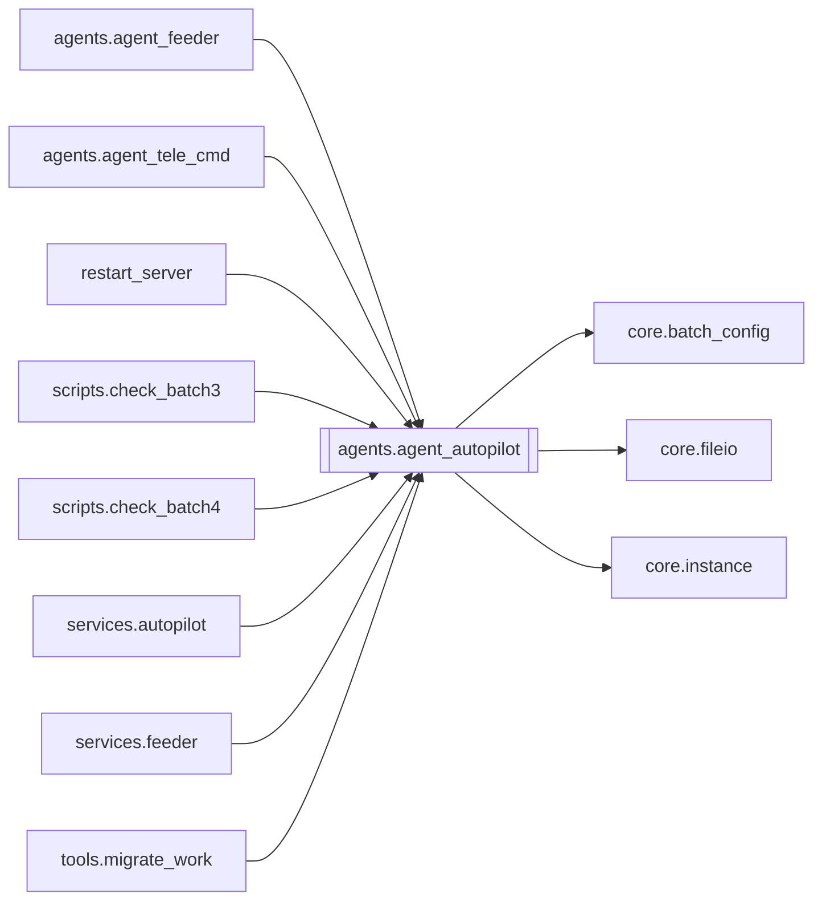

# `agents.agent_autopilot`

[← Index](../generated/module-index.md) · [Brain home](../README.md)

<!-- AUTO:START — sinh bởi scripts/brain_build.py 2026-11-11 13:00. Đừng sửa tay khối này. -->
**File:** `agents/agent_autopilot.py` · **Lớp:** `sidecar` · **332 dòng** (272 code) · **16 hàm**, **0 class** · sha1 `2fa935f18b`

> Auto-pilot — queue need_queue + heal safe qua HTTP Pineline (server của instance, PINELINE_BASE). Chạy trong sidecar (agent_tele_cmd) — không cần restart server.

### Phụ thuộc

- **Gọi tới (import nội bộ):** [core.batch_config](./core.batch_config.md), [core.fileio](./core.fileio.md), [core.instance](./core.instance.md)
- **Được dùng bởi:** [agents.agent_feeder](./agents.agent_feeder.md), [agents.agent_tele_cmd](./agents.agent_tele_cmd.md), [restart_server](./restart_server.md), [scripts.check_batch3](./scripts.check_batch3.md), [scripts.check_batch4](./scripts.check_batch4.md), [services.autopilot](./services.autopilot.md), [services.feeder](./services.feeder.md), [tools.migrate_work](./tools.migrate_work.md)
- **Được nhắc tên file `.py` (subprocess/script) bởi:** [restart_server](./restart_server.md)
- **Test:** ❌ chưa có test import trực tiếp
- **Thư viện ngoài:** `requests`

### Hàm & class top-level

| Tên | Dòng | Dài | Tham số | Docstring |
|---|---:|---:|---|---|
| `_now` | 26 | 2 | `` |  |
| `load_state` | 33 | 17 | `` |  |
| `save_state` | 52 | 2 | `state` |  |
| `update_state` | 56 | 7 | `fn` | Đọc-sửa-ghi trong khoá: tick sidecar và bật/tắt (server/script) không đè nhau. |
| `set_enabled` | 65 | 16 | `on` |  |
| `_get` | 83 | 4 | `base, path, timeout` |  |
| `_post` | 89 | 16 | `base, path, body, timeout` |  |
| `queue_opts` | 107 | 6 | `base` |  |
| `_opts_differ` | 115 | 9 | `a, b` |  |
| `sync_pending_to_batch` | 126 | 48 | `base` | Job chưa bắt đầu trong hàng chờ → theo config batch mới nhất (giữ thứ tự). |
| `status_brief` | 176 | 18 | `base` |  |
| `tick_once` | 196 | 62 | `base, force` | 1 vòng: queue need_queue (nếu rỗng/thiếu) + watch-once heal safe. |
| `agent_chat` | 260 | 20 | `base, message, history, allow_mutate, require_confirm` |  |
| `agent_confirm` | 282 | 2 | `base, cid, approve` |  |
| `hard_stop` | 286 | 33 | `base` | Dừng queue + mọi stage running + tắt ý định re-queue. |
| `format_status` | 321 | 12 | `brief` |  |

**File/artifact nhắc tới:** `autopilot_state.json`, `manifest.json`

**Tín hiệu rủi ro (đếm tĩnh):** broad_except=6 · global_stmt=1 · sleep=1

### Lịch sử (từ docs/)

- **Fix logs (1):**
  - [2026-11-11 — F4 (services + sidecar thuần) + F5 (render tiến trình con)](../../fixes/2026-11-11-f4-f5.md)
- Nhắc trong CHANGELOG: **0** lần · DECISIONS: **0** lần

<!-- AUTO:END -->

<!-- MANUAL:START -->
## Vai trò (viết tay)

_Chưa viết. 2–4 câu: module này chịu trách nhiệm gì trong pipeline, ai gọi nó, nó KHÔNG làm gì._

## Luồng chính

_Các hàm vào (entry) → bước chính → output/side effect. Ghi tên hàm thật._

## Bất biến & hợp đồng

_Điều luôn phải đúng (vd: chỉ ghi manifest qua `Manifest.update`; 1 job / ghế). Vi phạm = bug._

## Bẫy đã biết

_Lỗi từng gặp + link `docs/fixes/...`. Những chỗ dễ sửa sai._

## Ghi chú vận hành

_Config key quan trọng, cần restart gì khi sửa (:8801 / :8802 / hot-reload), cách test._
<!-- MANUAL:END -->
