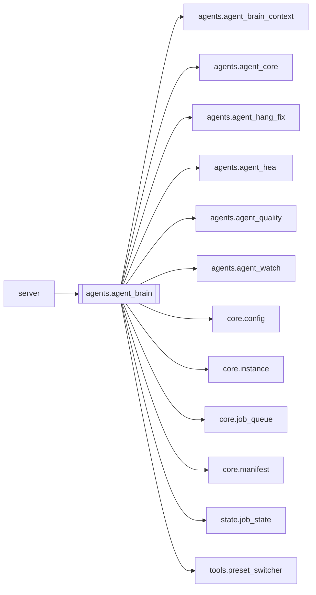

# `agents.agent_brain`

[← Index](../generated/module-index.md) · [Brain home](../README.md)

<!-- AUTO:START — sinh bởi scripts/brain_build.py 2026-11-11 13:00. Đừng sửa tay khối này. -->
**File:** `agents/agent_brain.py` · **Lớp:** `agent` · **1233 dòng** (1098 code) · **36 hàm**, **0 class** · sha1 `107b27e55a`

> Second Brain — daemon nền full-silent. Sensors → incidents → policy → actuators. Bật: AGENT_BRAIN=1 (hoặc pineline.config.json).

### Phụ thuộc

- **Gọi tới (import nội bộ):** [agents.agent_brain_context](./agents.agent_brain_context.md), [agents.agent_core](./agents.agent_core.md), [agents.agent_hang_fix](./agents.agent_hang_fix.md), [agents.agent_heal](./agents.agent_heal.md), [agents.agent_quality](./agents.agent_quality.md), [agents.agent_watch](./agents.agent_watch.md), [core.config](./core.config.md), [core.instance](./core.instance.md), [core.job_queue](./core.job_queue.md), [core.manifest](./core.manifest.md), [state.job_state](./state.job_state.md), [tools.preset_switcher](./tools.preset_switcher.md)
- **Được dùng bởi:** [server](./server.md)
- **Test:** ❌ chưa có test import trực tiếp
- **Thư viện ngoài:** `state`

### Hàm & class top-level

| Tên | Dòng | Dài | Tham số | Docstring |
|---|---:|---:|---|---|
| `_sidecar_url` | 22 | 3 | `` |  |
| `_self_base` | 27 | 4 | `` | URL server Pineline đang chạy brain (fix 2026-11-11: trước cứng :8801 → V4/V5 điều khiển nhầm V2). |
| `_cfg` | 40 | 9 | `key, default` |  |
| `_truthy` | 51 | 2 | `v` |  |
| `brain_enabled` | 55 | 6 | `` |  |
| `_interval_sec` | 63 | 5 | `` |  |
| `_tg_mode` | 70 | 2 | `` |  |
| `_log_dir` | 74 | 4 | `root` |  |
| `log_line` | 80 | 9 | `root, msg` |  |
| `_state_path` | 91 | 2 | `root` |  |
| `_load_state` | 95 | 8 | `root` |  |
| `_save_state` | 105 | 7 | `root, state` |  |
| `_cooldown_ok` | 114 | 4 | `state, fp, sec` |  |
| `_mark_fp` | 120 | 3 | `state, fp, note` |  |
| `_telegram` | 125 | 16 | `msg, level` |  |
| `_ping` | 143 | 12 | `url, timeout` |  |
| `sense_infra` | 157 | 21 | `` |  |
| `sense_jobs` | 180 | 49 | `work_root, max_jobs` | Quét job có script / failed / stale cho quality + ops hints. |
| `_qa_pipeline_phase` | 231 | 63 | `work_dir` | Perceive: job đang ở đâu — mid_review / pre_tts / post_tts / idle. |
| `_gpu_or_queue_busy` | 296 | 12 | `work_root` |  |
| `decide` | 310 | 39 | `incidents, state` | Policy full-silent → list actions. |
| `apply_actions` | 351 | 191 ⚠️ | `work_root, actions, state, hooks` |  |
| `_llm_enabled` | 544 | 7 | `` |  |
| `_llm_interval_sec` | 553 | 5 | `` |  |
| `_http_json` | 560 | 11 | `method, url, body, timeout` |  |
| `_ensure_brain_runtime` | 573 | 177 ⚠️ | `work_root` | Bind agent_core Runtime nếu chưa có — FS + HTTP proxy (không cần restart :8801). |
| `_run_agent_llm` | 752 | 71 | `message, work_root, max_steps, force_first_tool, force_first_args` | Gọi agent_core tool-loop in-process (bind FS/HTTP nếu cần) hoặc fallback HTTP chat. |
| `llm_tick` | 825 | 185 ⚠️ | `work_root` | LLM Second Brain: đọc snapshot toàn hệ → tool-loop quyết định. |
| `_tg_report_sec` | 1013 | 5 | `` |  |
| `_progress_digest` | 1020 | 72 | `work_root` | Tóm tắt ngắn running/queue cho Telegram. |
| `_maybe_tg_progress` | 1094 | 11 | `work_root, state` |  |
| `tick` | 1107 | 73 | `work_root, hooks, list_jobs` |  |
| `_loop` | 1182 | 14 | `work_root, hooks, list_jobs, interval` |  |
| `start_brain` | 1198 | 22 | `work_root, hooks, list_jobs` |  |
| `stop_brain` | 1222 | 2 | `` |  |
| `brain_once` | 1226 | 8 | `work_root, hooks, list_jobs` | API/ops: chạy 1 tick thủ công. |

**Hàm dài ≥120 dòng:** `apply_actions` (191, L351), `llm_tick` (185, L825), `_ensure_brain_runtime` (177, L573)

### Config / env keys (10)

`AGENT_BRAIN`, `AGENT_BRAIN_LLM`, `AGENT_BRAIN_LLM_SEC`, `AGENT_BRAIN_LLM_STEPS`, `AGENT_BRAIN_MODE`, `AGENT_BRAIN_SEC`, `AGENT_BRAIN_TELEGRAM`, `AGENT_BRAIN_TG_SEC`, `REVIEW_PRESET`, `TRANSLATE_PRESET`

**Cổng nhắc tới:** 3377, 8083

**File/artifact nhắc tới:** `agent_brain.log`, `agent_brain_last_snapshot.json`, `agent_brain_state.json`, `brain_pending_decisions.json`, `manifest.json`, `script.json`

**Tín hiệu rủi ro (đếm tĩnh):** broad_except=36 · file_writes=5 · global_stmt=1 · swallow_except=8 · threads=1

### Lịch sử (từ docs/)

- Fix logs: —
- Nhắc trong CHANGELOG: **0** lần · DECISIONS: **0** lần

<!-- AUTO:END -->

<!-- MANUAL:START -->
## Vai trò (viết tay)

_Chưa viết. 2–4 câu: module này chịu trách nhiệm gì trong pipeline, ai gọi nó, nó KHÔNG làm gì._

## Luồng chính

_Các hàm vào (entry) → bước chính → output/side effect. Ghi tên hàm thật._

## Bất biến & hợp đồng

_Điều luôn phải đúng (vd: chỉ ghi manifest qua `Manifest.update`; 1 job / ghế). Vi phạm = bug._

## Bẫy đã biết

_Lỗi từng gặp + link `docs/fixes/...`. Những chỗ dễ sửa sai._

## Ghi chú vận hành

_Config key quan trọng, cần restart gì khi sửa (:8801 / :8802 / hot-reload), cách test._
<!-- MANUAL:END -->
