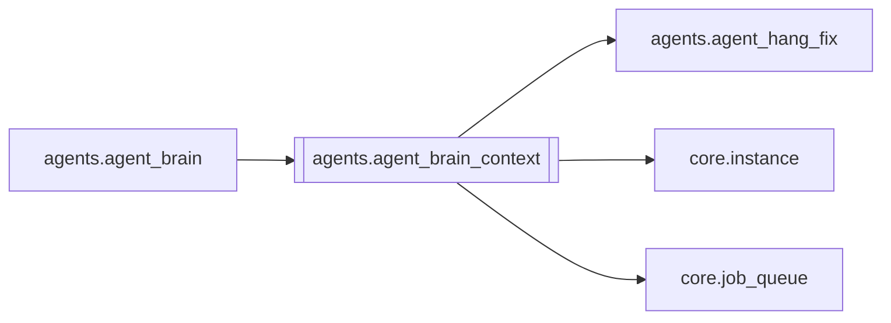

# `agents.agent_brain_context`

[← Index](../generated/module-index.md) · [Brain home](../README.md)

<!-- AUTO:START — sinh bởi scripts/brain_build.py 2026-11-11 13:00. Đừng sửa tay khối này. -->
**File:** `agents/agent_brain_context.py` · **Lớp:** `agent` · **268 dòng** (235 code) · **7 hàm**, **0 class** · sha1 `a5f1e74200`

> System snapshot cho Second Brain LLM — toàn hệ, không chỉ 1 job.

### Phụ thuộc

- **Gọi tới (import nội bộ):** [agents.agent_hang_fix](./agents.agent_hang_fix.md), [core.instance](./core.instance.md), [core.job_queue](./core.job_queue.md)
- **Được dùng bởi:** [agents.agent_brain](./agents.agent_brain.md)
- **Test:** ❌ chưa có test import trực tiếp

### Hàm & class top-level

| Tên | Dòng | Dài | Tham số | Docstring |
|---|---:|---:|---|---|
| `_sidecar_url` | 14 | 3 | `` |  |
| `_self_base` | 19 | 4 | `` | URL server Pineline đang chạy brain (fix 2026-11-11: trước cứng :8801 → V4/V5 điều khiển nhầm V2). |
| `_ping` | 25 | 11 | `url, timeout` |  |
| `_disk` | 38 | 11 | `path` |  |
| `_job_brief` | 51 | 91 | `work_root, d` |  |
| `build_system_snapshot` | 144 | 87 | `work_root, max_jobs` |  |
| `snapshot_to_prompt` | 233 | 6 | `snap, max_chars` | JSON gọn cho LLM user message. |

**Cổng nhắc tới:** 3377, 8000, 8083

**File/artifact nhắc tới:** `manifest.json`, `output.mp4`, `qa_brain.json`, `script.json`

**Tín hiệu rủi ro (đếm tĩnh):** broad_except=7 · swallow_except=3

### Lịch sử (từ docs/)

- Fix logs: —
- Nhắc trong CHANGELOG: **0** lần · DECISIONS: **0** lần

<!-- AUTO:END -->

<!-- MANUAL:START -->
## Vai trò (viết tay)

_Chưa viết. 2–4 câu: module này chịu trách nhiệm gì trong pipeline, ai gọi nó, nó KHÔNG làm gì._

## Luồng chính

_Các hàm vào (entry) → bước chính → output/side effect. Ghi tên hàm thật._

## Bất biến & hợp đồng

_Điều luôn phải đúng (vd: chỉ ghi manifest qua `Manifest.update`; 1 job / ghế). Vi phạm = bug._

## Bẫy đã biết

_Lỗi từng gặp + link `docs/fixes/...`. Những chỗ dễ sửa sai._

## Ghi chú vận hành

_Config key quan trọng, cần restart gì khi sửa (:8801 / :8802 / hot-reload), cách test._
<!-- MANUAL:END -->
