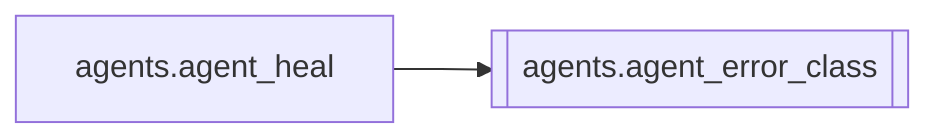

# `agents.agent_error_class`

[← Index](../generated/module-index.md) · [Brain home](../README.md)

<!-- AUTO:START — sinh bởi scripts/brain_build.py 2026-11-11 13:00. Đừng sửa tay khối này. -->
**File:** `agents/agent_error_class.py` · **Lớp:** `agent` · **121 dòng** (106 code) · **3 hàm**, **0 class** · sha1 `e395cd2a0d`

> Phân loại lỗi theo log / cur_text / error (ASR · TTS · mux · …).

### Phụ thuộc

- **Gọi tới (import nội bộ):** —
- **Được dùng bởi:** [agents.agent_heal](./agents.agent_heal.md)
- **Test:** ❌ chưa có test import trực tiếp

### Hàm & class top-level

| Tên | Dòng | Dài | Tham số | Docstring |
|---|---:|---:|---|---|
| `classify_error` | 52 | 31 | `stage, text, extra` |  |
| `classify_stage_status` | 85 | 7 | `stage, st` |  |
| `filter_actions_by_class` | 105 | 17 | `actions_safe, classifications` | Loại action oan khi class bảo notify_only / none. |

### Lịch sử (từ docs/)

- Fix logs: —
- Nhắc trong CHANGELOG: **0** lần · DECISIONS: **0** lần

<!-- AUTO:END -->

<!-- MANUAL:START -->
## Vai trò (viết tay)

_Chưa viết. 2–4 câu: module này chịu trách nhiệm gì trong pipeline, ai gọi nó, nó KHÔNG làm gì._

## Luồng chính

_Các hàm vào (entry) → bước chính → output/side effect. Ghi tên hàm thật._

## Bất biến & hợp đồng

_Điều luôn phải đúng (vd: chỉ ghi manifest qua `Manifest.update`; 1 job / ghế). Vi phạm = bug._

## Bẫy đã biết

_Lỗi từng gặp + link `docs/fixes/...`. Những chỗ dễ sửa sai._

## Ghi chú vận hành

_Config key quan trọng, cần restart gì khi sửa (:8801 / :8802 / hot-reload), cách test._
<!-- MANUAL:END -->
