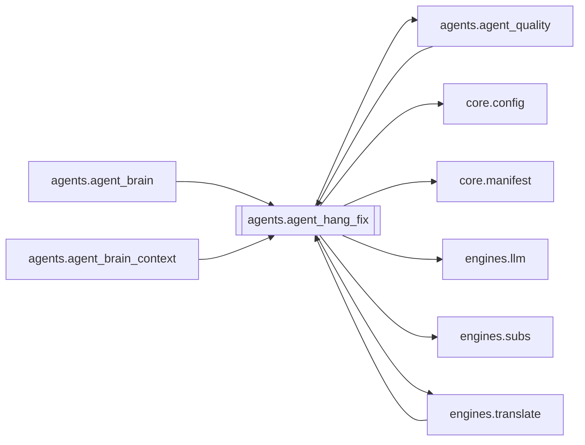

# `agents.agent_hang_fix`

[← Index](../generated/module-index.md) · [Brain home](../README.md)

<!-- AUTO:START — sinh bởi scripts/brain_build.py 2026-11-11 13:00. Đừng sửa tay khối này. -->
**File:** `agents/agent_hang_fix.py` · **Lớp:** `agent` · **368 dòng** (326 code) · **9 hàm**, **0 class** · sha1 `ff9b157cf2`

> Second Brain — pass LLM trace + xử lý high `hang` (đuôi treo / nửa câu). Không chỉ merge mù: mỗi flag được chẩn đoán (root), chọn phương án, rồi áp VI. Ghi `qa_hang_trace.json` để audit. Chỉ mở HOLD khi re-scan hết high 

### Phụ thuộc

- **Gọi tới (import nội bộ):** [agents.agent_quality](./agents.agent_quality.md), [core.config](./core.config.md), [core.manifest](./core.manifest.md), [engines.llm](./engines.llm.md), [engines.subs](./engines.subs.md), [engines.translate](./engines.translate.md)
- **Được dùng bởi:** [agents.agent_brain](./agents.agent_brain.md), [agents.agent_brain_context](./agents.agent_brain_context.md), [agents.agent_quality](./agents.agent_quality.md), [engines.translate](./engines.translate.md)
- **Test:** ❌ chưa có test import trực tiếp

### Hàm & class top-level

| Tên | Dòng | Dài | Tham số | Docstring |
|---|---:|---:|---|---|
| `_cfg` | 19 | 6 | `key, default` |  |
| `enabled` | 27 | 3 | `` |  |
| `_pos_map` | 32 | 6 | `rows` |  |
| `_window` | 40 | 15 | `rows, idx, radius` |  |
| `collect_hang_cases` | 57 | 37 | `rows, flags` | Lấy high hang (+ med hang kết thúc là/nhưng rõ) kèm cửa sổ ZH/VI. |
| `_llm_trace_batch` | 96 | 68 | `cases, model` | Trả list {i, root_cause, plan, rationale, fixes:[{i,vi}]}. |
| `apply_trace_items` | 166 | 38 | `rows, items` |  |
| `_review_or_translate_busy` | 206 | 40 | `work_dir` | Tránh race: review/dịch đang ghi script sẽ xoá hang_ack/hang_fix. |
| `fix_hang_job` | 248 | 121 ⚠️ | `work_dir, model, write, max_cases, force` | Trace + LLM fix hang → ghi script + qa_hang_trace.json → re-scan quality. |

**Hàm dài ≥120 dòng:** `fix_hang_job` (121, L248)

### Config / env keys (3)

`BRAIN_HANG_FIX`, `HANG_FIX_MODEL`, `PRONOUN_MODEL`

**File/artifact nhắc tới:** `qa_hang_trace.json`, `script.json`, `sub.vi.srt`

**Tín hiệu rủi ro (đếm tĩnh):** broad_except=7 · file_writes=4 · swallow_except=3

### Lịch sử (từ docs/)

- Fix logs: —
- Nhắc trong CHANGELOG: **0** lần · DECISIONS: **0** lần

<!-- AUTO:END -->

<!-- MANUAL:START -->
## Vai trò (viết tay)

_Chưa viết. 2–4 câu: module này chịu trách nhiệm gì trong pipeline, ai gọi nó, nó KHÔNG làm gì._

## Luồng chính

_Các hàm vào (entry) → bước chính → output/side effect. Ghi tên hàm thật._

## Bất biến & hợp đồng

_Điều luôn phải đúng (vd: chỉ ghi manifest qua `Manifest.update`; 1 job / ghế). Vi phạm = bug._

## Bẫy đã biết

_Lỗi từng gặp + link `docs/fixes/...`. Những chỗ dễ sửa sai._

## Ghi chú vận hành

_Config key quan trọng, cần restart gì khi sửa (:8801 / :8802 / hot-reload), cách test._
<!-- MANUAL:END -->
