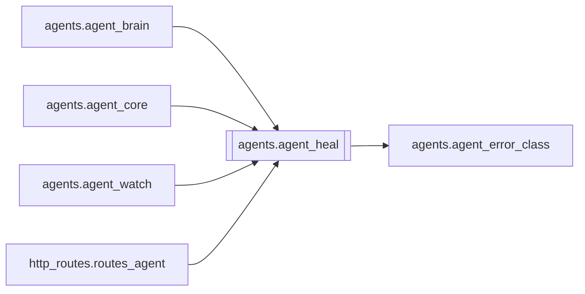

# `agents.agent_heal`

[← Index](../generated/module-index.md) · [Brain home](../README.md)

<!-- AUTO:START — sinh bởi scripts/brain_build.py 2026-11-11 13:00. Đừng sửa tay khối này. -->
**File:** `agents/agent_heal.py` · **Lớp:** `agent` · **662 dòng** (563 code) · **10 hàm**, **0 class** · sha1 `64f1488b77`

> agent_heal.py — Chẩn đoán + heal job lỗi (an toàn theo cấp). safe: heal stale running, vá dịch trống, TTS thiếu clip, mux lại nếu có audio. aggressive: thêm asr/tts force (chỉ khi user/agent allow + level=aggressive).

### Phụ thuộc

- **Gọi tới (import nội bộ):** [agents.agent_error_class](./agents.agent_error_class.md)
- **Được dùng bởi:** [agents.agent_brain](./agents.agent_brain.md), [agents.agent_core](./agents.agent_core.md), [agents.agent_watch](./agents.agent_watch.md), [http_routes.routes_agent](./http_routes.routes_agent.md)
- **Test:** ❌ chưa có test import trực tiếp

### Hàm & class top-level

| Tên | Dòng | Dài | Tham số | Docstring |
|---|---:|---:|---|---|
| `_mf` | 18 | 8 | `work` |  |
| `_stage` | 28 | 2 | `data, name` |  |
| `_count_missing_vi` | 32 | 11 | `work` |  |
| `_tts_missing` | 45 | 16 | `work, st` |  |
| `diagnose_job` | 63 | 175 ⚠️ | `work_root, job_id` |  |
| `heal_job` | 240 | 103 | `work_root, job_id, apply, level, hooks` | apply=False: chỉ trả plan. apply=True: chạy actions theo level. |
| `_job_needs_attention` | 345 | 12 | `diag` |  |
| `scan_problem_jobs` | 359 | 51 | `work_root, list_jobs, include_done_ok` | Quét mọi job có manifest — tìm fail/kẹt/thiếu bước. |
| `heal_failed_batch` | 412 | 56 | `work_root, apply, level, max_jobs, list_jobs, hooks` | Bắt mọi job lỗi/kẹt rồi heal (plan hoặc apply). |
| `reset_job_state` | 470 | 192 ⚠️ | `work_root, job_id, stages, keep_asr, restart, hooks` | Reset sạch các stage bị kẹt/lỗi của 1 job (xóa artifact dở, gỡ .stop, reset manifest về pending). |

**Hàm dài ≥120 dòng:** `reset_job_state` (192, L470), `diagnose_job` (175, L63)

### Config / env keys (1)

`WORK_DIR`

**File/artifact nhắc tới:** `_filter_complex.txt`, `asr.json`, `audio.wav`, `audio.wav.json`, `dub_fit.wav`, `manifest.json`, `output.mp4`, `output.partial.mp4`, `script.display.json`, `script.json`, `script.pre_agent_review.json`, `script.pre_review.json`, `sub.vi.burn.follow.ass`, `sub.vi.burn.srt`, `sub.vi.srt`, `sub.zh.srt`, `tts.json`, `tts_config.json`, `tts_fit.json`

**Tín hiệu rủi ro (đếm tĩnh):** broad_except=16 · file_writes=1 · swallow_except=8

### Lịch sử (từ docs/)

- Fix logs: —
- Nhắc trong CHANGELOG: **0** lần · DECISIONS: **0** lần

<!-- AUTO:END -->

<!-- MANUAL:START -->
## Vai trò (viết tay)

_Chưa viết. 2–4 câu: module này chịu trách nhiệm gì trong pipeline, ai gọi nó, nó KHÔNG làm gì._

## Luồng chính

_Các hàm vào (entry) → bước chính → output/side effect. Ghi tên hàm thật._

## Bất biến & hợp đồng

_Điều luôn phải đúng (vd: chỉ ghi manifest qua `Manifest.update`; 1 job / ghế). Vi phạm = bug._

## Bẫy đã biết

_Lỗi từng gặp + link `docs/fixes/...`. Những chỗ dễ sửa sai._

## Ghi chú vận hành

_Config key quan trọng, cần restart gì khi sửa (:8801 / :8802 / hot-reload), cách test._
<!-- MANUAL:END -->
