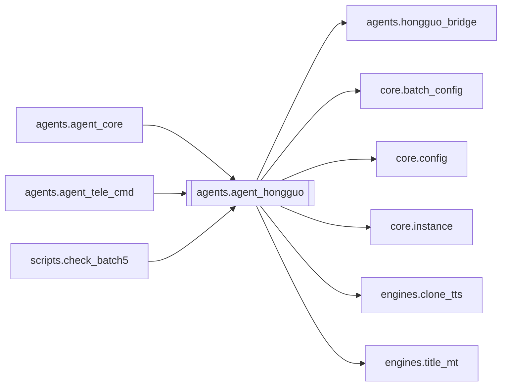

# `agents.agent_hongguo`

[← Index](../generated/module-index.md) · [Brain home](../README.md)

<!-- AUTO:START — sinh bởi scripts/brain_build.py 2026-11-11 13:00. Đừng sửa tay khối này. -->
**File:** `agents/agent_hongguo.py` · **Lớp:** `agent` · **1572 dòng** (1382 code) · **36 hàm**, **0 class** · sha1 `e020146025`

> agent_hongguo.py — Tích hợp bộ tool Hongguo Downloader & Auto-chain cho Pineline AI Agent. Hỗ trợ 4 nhóm chức năng: 1. Cơ bản: hg_search, hg_download, hg_status, hg_library

### Phụ thuộc

- **Gọi tới (import nội bộ):** [agents.hongguo_bridge](./agents.hongguo_bridge.md), [core.batch_config](./core.batch_config.md), [core.config](./core.config.md), [core.instance](./core.instance.md), [engines.clone_tts](./engines.clone_tts.md), [engines.title_mt](./engines.title_mt.md)
- **Được dùng bởi:** [agents.agent_core](./agents.agent_core.md), [agents.agent_tele_cmd](./agents.agent_tele_cmd.md), [scripts.check_batch5](./scripts.check_batch5.md)
- **Được nhắc tên file `.py` (subprocess/script) bởi:** [restart_server](./restart_server.md), [scripts.check_batch1](./scripts.check_batch1.md)
- **Test:** ❌ chưa có test import trực tiếp
- **Thư viện ngoài:** `requests`

### Hàm & class top-level

| Tên | Dòng | Dài | Tham số | Docstring |
|---|---:|---:|---|---|
| `detect_flow_mode` | 34 | 8 | `target` | Chỉ nhận cả chuỗi là từ khoá; tên phim chứa 'top'/'hot'/'kho' vẫn là 'name'. |
| `_find_hongguo_executable` | 44 | 16 | `` | Tìm đường dẫn pythonw.exe và launcher.pyc/app.pyc của Hongguo Downloader. |
| `ensure_hongguo_running` | 62 | 44 | `timeout` | Kiểm tra Hongguo Downloader, nếu tắt sẽ tự khởi chạy. |
| `tool_hg_search` | 108 | 35 | `query, expand, limit` | Tìm kiếm phim trên Hongguo theo tên hoặc từ khóa. |
| `_norm_lb_cat` | 158 | 7 | `category` |  |
| `load_leaderboard` | 167 | 20 | `category` | Leaderboard như app: /dl/rank board=new, 100 phim / thể loại (AI · Live-action · Animated). |
| `load_catalog` | 189 | 33 | `genre, sort, status, q, api_page` | Catalog như app: explorer.hongguodownloader.com, 100 phim / trang, lọc thể loại · sắp xếp · trạng thái. |
| `_enrich_page` | 224 | 22 | `items` | Dịch tên + lấy số tập thật cho các phim của trang đang hiện (lười, có cache trong item). |
| `_item_dict` | 248 | 7 | `r` |  |
| `tool_hg_rank` | 257 | 13 | `category, board, size` | Leaderboard Hongguo (AI / Live-action / Animated) kèm tên Việt + link xem thử từng phim. |
| `tool_hg_catalog` | 272 | 16 | `genre, sort, status, q, page, size` | Catalog Hongguo theo thể loại / sắp xếp / trạng thái / từ khoá, kèm link xem thử từng phim. |
| `tool_hg_genres` | 290 | 7 | `` | Lấy danh sách các thể loại phim có sẵn trong Hongguo Catalog. |
| `_mark` | 299 | 2 | `on, label` |  |
| `render_view` | 303 | 57 | `page, per_page` | Trang danh sách kiểu app: phim + nút 👁 xem thử cạnh ▶ làm, tab Leaderboard/Catalog, bộ lọc, phân trang. |
| `render_genre_picker` | 365 | 13 | `` |  |
| `view_callback` | 380 | 18 | `data` | Callback nút tab / lọc / trang của Leaderboard & Catalog → (text, buttons) để sửa tin nhắn. |
| `page_covers` | 400 | 9 | `page, per_page` | (cover_url, caption) cho các phim của trang đang hiện. |
| `cache_pick` | 423 | 6 | `idx` | Phim theo số thứ tự đang hiển thị (Catalog trang 2 bắt đầu từ 101). |
| `resolve_series_ref` | 431 | 22 | `ref` | series_id / số thứ tự trong BXH/catalog vừa xem / tên phim → (series_id, title, lỗi). |
| `watch_url` | 455 | 2 | `series_id, ep` |  |
| `preview_info` | 459 | 35 | `ref, ep, fresh` | Tập xem thử miễn phí (Hongguo /dl/preview): link MP4 + số tập free/tổng. |
| `download_preview` | 496 | 23 | `url, dest, max_bytes` | Tải MP4 xem thử về máy. CDN trả 403 nếu request có Referer nên không gửi Referer. |
| `render_watch_page` | 521 | 34 | `series_id, ep` | Trang HTML xem thử: <video> không gửi Referer (CDN chặn Referer localhost). |
| `tool_hg_preview` | 557 | 29 | `series_id, ep, folder_name` | Xem thử phim mà không cần tải: tập miễn phí online, hoặc phim đã tải trong D:\Lib. |
| `tool_hg_download` | 588 | 20 | `series_ids` | Đưa danh sách series_id vào hàng đợi tải của Hongguo Downloader. |
| `tool_hg_status` | 610 | 28 | `` | Kiểm tra tiến độ tải của Hongguo Downloader. |
| `tool_hg_library` | 640 | 26 | `query` | Liệt kê các bộ phim trong thư viện tải về (D:\Lib). |
| `tool_hg_merge` | 668 | 24 | `folder_name` | Gộp các tập video mảnh (.mp4) trong thư viện thành 1 file (merged).mp4. |
| `tool_hg_clean` | 694 | 29 | `folder_name` | Dọn dẹp/xóa các file tập mảnh lẻ sau khi đã gộp xong file (merged).mp4. |
| `_pick_lib_item` | 725 | 21 | `items, target` | Chọn folder thư viện: tên trùng khớp → series_id → chuỗi con DUY NHẤT. |
| `_get_existing_pineline_titles` | 748 | 21 | `rt` | Lấy danh sách tiêu đề các phim đã tạo Job trong Pineline để tránh làm trùng. |
| `tool_hg_series` | 771 | 119 | `query_or_id` | Tra cứu trọn bộ các phần / season của một bộ phim (Full series / Đồng hệ liệt). |
| `tool_hg_auto_flow` | 891 | 365 ⚠️ | `query_or_id, voice, tts_engine, auto_run, rt, notify_cb, mode` | Workflow tự động A-Z (mode: name / lib / rank; bỏ trống = đoán theo cả chuỗi): |
| `handle_hongguo_tool` | 1475 | 45 | `rt, name, args, allow_mutate` | Điều phối thực thi các tool Hongguo cho AI Agent. |
| `running_auto_flows` | 1522 | 3 | `` |  |
| `start_auto_flow_bg` | 1527 | 46 | `rt, args, notify` | Chạy tool_hg_auto_flow trong thread nền; trùng target đang chạy thì không chạy thêm. |

**Hàm dài ≥120 dòng:** `tool_hg_auto_flow` (365, L891)

### Config / env keys (2)

`LOCALAPPDATA`, `PORT`

**File/artifact nhắc tới:** `tts_config.json`

**Tín hiệu rủi ro (đếm tĩnh):** broad_except=33 · file_writes=1 · global_stmt=2 · sleep=4 · subprocess=1 · swallow_except=12 · threads=1

### Lịch sử (từ docs/)

- **Fix logs (1):**
  - [2026-11-11 — F4 (services + sidecar thuần) + F5 (render tiến trình con)](../../fixes/2026-11-11-f4-f5.md)
- Nhắc trong CHANGELOG: **0** lần · DECISIONS: **0** lần

<!-- AUTO:END -->

<!-- MANUAL:START -->
## Vai trò (viết tay)

_Chưa viết. 2–4 câu: module này chịu trách nhiệm gì trong pipeline, ai gọi nó, nó KHÔNG làm gì._

## Luồng chính

_Các hàm vào (entry) → bước chính → output/side effect. Ghi tên hàm thật._

## Bất biến & hợp đồng

_Điều luôn phải đúng (vd: chỉ ghi manifest qua `Manifest.update`; 1 job / ghế). Vi phạm = bug._

## Bẫy đã biết

_Lỗi từng gặp + link `docs/fixes/...`. Những chỗ dễ sửa sai._

## Ghi chú vận hành

_Config key quan trọng, cần restart gì khi sửa (:8801 / :8802 / hot-reload), cách test._
<!-- MANUAL:END -->
