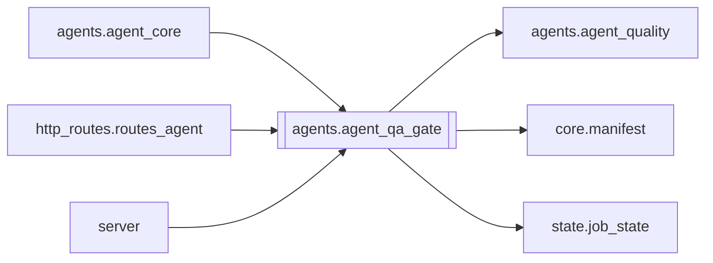

# `agents.agent_qa_gate`

[← Index](../generated/module-index.md) · [Brain home](../README.md)

<!-- AUTO:START — sinh bởi scripts/brain_build.py 2026-11-11 13:00. Đừng sửa tay khối này. -->
**File:** `agents/agent_qa_gate.py` · **Lớp:** `agent` · **227 dòng** (197 code) · **8 hàm**, **0 class** · sha1 `a81c024b77`

> Gate QA: translate → review → diff → mới cho TTS.

### Phụ thuộc

- **Gọi tới (import nội bộ):** [agents.agent_quality](./agents.agent_quality.md), [core.manifest](./core.manifest.md), [state.job_state](./state.job_state.md)
- **Được dùng bởi:** [agents.agent_core](./agents.agent_core.md), [http_routes.routes_agent](./http_routes.routes_agent.md), [server](./server.md)
- **Test:** ❌ chưa có test import trực tiếp
- **Thư viện ngoài:** `state`

### Hàm & class top-level

| Tên | Dòng | Dài | Tham số | Docstring |
|---|---:|---:|---|---|
| `_now` | 12 | 2 | `` |  |
| `_load_rows` | 16 | 8 | `path` |  |
| `snapshot_pre_review` | 26 | 7 | `work_dir` |  |
| `review_diff` | 35 | 86 | `work_dir, job_id` | So script.json vs script.pre_review.json + thống kê rv / missing. |
| `_fail_reasons` | 123 | 20 | `n, missing_ratio, review_ran, pack, brain_high` |  |
| `evaluate_qa_gate` | 145 | 2 | `work_dir` |  |
| `run_qa_gate` | 149 | 60 | `work_dir, run_review_fn, target, review_model` | Snapshot → run_review (sync) → diff → quyết định pass/block. |
| `set_qa_gate` | 211 | 17 | `work_dir, enabled, override_pass` |  |

**File/artifact nhắc tới:** `glossary.json`, `qa_flags.json`, `script.json`, `script.pre_review.json`, `style_lock.json`

**Tín hiệu rủi ro (đếm tĩnh):** broad_except=5

### Lịch sử (từ docs/)

- Fix logs: —
- Nhắc trong CHANGELOG: **0** lần · DECISIONS: **0** lần

<!-- AUTO:END -->

<!-- MANUAL:START -->
## Vai trò (viết tay)

_Chưa viết. 2–4 câu: module này chịu trách nhiệm gì trong pipeline, ai gọi nó, nó KHÔNG làm gì._

## Luồng chính

_Các hàm vào (entry) → bước chính → output/side effect. Ghi tên hàm thật._

## Bất biến & hợp đồng

_Điều luôn phải đúng (vd: chỉ ghi manifest qua `Manifest.update`; 1 job / ghế). Vi phạm = bug._

## Bẫy đã biết

_Lỗi từng gặp + link `docs/fixes/...`. Những chỗ dễ sửa sai._

## Ghi chú vận hành

_Config key quan trọng, cần restart gì khi sửa (:8801 / :8802 / hot-reload), cách test._
<!-- MANUAL:END -->
