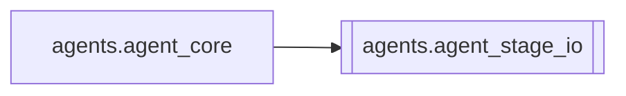

# `agents.agent_stage_io`

[← Index](../generated/module-index.md) · [Brain home](../README.md)

<!-- AUTO:START — sinh bởi scripts/brain_build.py 2026-11-11 13:00. Đừng sửa tay khối này. -->
**File:** `agents/agent_stage_io.py` · **Lớp:** `agent` · **286 dòng** (251 code) · **14 hàm**, **0 class** · sha1 `13f574576c`

> Peek / tóm tắt từng stage — chỉ đọc disk (an toàn).

### Phụ thuộc

- **Gọi tới (import nội bộ):** —
- **Được dùng bởi:** [agents.agent_core](./agents.agent_core.md)
- **Test:** ❌ chưa có test import trực tiếp

### Hàm & class top-level

| Tên | Dòng | Dài | Tham số | Docstring |
|---|---:|---:|---|---|
| `_mf` | 9 | 8 | `work` |  |
| `_stage` | 19 | 2 | `data, name` |  |
| `_file_info` | 23 | 8 | `path` |  |
| `_sample_list` | 33 | 37 | `path, text_keys, n` |  |
| `peek_download` | 72 | 23 | `work_root, job_id` |  |
| `peek_asr` | 97 | 18 | `work_root, job_id` |  |
| `peek_translate` | 117 | 19 | `work_root, job_id` |  |
| `peek_tts` | 138 | 26 | `work_root, job_id` |  |
| `peek_ocr` | 166 | 13 | `work_root, job_id` |  |
| `peek_mux` | 181 | 22 | `work_root, job_id` |  |
| `peek_stage` | 215 | 6 | `work_root, job_id, stage` |  |
| `peek_all` | 223 | 5 | `work_root, job_id` |  |
| `peek_style_pack` | 230 | 53 | `work_root, job_id` | Pack kịch bản / văn phong (Context Studio + glossary Pineline). |
| `json_dump` | 285 | 2 | `obj` |  |

**File/artifact nhắc tới:** `asr.json`, `context_pack.json`, `dub_fit.wav`, `glossary.json`, `manifest.json`, `ocr.json`, `output.mp4`, `output.partial.mp4`, `qa_flags.json`, `relation_matrix.json`, `script.json`, `source.mp4`, `style_lock.json`, `tts.json`, `tts_config.json`

**Tín hiệu rủi ro (đếm tĩnh):** broad_except=4

### Lịch sử (từ docs/)

- Fix logs: —
- Nhắc trong CHANGELOG: **0** lần · DECISIONS: **0** lần

<!-- AUTO:END -->

<!-- MANUAL:START -->
## Vai trò (viết tay)

_Chưa viết. 2–4 câu: module này chịu trách nhiệm gì trong pipeline, ai gọi nó, nó KHÔNG làm gì._

## Luồng chính

_Các hàm vào (entry) → bước chính → output/side effect. Ghi tên hàm thật._

## Bất biến & hợp đồng

_Điều luôn phải đúng (vd: chỉ ghi manifest qua `Manifest.update`; 1 job / ghế). Vi phạm = bug._

## Bẫy đã biết

_Lỗi từng gặp + link `docs/fixes/...`. Những chỗ dễ sửa sai._

## Ghi chú vận hành

_Config key quan trọng, cần restart gì khi sửa (:8801 / :8802 / hot-reload), cách test._
<!-- MANUAL:END -->
