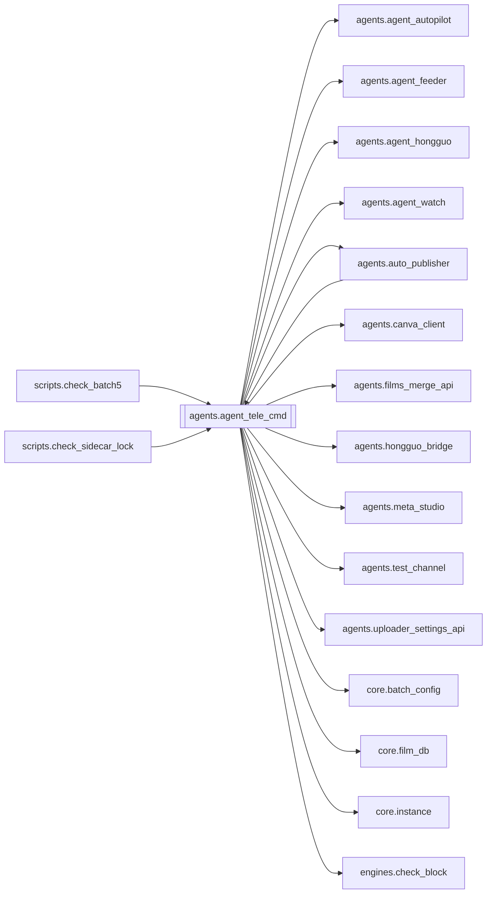

# `agents.agent_tele_cmd`

[← Index](../generated/module-index.md) · [Brain home](../README.md)

<!-- AUTO:START — sinh bởi scripts/brain_build.py 2026-11-11 13:00. Đừng sửa tay khối này. -->
**File:** `agents/agent_tele_cmd.py` · **Lớp:** `sidecar` · **2302 dòng** (2079 code) · **40 hàm**, **2 class** · sha1 `041f9ee2cb`

> Sidecar: Telegram lệnh + HTTP mỏng (cổng AUTOPILOT_PORT của instance; V2 cũ: :8802) KHÔNG restart Pineline server — chỉ gọi API server của instance (PINELINE_BASE). Chạy:  python agents/agent_tele_cmd.py --instance v6   

### Phụ thuộc

- **Gọi tới (import nội bộ):** [agents.agent_autopilot](./agents.agent_autopilot.md), [agents.agent_feeder](./agents.agent_feeder.md), [agents.agent_hongguo](./agents.agent_hongguo.md), [agents.agent_watch](./agents.agent_watch.md), [agents.auto_publisher](./agents.auto_publisher.md), [agents.canva_client](./agents.canva_client.md), [agents.films_merge_api](./agents.films_merge_api.md), [agents.hongguo_bridge](./agents.hongguo_bridge.md), [agents.meta_studio](./agents.meta_studio.md), [agents.test_channel](./agents.test_channel.md), [agents.uploader_settings_api](./agents.uploader_settings_api.md), [core.batch_config](./core.batch_config.md), [core.film_db](./core.film_db.md), [core.instance](./core.instance.md), [engines.check_block](./engines.check_block.md), [engines.llm](./engines.llm.md), [engines.title_mt](./engines.title_mt.md), [services.autopilot](./services.autopilot.md), [services.feeder](./services.feeder.md), [services.film_db_sync](./services.film_db_sync.md), [tools.lib_check](./tools.lib_check.md)
- **Được dùng bởi:** [agents.auto_publisher](./agents.auto_publisher.md), [scripts.check_batch5](./scripts.check_batch5.md), [scripts.check_sidecar_lock](./scripts.check_sidecar_lock.md)
- **Được nhắc tên file `.py` (subprocess/script) bởi:** [restart_server](./restart_server.md), [scripts.check_batch2](./scripts.check_batch2.md), [services.__init__](./services.__init__.md), [services.autopilot](./services.autopilot.md), [tools.migrate_work](./tools.migrate_work.md)
- **Test:** `tests/test_b11_risky_modules.py`, `tests/test_f4_services.py`, `tests/test_review2_f4f5.py`
- **Thư viện ngoài:** `PIL`, `requests`

### Hàm & class top-level

| Tên | Dòng | Dài | Tham số | Docstring |
|---|---:|---:|---|---|
| **class `CtrlHandler`** | 895 | 8 method | |  |
| **class `_ExclusiveHTTPServer`** | 2193 | 1 method | | Windows: SO_REUSEADDR (mặc định của HTTPServer) cho bản thứ 2 bind trùng cổng. |
| `_load_history_from_disk` | 95 | 10 | `` |  |
| `_save_history_to_disk` | 107 | 11 | `` |  |
| `get_user_history` | 123 | 9 | `uid` |  |
| `add_user_history` | 134 | 11 | `uid, role, content` |  |
| `clear_user_history` | 147 | 5 | `uid` |  |
| `_telegram_allowed` | 154 | 5 | `` | V6 F4: instance tắt telegram (PINELINE_FLAG_TELEGRAM=0) → sidecar KHÔNG gửi/poll Telegram. |
| `_ensure_agent_telegram` | 161 | 7 | `` |  |
| `tg_send` | 170 | 5 | `text, force` |  |
| `tg_api` | 177 | 13 | `method, payload` |  |
| `allowed_uids` | 192 | 3 | `` |  |
| `tg_send_video` | 197 | 19 | `chat_id, path, caption, buttons, meta` |  |
| `send_preview` | 221 | 42 | `uid, ref, ep` | Gửi tập xem thử (miễn phí) vào chat: video + nút chuyển tập + nút làm A-Z. |
| `send_covers` | 265 | 37 | `uid, page` | Album ảnh bìa (tối đa 10) của trang Leaderboard/Catalog đang xem — giống lưới poster của app. |
| `_edit_or_send` | 304 | 10 | `uid, cq, text, buttons` |  |
| `spawn_preview` | 316 | 2 | `uid, ref, ep` |  |
| `_parse_catalog_args` | 325 | 25 | `text` | '/hg catalog Urban popular completed' → genre / sort / status; phần còn lại = từ khoá. |
| `hg_tele_command` | 352 | 223 ⚠️ | `raw, uid` |  |
| `_send_confirm_buttons` | 577 | 12 | `uid, confirms` |  |
| `_agent_ask` | 591 | 10 | `msg, uid` | Chat agent; có uid (Telegram) thì tool phá huỷ đỗ lại và gửi nút ✅/❌. |
| `_confirm_callback` | 603 | 12 | `uid, cq, data` |  |
| `_slash_hint` | 625 | 32 | `text` | Chữ thường (không '/') mà đổi trạng thái → ("hint", gợi ý) nếu ngắn kiểu lệnh hoặc có tiền tố |
| `handle_command` | 659 | 184 ⚠️ | `text, uid` |  |
| `_agent_reply` | 845 | 10 | `msg, uid` |  |
| `_fetch_poster_bytes` | 857 | 33 | `name` |  |
| `autopilot_loop` | 1912 | 3 | `stop` |  |
| `filmdb_loop` | 1920 | 3 | `stop` |  |
| `runwatch_loop` | 1971 | 3 | `stop` | Luôn theo dõi job chạy + báo xong/treo; chỉ tự xử lý treo khi Auto-pilot ON. |
| `feeder_loop` | 1976 | 2 | `stop` |  |
| `_sync_and_report` | 1983 | 3 | `reason` |  |
| `config_watch_loop` | 1988 | 6 | `stop` |  |
| `_inline_kb` | 1996 | 3 | `rows` |  |
| `_on_callback` | 2001 | 92 | `cq, allow` |  |
| `telegram_loop` | 2095 | 49 | `stop` |  |
| `is_priority_cmd` | 2150 | 4 | `text` | Lệnh chạy ngay trên luồng poll, không xếp sau lượt agent đang nghĩ (tới 180s). |
| `_tg_worker` | 2156 | 10 | `stop` |  |
| `_handle_tg_text` | 2168 | 23 | `uid, text` |  |
| `_single_instance_lock` | 2203 | 14 | `` | Khoá 1 bản / cổng; trả file handle (giữ sống tới khi thoát) hoặc None nếu đã có bản khác. |
| `_apply_instance` | 2219 | 21 | `argv` | V6 F4: `--instance <tên>` (hoặc env PINELINE_INSTANCE khi chưa có PINELINE_FLAG_*) → apply_env |
| `sidecar_owns_background` | 2242 | 6 | `` | Sidecar còn tự chạy vòng nền (autopilot/feeder/runwatch/film_db/config-live/auto-publish)? |
| `main` | 2250 | 49 | `` |  |

**Hàm dài ≥120 dòng:** `CtrlHandler.do_POST` (587, L1323), `CtrlHandler.do_GET` (370, L952), `hg_tele_command` (223, L352), `handle_command` (184, L659)

### Config / env keys (12)

`AGENT_TELEGRAM`, `AUTOPILOT_HOST`, `AUTOPILOT_TICK_SEC`, `FILMDB_SEC`, `PINELINE_FLAG_FEEDER`, `PINELINE_FLAG_TELEGRAM`, `PINELINE_INSTANCE`, `QUEUE_LIVE_CONFIG`, `RUNWATCH_SEC`, `TELEGRAM_POLL_SEC`, `TEMP`, `TMP`

**Cổng nhắc tới:** 8000, 8802

**File/artifact nhắc tới:** `tele_chat_history.json`

**Tín hiệu rủi ro (đếm tĩnh):** broad_except=53 · file_writes=3 · global_stmt=4 · sleep=3 · subprocess=1 · swallow_except=11 · threads=11

### Lịch sử (từ docs/)

- **Fix logs (1):**
  - [2026-11-11 — F4 (services + sidecar thuần) + F5 (render tiến trình con)](../../fixes/2026-11-11-f4-f5.md)
- **Reviews:** [2026-11-11-review-f4-f5](../../reviews/2026-11-11-review-f4-f5.md)
- Nhắc trong CHANGELOG: **0** lần · DECISIONS: **0** lần

<!-- AUTO:END -->

<!-- MANUAL:START -->
## Vai trò (viết tay)

_Chưa viết. 2–4 câu: module này chịu trách nhiệm gì trong pipeline, ai gọi nó, nó KHÔNG làm gì._

## Luồng chính

_Các hàm vào (entry) → bước chính → output/side effect. Ghi tên hàm thật._

## Bất biến & hợp đồng

_Điều luôn phải đúng (vd: chỉ ghi manifest qua `Manifest.update`; 1 job / ghế). Vi phạm = bug._

## Bẫy đã biết

_Lỗi từng gặp + link `docs/fixes/...`. Những chỗ dễ sửa sai._

## Ghi chú vận hành

_Config key quan trọng, cần restart gì khi sửa (:8801 / :8802 / hot-reload), cách test._
<!-- MANUAL:END -->
