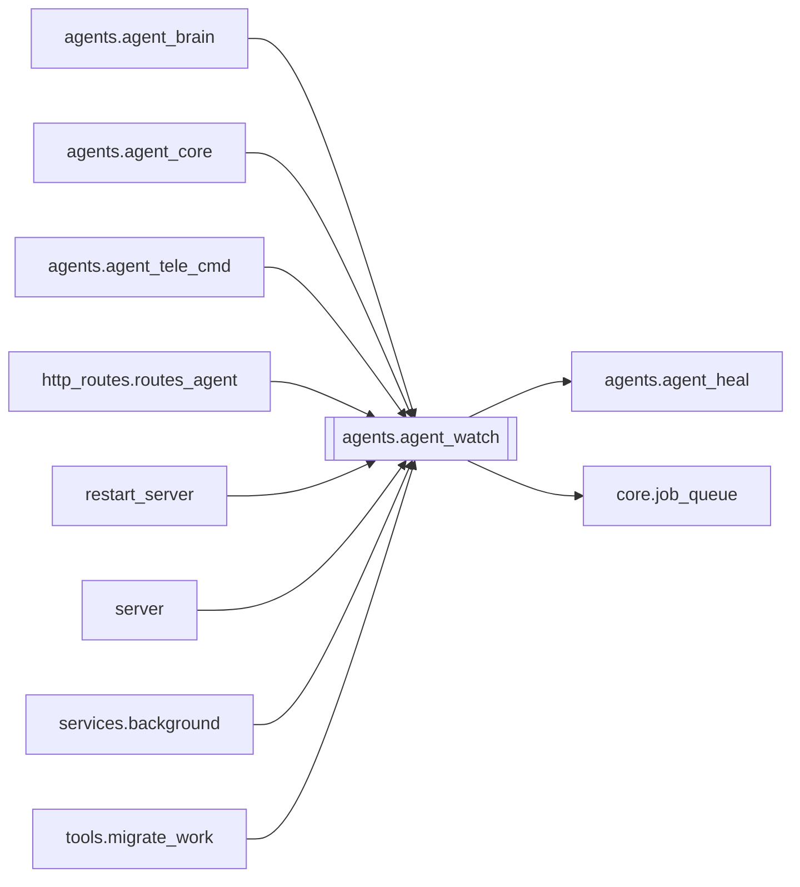

# `agents.agent_watch`

[← Index](../generated/module-index.md) · [Brain home](../README.md)

<!-- AUTO:START — sinh bởi scripts/brain_build.py 2026-11-11 13:00. Đừng sửa tay khối này. -->
**File:** `agents/agent_watch.py` · **Lớp:** `agent` · **375 dòng** (320 code) · **19 hàm**, **0 class** · sha1 `3d22f44b02`

> Watcher A: định kỳ scan → heal safe + log + Telegram (tuỳ chọn). Env: AGENT_WATCH=1

### Phụ thuộc

- **Gọi tới (import nội bộ):** [agents.agent_heal](./agents.agent_heal.md), [core.job_queue](./core.job_queue.md)
- **Được dùng bởi:** [agents.agent_brain](./agents.agent_brain.md), [agents.agent_core](./agents.agent_core.md), [agents.agent_tele_cmd](./agents.agent_tele_cmd.md), [http_routes.routes_agent](./http_routes.routes_agent.md), [restart_server](./restart_server.md), [server](./server.md), [services.background](./services.background.md), [tools.migrate_work](./tools.migrate_work.md)
- **Test:** ❌ chưa có test import trực tiếp

### Hàm & class top-level

| Tên | Dòng | Dài | Tham số | Docstring |
|---|---:|---:|---|---|
| `_log_dir` | 32 | 4 | `root` |  |
| `log_line` | 38 | 9 | `root, msg` |  |
| `_state_path` | 49 | 2 | `root` |  |
| `_load_state` | 53 | 8 | `root` |  |
| `_save_state` | 63 | 7 | `root, state` |  |
| `_cooldown_sec` | 72 | 5 | `` |  |
| `_skip_prefixes` | 79 | 3 | `` |  |
| `_should_skip_job` | 84 | 3 | `job_id` |  |
| `_fingerprint` | 89 | 4 | `problem` |  |
| `_load_dotenv` | 95 | 14 | `path` |  |
| `telegram_config` | 111 | 13 | `` |  |
| `telegram_send` | 126 | 28 | `text, force, dedupe_key` |  |
| `_gpu_busy` | 156 | 21 | `work_root` |  |
| `_filter_problems` | 179 | 26 | `work_root, problems` | Bỏ job test + đang cooldown cùng fingerprint. |
| `_mark_healed` | 207 | 10 | `work_root, problems` |  |
| `watch_once` | 219 | 104 | `work_root, list_jobs, hooks, max_jobs` |  |
| `_loop` | 325 | 15 | `work_root, list_jobs, hooks, interval, max_jobs` |  |
| `start_watcher` | 342 | 30 | `work_root, list_jobs, hooks` |  |
| `stop_watcher` | 374 | 2 | `` |  |

### Config / env keys (9)

`AGENT_TELEGRAM`, `AGENT_TELEGRAM_STARTUP`, `AGENT_WATCH`, `AGENT_WATCH_COOLDOWN`, `AGENT_WATCH_MAX_JOBS`, `AGENT_WATCH_SEC`, `AGENT_WATCH_SKIP_PREFIX`, `TELEGRAM_ALLOWED_USERS`, `TELEGRAM_BOT_TOKEN`

**File/artifact nhắc tới:** `agent_watch.log`, `agent_watch_state.json`, `manifest.json`

**Tín hiệu rủi ro (đếm tĩnh):** broad_except=12 · file_writes=1 · global_stmt=1 · swallow_except=4 · threads=1

### Lịch sử (từ docs/)

- **Fix logs (2):**
  - [2026-11-11 — F4 (services + sidecar thuần) + F5 (render tiến trình con)](../../fixes/2026-11-11-f4-f5.md)
  - [2026-11-11 — F2 (core/job_opts) + F3 tích hợp (1 tiến trình V5+V6, UI cũ hết polling)](../../fixes/2026-11-11-f2-f3-integration.md)
- **Reviews:** [2026-11-11-review-f2-f3](../../reviews/2026-11-11-review-f2-f3.md)
- Nhắc trong CHANGELOG: **0** lần · DECISIONS: **0** lần

<!-- AUTO:END -->

<!-- MANUAL:START -->
## Vai trò (viết tay)

_Chưa viết. 2–4 câu: module này chịu trách nhiệm gì trong pipeline, ai gọi nó, nó KHÔNG làm gì._

## Luồng chính

_Các hàm vào (entry) → bước chính → output/side effect. Ghi tên hàm thật._

## Bất biến & hợp đồng

_Điều luôn phải đúng (vd: chỉ ghi manifest qua `Manifest.update`; 1 job / ghế). Vi phạm = bug._

## Bẫy đã biết

_Lỗi từng gặp + link `docs/fixes/...`. Những chỗ dễ sửa sai._

## Ghi chú vận hành

_Config key quan trọng, cần restart gì khi sửa (:8801 / :8802 / hot-reload), cách test._
<!-- MANUAL:END -->
