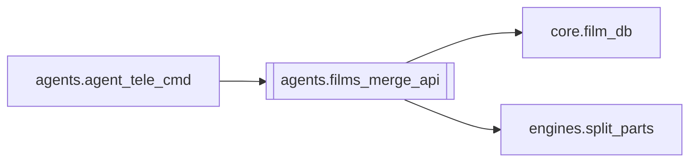

# `agents.films_merge_api`

[← Index](../generated/module-index.md) · [Brain home](../README.md)

<!-- AUTO:START — sinh bởi scripts/brain_build.py 2026-11-11 13:00. Đừng sửa tay khối này. -->
**File:** `agents/films_merge_api.py` · **Lớp:** `publish` · **174 dòng** (146 code) · **10 hàm**, **0 class** · sha1 `10bea381cd`

> Gộp parts (split jobs) + scan job đã làm sẵn sàng merge — dùng từ sidecar :8802.

### Phụ thuộc

- **Gọi tới (import nội bộ):** [core.film_db](./core.film_db.md), [engines.split_parts](./engines.split_parts.md)
- **Được dùng bởi:** [agents.agent_tele_cmd](./agents.agent_tele_cmd.md)
- **Test:** ❌ chưa có test import trực tiếp

### Hàm & class top-level

| Tên | Dòng | Dài | Tham số | Docstring |
|---|---:|---:|---|---|
| `_ok` | 13 | 2 | `data, **extra` |  |
| `_err` | 17 | 2 | `msg, code, **extra` |  |
| `_parent_id` | 21 | 5 | `job_id` |  |
| `_read_split_status` | 28 | 9 | `parent_dir` |  |
| `_part_ready` | 39 | 16 | `part_dir` |  |
| `scan_mergeable` | 57 | 47 | `limit` | Parent có đủ part output, chưa merged → sẵn sàng gộp. |
| `list_mergeable` | 106 | 8 | `` |  |
| `merge_one` | 116 | 24 | `job_id` |  |
| `merge_many` | 142 | 18 | `payload` |  |
| `dispatch` | 162 | 13 | `method, path, body` |  |

### Config / env keys (1)

`WORK_DIR`

**File/artifact nhắc tới:** `manifest.json`, `output.mp4`, `output_full.mp4`

**Tín hiệu rủi ro (đếm tĩnh):** broad_except=4 · swallow_except=2

### Lịch sử (từ docs/)

- Fix logs: —
- Nhắc trong CHANGELOG: **0** lần · DECISIONS: **0** lần

<!-- AUTO:END -->

<!-- MANUAL:START -->
## Vai trò (viết tay)

_Chưa viết. 2–4 câu: module này chịu trách nhiệm gì trong pipeline, ai gọi nó, nó KHÔNG làm gì._

## Luồng chính

_Các hàm vào (entry) → bước chính → output/side effect. Ghi tên hàm thật._

## Bất biến & hợp đồng

_Điều luôn phải đúng (vd: chỉ ghi manifest qua `Manifest.update`; 1 job / ghế). Vi phạm = bug._

## Bẫy đã biết

_Lỗi từng gặp + link `docs/fixes/...`. Những chỗ dễ sửa sai._

## Ghi chú vận hành

_Config key quan trọng, cần restart gì khi sửa (:8801 / :8802 / hot-reload), cách test._
<!-- MANUAL:END -->
