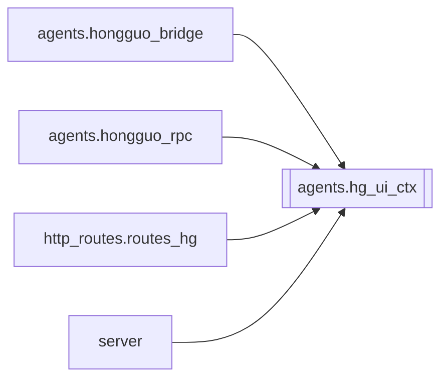

# `agents.hg_ui_ctx`

[← Index](../generated/module-index.md) · [Brain home](../README.md)

<!-- AUTO:START — sinh bởi scripts/brain_build.py 2026-11-11 13:00. Đừng sửa tay khối này. -->
**File:** `agents/hg_ui_ctx.py` · **Lớp:** `source` · **46 dòng** (32 code) · **4 hàm**, **0 class** · sha1 `fa82e36254`

> Per-request Hongguo UI backend context (không reload — tránh mất override). Hongguo1 vs Hongguo2 dùng chung process nhưng chọn backend khác nhau qua `apply` từ routes_hg (header X-HG-UI / Referer).

### Phụ thuộc

- **Gọi tới (import nội bộ):** —
- **Được dùng bởi:** [agents.hongguo_bridge](./agents.hongguo_bridge.md), [agents.hongguo_rpc](./agents.hongguo_rpc.md), [http_routes.routes_hg](./http_routes.routes_hg.md), [server](./server.md)
- **Test:** ❌ chưa có test import trực tiếp

### Hàm & class top-level

| Tên | Dòng | Dài | Tham số | Docstring |
|---|---:|---:|---|---|
| `apply` | 17 | 13 | `ui, referer` |  |
| `force` | 32 | 7 | `choice` | Ép backend theo namespace URL (/api/hg vs /api/hg2) — nguồn sự thật tách UI. |
| `get` | 41 | 2 | `` |  |
| `is_classic` | 45 | 2 | `` |  |

### Lịch sử (từ docs/)

- Fix logs: —
- Nhắc trong CHANGELOG: **0** lần · DECISIONS: **0** lần

<!-- AUTO:END -->

<!-- MANUAL:START -->
## Vai trò (viết tay)

_Chưa viết. 2–4 câu: module này chịu trách nhiệm gì trong pipeline, ai gọi nó, nó KHÔNG làm gì._

## Luồng chính

_Các hàm vào (entry) → bước chính → output/side effect. Ghi tên hàm thật._

## Bất biến & hợp đồng

_Điều luôn phải đúng (vd: chỉ ghi manifest qua `Manifest.update`; 1 job / ghế). Vi phạm = bug._

## Bẫy đã biết

_Lỗi từng gặp + link `docs/fixes/...`. Những chỗ dễ sửa sai._

## Ghi chú vận hành

_Config key quan trọng, cần restart gì khi sửa (:8801 / :8802 / hot-reload), cách test._
<!-- MANUAL:END -->
