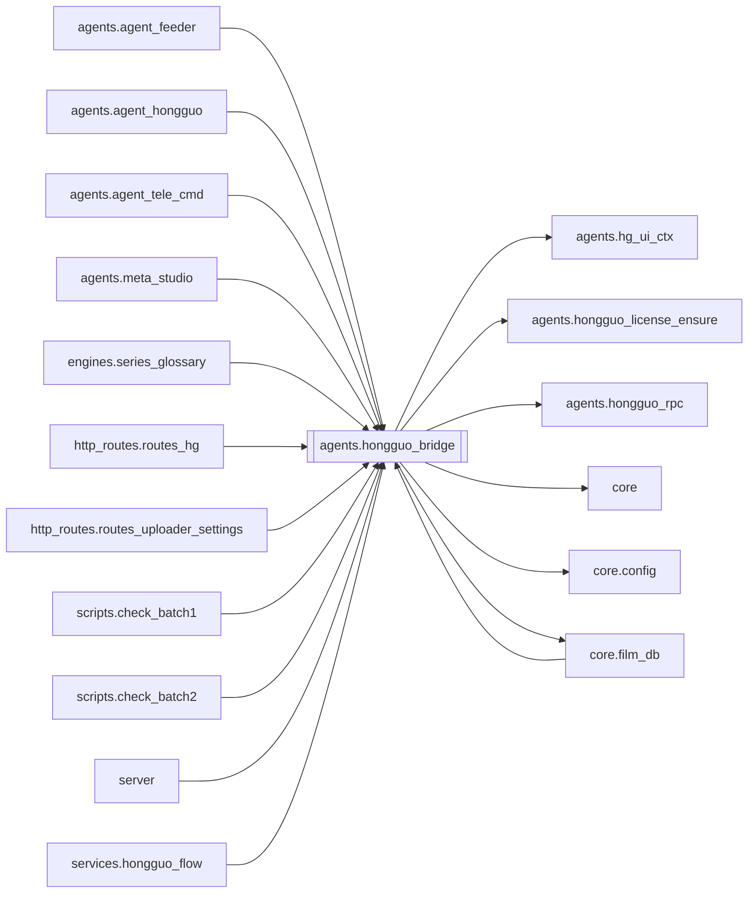

# `agents.hongguo_bridge`

[← Index](../generated/module-index.md) · [Brain home](../README.md)

<!-- AUTO:START — sinh bởi scripts/brain_build.py 2026-11-11 13:00. Đừng sửa tay khối này. -->
**File:** `agents/hongguo_bridge.py` · **Lớp:** `source` · **4222 dòng** (3744 code) · **118 hàm**, **0 class** · sha1 `7ed32dd76d`

> hongguo_bridge.py — client mỏng gọi Hongguo Downloader local API (:8000). App Hongguo phải đang chạy. Pineline chỉ proxy + queue merge tuần tự. Merge Hongguo gốc là -c copy (giữ nguyên bitstream) → series lẫn 1080/720

### Phụ thuộc

- **Gọi tới (import nội bộ):** [agents.hg_ui_ctx](./agents.hg_ui_ctx.md), [agents.hongguo_license_ensure](./agents.hongguo_license_ensure.md), [agents.hongguo_rpc](./agents.hongguo_rpc.md), [core](./core.md), [core.config](./core.config.md), [core.film_db](./core.film_db.md)
- **Được dùng bởi:** [agents.agent_feeder](./agents.agent_feeder.md), [agents.agent_hongguo](./agents.agent_hongguo.md), [agents.agent_tele_cmd](./agents.agent_tele_cmd.md), [agents.meta_studio](./agents.meta_studio.md), [core.film_db](./core.film_db.md), [engines.series_glossary](./engines.series_glossary.md), [http_routes.routes_hg](./http_routes.routes_hg.md), [http_routes.routes_uploader_settings](./http_routes.routes_uploader_settings.md), [scripts.check_batch1](./scripts.check_batch1.md), [scripts.check_batch2](./scripts.check_batch2.md), [server](./server.md), [services.hongguo_flow](./services.hongguo_flow.md)
- **Được nhắc tên file `.py` (subprocess/script) bởi:** [restart_server](./restart_server.md)
- **Test:** `tests/v5/test_hg_merge_queue.py`

### Hàm & class top-level

| Tên | Dòng | Dài | Tham số | Docstring |
|---|---:|---:|---|---|
| `apply_request_backend` | 33 | 4 | `ui, referer` | Gắn backend theo UI — ủy quyền `hg_ui_ctx` (module không reload). |
| `_hg_backend_pref` | 42 | 16 | `` |  |
| `_rpc_mod` | 60 | 34 | `` | Trả module RPC. |
| `_http_reachable` | 99 | 13 | `base, timeout` | Downloader 1.x :8000 còn sống? (status không cần token). |
| `_use_rpc` | 114 | 39 | `` |  |
| `_save_merge_state` | 205 | 13 | `` | Gọi khi đang giữ _merge_lock. |
| `_load_merge_state` | 220 | 18 | `` |  |
| `_set_phase` | 244 | 10 | `name, phase, pct` |  |
| `season_stem` | 259 | 13 | `title` | Bỏ hậu tố mùa để gom series cùng tên gốc. |
| `franchise_core` | 274 | 3 | `title` | Lấy tên thương hiệu/series chuẩn để nhóm mùa chính xác mà không gộp nhầm thể loại (như 高武：, 游戏入侵：). |
| `_parse_cn_int` | 285 | 18 | `s` |  |
| `season_timeline_key` | 305 | 19 | `title, series_id` | Thứ tự phát hành ≈ series_id (snowflake). Phụ: cung/第N季 để ổn định khi thiếu id. |
| `order_franchise_items` | 326 | 67 | `items` | Sort theo thời gian phát hành (series_id) + gắn SS1→SSN. |
| `web_search_hongguoduanju` | 409 | 61 | `q, timeout` | Search trên hongguoduanju.com — thường ra đủ 第N季 mà /dl/search sót. |
| `_ingest_web_into` | 472 | 21 | `by_id, q, core_filter` | Ingest web results; nếu có core_filter chỉ giữ title cùng thương hiệu. |
| `web_expand_queries` | 501 | 24 | `q` | Query web tối thiểu nhưng phủ cao: exact + stem + vài mốc mùa. |
| `web_expand_into` | 527 | 28 | `by_id, q, workers` | Chạy song song vài web search → gộp vào by_id (lọc theo core). |
| `_load_title_cache` | 557 | 16 | `` |  |
| `_save_title_cache` | 575 | 8 | `data` |  |
| `lookup_series` | 585 | 73 | `series_id, base` | Lấy meta từ series_id (khi search không ra). |
| `series_seasons` | 660 | 20 | `series_id, base` |  |
| `series_qualities` | 682 | 23 | `series_id, base` | Không bao giờ 502 — catalog RPC chết thì trả ladder mặc định. |
| `_normalize_episode_cnt` | 707 | 18 | `v` | RPC 2.x đôi khi trả episodes=list[{number,durationSec}] — UI cũ cần int. |
| `resolve_text` | 727 | 73 | `text, base` | Parse link/share → series. Nhận URL detail/player hoặc series_id thuần. |
| `_cache_put` | 802 | 13 | `r` |  |
| `_fill_missing_from_cache` | 817 | 36 | `by_id, stem, base` | Với stem gốc, dò cache/seed cho 第1–15季 nếu search bỏ sót. |
| `expand_queries` | 855 | 28 | `q` | Sinh thêm query để bắt mùa đổi tên (灵界篇/仙界篇…). |
| `_base_port` | 885 | 8 | `base` |  |
| `_read_process_env_win` | 895 | 54 | `pid` | Đọc môi trường process khác (x64) qua PEB — lấy HG_UI_TOKEN. |
| `_hongguo_pids` | 951 | 16 | `` | PID process Hongguo Downloader (pythonw trong thư mục cài đặt). |
| `discover_ui_token` | 969 | 31 | `force` | Lấy HG_UI_TOKEN: env Pineline → cache → env process Downloader. |
| `_auth_headers` | 1002 | 9 | `base` |  |
| `_is_ui_auth_error` | 1013 | 9 | `detail` |  |
| `_req` | 1024 | 53 | `method, base, path, payload, query, timeout, _retry_auth` |  |
| `_license_magic` | 1079 | 26 | `cmd, payload` | Hot-path license ops via search/resolve (works before :8801 reload of /api/hg/license/*). |
| `ping` | 1107 | 42 | `base` |  |
| `search` | 1151 | 166 ⚠️ | `q, base, expand` |  |
| `status` | 1319 | 4 | `base` |  |
| `settings` | 1325 | 10 | `base` | WinUI settings.get — saveFolder/quality/parallel… |
| `settings_update` | 1337 | 11 | `patch, base` | WinUI settings.update — ghi patch vào helper (cùng store với app). |
| `cancel` | 1350 | 5 | `base` | Stop all active downloads. |
| `cancel_download` | 1357 | 12 | `series_id, base` | Stop 1 download (RPC: cancelAll + requeue others). |
| `clear_finished` | 1371 | 4 | `base` |  |
| `remove_download` | 1377 | 7 | `series_id, base` |  |
| `retry_download` | 1386 | 7 | `series_id, base` |  |
| `open_folder` | 1395 | 24 | `path, name` | Mở thư mục series trong Explorer (WinUI Open folder). |
| `submit` | 1421 | 17 | `series_ids, base, scores, quality` |  |
| `library_update` | 1440 | 20 | `base, names` |  |
| `library_update_info` | 1462 | 5 | `base` | WinUI nút Update info — quét meta/poster, không tải mùa mới. |
| `seasons_decline` | 1469 | 5 | `series_ids, base` |  |
| `_normalize_browse_items` | 1476 | 25 | `items` |  |
| `_filter_by_genre_tag` | 1528 | 15 | `results, genre` |  |
| `_feed_labels` | 1568 | 18 | `` |  |
| `_feed_item_en` | 1588 | 5 | `zh_name` |  |
| `_localize_feed_rows` | 1595 | 25 | `rows` | Gắn label EN (WinUI FilterText) cho selector panel. |
| `feed_browse` | 1622 | 66 | `select, offset, size, panel, session_id` | Hongguo 2.x Browse = feed.page + selector panel (genre/theme/setting/…). |
| `_filter_by_status` | 1690 | 17 | `results, status` |  |
| `_rank_board_label` | 1765 | 7 | `zh` |  |
| `_localize_rank_charts` | 1774 | 23 | `charts` |  |
| `_resolve_rank_chart` | 1799 | 12 | `chart, board_legacy` |  |
| `_resolve_rank_board` | 1813 | 14 | `board, category` | RPC board id ('' = 总榜). category giữ alias cũ all/female/male/… |
| `rank_page` | 1829 | 38 | `chart, board, category, offset, size` | Hongguo 2.x Ranking = rank.page (charts + boards). |
| `rank` | 1869 | 133 ⚠️ | `category, board, offset, size, base, chart` | Bảng hot giống app Hongguo Downloader. |
| `genres` | 2004 | 15 | `limit` | Lấy danh sách các thể loại phim từ Hongguo Catalog Explorer. |
| `catalog` | 2021 | 62 | `genre, sort, status, q, page, size` | Khám phá kho phim Hongguo Catalog (Explorer). |
| `rank_episodes` | 2085 | 7 | `series_ids, base` | Bổ sung số tập cho list rank (POST /dl/rank-episodes). |
| `preview_series` | 2094 | 81 | `series_id, ep, fresh, base, quality` | Xem thử 1 tập. |
| `library` | 2177 | 34 | `base` |  |
| `_output_dir` | 2213 | 13 | `base` |  |
| `inspect_series_folder` | 2228 | 35 | `folder` | Quét folder series: có file (merged)? còn bao nhiêu mảnh tập? |
| `safe_child` | 2265 | 13 | `root, name` | root/name chỉ khi name là 1 cấp thư mục ngay dưới root. |
| `resolve_preview_path` | 2280 | 11 | `name, base` | Đường dẫn file xem thử trong thư viện (merged hoặc tập đầu). |
| `resolve_poster_path` | 2293 | 13 | `name, base` | poster.jpg/png trong folder series (local). |
| `fetch_poster` | 2308 | 38 | `name, base` | Bytes poster: ưu tiên /dl/poster (auth), fallback file local. |
| `fetch_img_proxy` | 2352 | 64 | `url, base` | Proxy ảnh cover: RPC ``covers.get`` → file local; HTTP :8000/img; fallback fetch trực tiếp. |
| `_trash_root` | 2422 | 7 | `folder` | Thùng rác NGOÀI thư viện (D:\Lib → D:\Lib_trash): Hongguo/Pineline quét thư viện |
| `purge_trash` | 2431 | 24 | `folder, days` | Xoá hẳn các lô trong thùng rác cũ hơn `days` ngày. Trả số lô đã xoá. |
| `merged_covers_fragments` | 2457 | 34 | `folder, merged_file` | Kiểm file gộp có chứa đủ các tập lẻ đang nằm trong folder không. |
| `_move_to_trash` | 2493 | 12 | `folder, files` |  |
| `cleanup_fragments` | 2507 | 30 | `folder` | Dọn tập lẻ sau khi đã có (merged) ĐỦ nội dung: chỉ file đúng mẫu tên tập, |
| `_ep_num_from_name` | 2539 | 15 | `name` | Số tập từ S01E013 / 第013集 / E13 / EP13 — không lấy nhầm season S01. |
| `_list_episode_frags` | 2556 | 33 | `folder` | Liệt kê tập mảnh; dedupe cùng số tập (ưu tiên SxxExxx + file đọc được). |
| `_probe_wh` | 2591 | 20 | `path` |  |
| `_probe_dur` | 2613 | 11 | `path` |  |
| `_frame_wh_at` | 2626 | 24 | `path, t` | Decode 1 frame tại t — bắt size thật (kể cả mid-stream đổi res). |
| `_pick_h264_encoder` | 2652 | 15 | `` | Args -c:v … cho normalize (ưu tiên NVENC). |
| `_scale_vf` | 2669 | 6 | `w, h` |  |
| `episode_resolutions` | 2677 | 20 | `folder` | Quét độ phân giải từng tập mảnh. mixed=True nếu lệch nhau. |
| `merged_has_mixed_res` | 2699 | 30 | `path, samples` | Kiểm tra file (merged) có đổi res giữa chừng không. |
| `normalize_merged_file` | 2731 | 72 | `path, target_wh, on_pct` | Re-encode 1 file (merged) về canvas cố định (scale+pad). |
| `merge_series_normalized` | 2805 | 117 | `folder, on_pct, target_wh` | Merge các tập mảnh về 1 canvas (scale+pad) rồi concat. |
| `mark_done` | 2924 | 8 | `name, merged_file, removed` |  |
| `merge_one` | 2934 | 5 | `name, base` |  |
| `merge_status` | 2941 | 2 | `base` |  |
| `open_library` | 2945 | 3 | `name, base` |  |
| `_film_db` | 2950 | 8 | `` | film_db dual-tree: V5 `core.film_db` hoặc V2/V4 `film_db`. |
| `remember_library_items` | 2960 | 9 | `items, source, on_disk, deleted` | Ghi meta series vào hg_watchlist (không giữ video). |
| `season_num` | 2971 | 14 | `title, season_field` | Số mùa từ field hoặc chữ 「第N季」 trong title; 0 = không rõ. |
| `discover_new_seasons` | 2987 | 197 ⚠️ | `base, max_cores, expand` | Chỉ tìm mùa/series mới theo watchlist+films+lib hiện có — KHÔNG gọi /dl/library/update. |
| `delete_library_series` | 3186 | 100 | `names, base` | Xoá vĩnh viễn thư mục series tại ổ đĩa D:\Lib để giải phóng dung lượng. |
| `merge_resume` | 3290 | 15 | `base` | Hàng đợi còn (nạp lại sau restart) mà không có worker → chạy tiếp, chỉ khi Hongguo đang mở |
| `merge_queue_state` | 3307 | 22 | `base` |  |
| `merge_queue_add` | 3331 | 41 | `names, base, skip_done` | Chỉ xếp hàng rồi trả về ngay — kiểm tra/chuẩn hoá/dọn tập đều do worker làm (UI thấy tiến độ). |
| `merge_queue_clear` | 3374 | 7 | `` |  |
| `_start_worker` | 3383 | 9 | `base` |  |
| `_finish` | 3394 | 13 | `name` | Kết thúc 1 series (xong hoặc lỗi): bỏ current, xoá phase, đếm vào batch, lưu state. |
| `_merge_worker` | 3409 | 244 ⚠️ | `base` |  |
| `_hist` | 3655 | 10 | `name, status, detail` |  |
| `_baike_get` | 3679 | 4 | `url, timeout` |  |
| `_baike_clean_title` | 3685 | 5 | `t` |  |
| `_titles_same_franchise` | 3692 | 21 | `root, other` | True nếu other cùng họ với root (bỏ ranking nhiễu trong 同系列). |
| `baike_search` | 3715 | 54 | `q, timeout` | Search https://www.duanjubaike.net/so.html?keyword=… |
| `baike_info` | 3771 | 189 ⚠️ | `series_id, timeout` | Trang info-{id}: meta + 同系列 (đã lọc nhiễu ranking). |
| `baike_deep` | 3962 | 37 | `series_id, title, timeout` | Lấy info sâu từ baike: ưu tiên series_id, không có thì search theo title. |
| `baike_versions` | 4001 | 51 | `q, timeout` | Q → search baike → chọn hit khớp nhất → danh sách version (đã lọc). |
| `_norm_title_key` | 4054 | 5 | `t` |  |
| `_hongguo_match_version` | 4061 | 94 | `ver, base` | Map 1 version baike → Hongguo. Ưu tiên series_id, rồi search đúng tên. |
| `search_via_baike` | 4157 | 66 | `q, base` | Baike nhận diện → versions → match từng cái trên Hongguo. |

**Hàm dài ≥120 dòng:** `_merge_worker` (244, L3409), `discover_new_seasons` (197, L2987), `baike_info` (189, L3771), `search` (166, L1151), `rank` (133, L1869)

### Config / env keys (4)

`HG_BACKEND`, `HG_UI_TOKEN`, `PINELINE_FLAG_HG_MERGE_RESUME`, `WORK_DIR`

**Cổng nhắc tới:** 8000

**File/artifact nhắc tới:** `.norm.partial.mp4`, `.norm.tmp.mp4`, `.series.json`, `.tmp.mp4`, `hg_merge_state.json`, `hg_title_cache.json`, `hongguo_feed_labels.json`, `list.txt`

**Tín hiệu rủi ro (đếm tĩnh):** broad_except=89 · file_writes=2 · global_stmt=7 · pools=2 · sleep=4 · subprocess=11 · swallow_except=25 · threads=1

### Lịch sử (từ docs/)

- Fix logs: —
- **Reviews:** [2026-11-11-review-f2-f3](../../reviews/2026-11-11-review-f2-f3.md)
- Nhắc trong CHANGELOG: **0** lần · DECISIONS: **0** lần

<!-- AUTO:END -->

<!-- MANUAL:START -->
## Vai trò (viết tay)

_Chưa viết. 2–4 câu: module này chịu trách nhiệm gì trong pipeline, ai gọi nó, nó KHÔNG làm gì._

## Luồng chính

_Các hàm vào (entry) → bước chính → output/side effect. Ghi tên hàm thật._

## Bất biến & hợp đồng

_Điều luôn phải đúng (vd: chỉ ghi manifest qua `Manifest.update`; 1 job / ghế). Vi phạm = bug._

## Bẫy đã biết

_Lỗi từng gặp + link `docs/fixes/...`. Những chỗ dễ sửa sai._

## Ghi chú vận hành

_Config key quan trọng, cần restart gì khi sửa (:8801 / :8802 / hot-reload), cách test._
<!-- MANUAL:END -->
