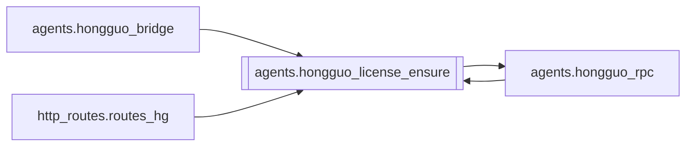

# `agents.hongguo_license_ensure`

[← Index](../generated/module-index.md) · [Brain home](../README.md)

<!-- AUTO:START — sinh bởi scripts/brain_build.py 2026-11-11 13:00. Đừng sửa tay khối này. -->
**File:** `agents/hongguo_license_ensure.py` · **Lớp:** `source` · **285 dòng** (245 code) · **11 hàm**, **1 class** · sha1 `b1e63dfe71`

> Ensure Hongguo 2.x helper is license-proved (same process as hongguo_rpc). Uses DPAPI key at %%LOCALAPPDATA%%\Pineline\hg_typed_key.dpapi and the WinUI Hongguo.Licensing stack (HgLicActivate host). Challenge/prove go thr

### Phụ thuộc

- **Gọi tới (import nội bộ):** [agents.hongguo_rpc](./agents.hongguo_rpc.md)
- **Được dùng bởi:** [agents.hongguo_bridge](./agents.hongguo_bridge.md), [agents.hongguo_rpc](./agents.hongguo_rpc.md), [http_routes.routes_hg](./http_routes.routes_hg.md)
- **Test:** ❌ chưa có test import trực tiếp
- **Thư viện ngoài:** `clr`

### Hàm & class top-level

| Tên | Dòng | Dài | Tham số | Docstring |
|---|---:|---:|---|---|
| **class `_Handler`** | 179 | 2 method | |  |
| `_resolve_activate_exe` | 24 | 14 | `` |  |
| `_unprotect_key` | 46 | 25 | `` |  |
| `license_ready` | 73 | 3 | `` |  |
| `has_stored_key` | 78 | 2 | `` |  |
| `activate_host_ok` | 82 | 2 | `` |  |
| `status_public` | 86 | 14 | `` | Safe status for UI — no secrets. |
| `store_key` | 102 | 35 | `typed_key` |  |
| `clear_key` | 139 | 7 | `` |  |
| `_handle_rpc` | 148 | 29 | `msg` |  |
| `ensure_licensed` | 198 | 63 | `force` | Prove into the current hongguo_rpc helper. Returns status dict. |
| `ensure_or_raise` | 263 | 23 | `` |  |

### Config / env keys (3)

`HG_LIC_ACTIVATE_EXE`, `LOCALAPPDATA`, `TEMP`

**File/artifact nhắc tới:** `.tmp.txt`

**Tín hiệu rủi ro (đếm tĩnh):** broad_except=8 · file_writes=2 · global_stmt=1 · subprocess=3 · swallow_except=2 · threads=1

### Lịch sử (từ docs/)

- Fix logs: —
- Nhắc trong CHANGELOG: **0** lần · DECISIONS: **0** lần

<!-- AUTO:END -->

<!-- MANUAL:START -->
## Vai trò (viết tay)

_Chưa viết. 2–4 câu: module này chịu trách nhiệm gì trong pipeline, ai gọi nó, nó KHÔNG làm gì._

## Luồng chính

_Các hàm vào (entry) → bước chính → output/side effect. Ghi tên hàm thật._

## Bất biến & hợp đồng

_Điều luôn phải đúng (vd: chỉ ghi manifest qua `Manifest.update`; 1 job / ghế). Vi phạm = bug._

## Bẫy đã biết

_Lỗi từng gặp + link `docs/fixes/...`. Những chỗ dễ sửa sai._

## Ghi chú vận hành

_Config key quan trọng, cần restart gì khi sửa (:8801 / :8802 / hot-reload), cách test._
<!-- MANUAL:END -->
