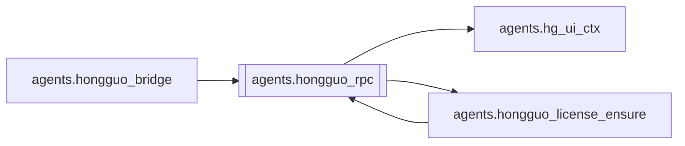

# `agents.hongguo_rpc`

[← Index](../generated/module-index.md) · [Brain home](../README.md)

<!-- AUTO:START — sinh bởi scripts/brain_build.py 2026-11-11 13:00. Đừng sửa tay khối này. -->
**File:** `agents/hongguo_rpc.py` · **Lớp:** `source` · **1449 dòng** (1260 code) · **57 hàm**, **1 class** · sha1 `a8b290bb17`

> hongguo_rpc.py — JSON-RPC stdio client cho Hongguo WinUI 2.x helper.jar. Không dùng HTTP :8000 (bản 1.x). Spawn engine local: …/HongguoWinUI/current/engine/runtime/bin/java.exe

### Phụ thuộc

- **Gọi tới (import nội bộ):** [agents.hg_ui_ctx](./agents.hg_ui_ctx.md), [agents.hongguo_license_ensure](./agents.hongguo_license_ensure.md)
- **Được dùng bởi:** [agents.hongguo_bridge](./agents.hongguo_bridge.md), [agents.hongguo_license_ensure](./agents.hongguo_license_ensure.md)
- **Test:** ❌ chưa có test import trực tiếp
- **Thư viện ngoài:** `psutil`

### Hàm & class top-level

| Tên | Dòng | Dài | Tham số | Docstring |
|---|---:|---:|---|---|
| **class `HgRpcError`** | 57 | 2 method | |  |
| `engine_dir` | 72 | 2 | `` |  |
| `helper_available` | 76 | 5 | `edir` |  |
| `_java_cmd` | 83 | 17 | `d` |  |
| `_on_line` | 102 | 23 | `line` |  |
| `_reader_loop` | 127 | 17 | `proc` |  |
| `_stderr_loop` | 146 | 12 | `proc` |  |
| `_write_pidfile` | 160 | 9 | `pid` |  |
| `_is_helper_cmdline` | 171 | 6 | `cmdline` |  |
| `reap_orphan_helpers` | 179 | 40 | `keep_pid, only_children` | Kill MainKt Hongguo helper bị mất handle (leak). Không đụng helper của WinUI.exe. |
| `_kill_unlocked` | 221 | 32 | `` |  |
| `stop` | 255 | 3 | `` |  |
| `_has_active_downloads_unlocked` | 260 | 9 | `` | Peek nhanh — tránh idle-kill khi đang tải (giống WinUI giữ helper). |
| `_ensure_unlocked` | 271 | 62 | `edir` | Đảm bảo 1 helper sống. Có thể gọi ngoài lock; tự khóa đoạn mutate. |
| `ensure` | 335 | 11 | `edir` | Đảm bảo helper sống; trả app.hello (cache). |
| `call` | 348 | 47 | `method, params, timeout` | Gọi method JSON-RPC; trả `result` hoặc raise HgRpcError. |
| `note` | 397 | 3 | `method` |  |
| `license_status` | 402 | 5 | `` |  |
| `ping` | 409 | 21 | `` | Shape gần hongguo_bridge.ping(). |
| `_card_to_result` | 432 | 13 | `c` |  |
| `search` | 447 | 17 | `q, page` |  |
| `rank` | 466 | 68 | `chart, board, category, offset, limit` | rank.page + rank.more đến tối đa ``limit`` (mặc định 100). |
| `feed` | 536 | 94 | `offset, select, panel, session_id, limit` | Browse landpage — feed.page (+ trang tiếp theo session). |
| `library` | 632 | 52 | `` |  |
| `library_update_info` | 686 | 3 | `` | WinUI «Update info» — library.updateInfo. |
| `library_refresh` | 691 | 5 | `` |  |
| `_job_state` | 707 | 2 | `j` |  |
| `_folder_basename` | 711 | 9 | `folder` | Tên thư mục tải = tên hiển thị đúng (snapshot hay để title rỗng). |
| `_enrich_title_cover` | 726 | 18 | `sid, need_title, need_cover` |  |
| `_normalize_dl_job` | 746 | 38 | `j` |  |
| `status` | 786 | 21 | `` |  |
| `cancel` | 809 | 3 | `` | Stop all active downloads (RPC chỉ có downloads.cancelAll). |
| `clear_finished` | 814 | 2 | `` |  |
| `_active_jobs_from_snap` | 818 | 8 | `snap` |  |
| `cancel_download` | 828 | 52 | `series_id` | Stop 1 series. |
| `remove_download` | 882 | 12 | `series_id` | Xóa khỏi danh sách. Đang tải → stop (cancel) thay vì báo lỗi under way. |
| `retry_download` | 896 | 23 | `series_id` | Thử lại job failed — cần license giống downloads.add. |
| `_ensure_licensed_quiet` | 921 | 31 | `` |  |
| `submit` | 954 | 35 | `series_ids, scores, quality` |  |
| `library_download_new_seasons` | 991 | 13 | `` |  |
| `resolve_link` | 1006 | 2 | `text` |  |
| `_play_cache_key` | 1030 | 2 | `series_id, episode, quality` |  |
| `_play_cache_load` | 1034 | 11 | `` |  |
| `_play_cache_save` | 1047 | 9 | `` |  |
| `_preview_quality` | 1058 | 6 | `quality` |  |
| `_play_path_allowed` | 1066 | 13 | `p` |  |
| `playback_stop` | 1081 | 20 | `session` | Dừng session playback (best-effort). |
| `playback_prepare` | 1103 | 92 | `series_id, episode, quality, timeout, force` | Chuẩn bị tập xem thử qua helper (tải về hongguo-player/*.mp4). |
| `playback_prepare_start` | 1197 | 107 | `series_id, episode, quality, force` | Chạy prepare nền — UI poll ``playback_job`` để hiện %. |
| `playback_job` | 1306 | 16 | `ticket` |  |
| `playback_session_path` | 1324 | 13 | `session` |  |
| `series_detail` | 1340 | 25 | `series_id` |  |
| `series_seasons` | 1367 | 16 | `series_id` |  |
| `series_qualities` | 1392 | 16 | `series_id` | Quality ladder mặc định. |
| `settings_get` | 1411 | 2 | `` |  |
| `settings_update` | 1415 | 6 | `patch` | WinUI settings.update — params = {patch: {...}}. |
| `_idle_watch` | 1423 | 15 | `` |  |
| `cleanup_machine_orphans` | 1440 | 6 | `` | CLI/ops: kill mọi MainKt Pineline (không đụng WinUI). |

### Config / env keys (8)

`HG_ENGINE_DIR`, `HG_HELPER_PIDFILE`, `HG_HELPER_SINGLETON`, `HG_RPC_IDLE_SEC`, `HG_RPC_TIMEOUT`, `LOCALAPPDATA`, `TEMP`, `TMP`

**File/artifact nhắc tới:** `hongguo_play_cache.json`

**Tín hiệu rủi ro (đếm tĩnh):** broad_except=22 · file_writes=2 · global_stmt=6 · sleep=6 · subprocess=1 · swallow_except=9 · threads=5

### Lịch sử (từ docs/)

- Fix logs: —
- Nhắc trong CHANGELOG: **0** lần · DECISIONS: **0** lần

<!-- AUTO:END -->

<!-- MANUAL:START -->
## Vai trò (viết tay)

_Chưa viết. 2–4 câu: module này chịu trách nhiệm gì trong pipeline, ai gọi nó, nó KHÔNG làm gì._

## Luồng chính

_Các hàm vào (entry) → bước chính → output/side effect. Ghi tên hàm thật._

## Bất biến & hợp đồng

_Điều luôn phải đúng (vd: chỉ ghi manifest qua `Manifest.update`; 1 job / ghế). Vi phạm = bug._

## Bẫy đã biết

_Lỗi từng gặp + link `docs/fixes/...`. Những chỗ dễ sửa sai._

## Ghi chú vận hành

_Config key quan trọng, cần restart gì khi sửa (:8801 / :8802 / hot-reload), cách test._
<!-- MANUAL:END -->
