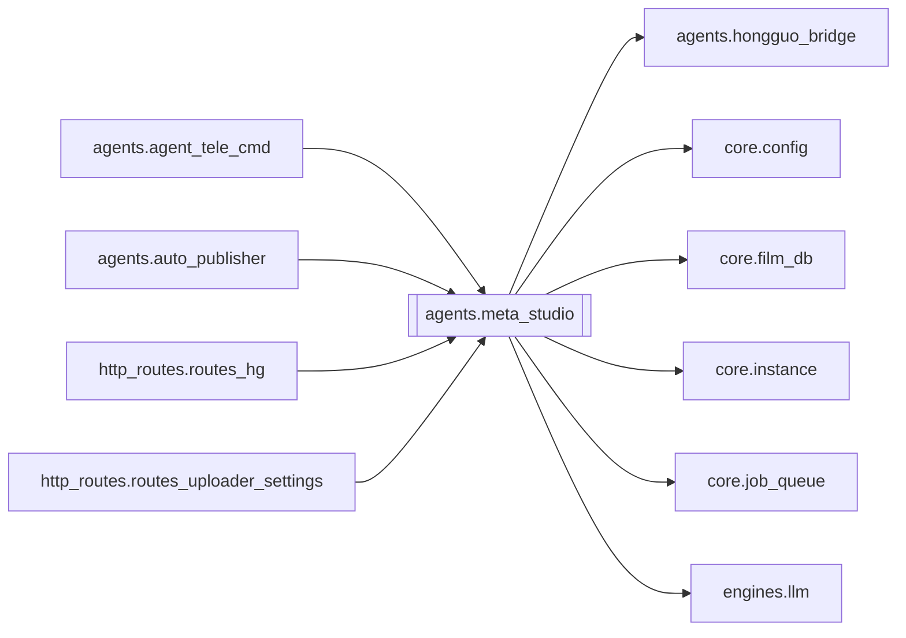

# `agents.meta_studio`

[← Index](../generated/module-index.md) · [Brain home](../README.md)

<!-- AUTO:START — sinh bởi scripts/brain_build.py 2026-11-11 13:00. Đừng sửa tay khối này. -->
**File:** `agents/meta_studio.py` · **Lớp:** `publish` · **1919 dòng** (1628 code) · **32 hàm**, **0 class** · sha1 `4d9bb16f37`

> meta_studio.py — Module sinh Metadata YouTube (Title / Description / Tags / AI Image Prompt) và dựng Thumbnail 16:9 chuẩn YouTube từ poster dọc + text giật gân.

### Phụ thuộc

- **Gọi tới (import nội bộ):** [agents.hongguo_bridge](./agents.hongguo_bridge.md), [core.config](./core.config.md), [core.film_db](./core.film_db.md), [core.instance](./core.instance.md), [core.job_queue](./core.job_queue.md), [engines.llm](./engines.llm.md)
- **Được dùng bởi:** [agents.agent_tele_cmd](./agents.agent_tele_cmd.md), [agents.auto_publisher](./agents.auto_publisher.md), [http_routes.routes_hg](./http_routes.routes_hg.md), [http_routes.routes_uploader_settings](./http_routes.routes_uploader_settings.md)
- **Test:** `tests/v5/test_meta_and_thumb.py`
- **Thư viện ngoài:** `PIL`, `requests`

### Hàm & class top-level

| Tên | Dòng | Dài | Tham số | Docstring |
|---|---:|---:|---|---|
| `to_series_slug` | 30 | 10 | `text` | Chuyển tên series sang slug không dấu (vd: 'Sinh Tồn Sa Mạc' -> 'sinh_ton_sa_mac'). |
| `clean_series_name` | 42 | 27 | `name, fallback` | Làm sạch tên series, loại bỏ toàn bộ chữ Hán, số phần P1/P2 thừa, và ký tự thừa. |
| `hooks_from_series_title` | 78 | 35 | `title_vi, title_zh` | Tách hook 2 dòng từ tên phim thật — không bịa cụm sáo rỗng. |
| `_hook_anchored_to_title` | 115 | 8 | `hook, title_vi` | ≥75% token (≥3 ký tự) của hook phải nằm trong tên phim — chặn bịa «ẨN NHẪN». |
| `sanitize_hook_texts` | 125 | 16 | `hooks, title_vi, title_zh` | Loại hook sáo / trống / không neo tên phim; fallback tách từ tên phim. |
| `pick_badge_text` | 150 | 12 | `raw, job_id, title_vi` | Badge góc trên: chỉ NEW hoặc HOT — không dùng «TRỌN BỘ THUYẾT MINH». |
| `vi_to_image_latin` | 164 | 15 | `text` | Bỏ dấu tiếng Việt → LATIN HOA để model ảnh ít vỡ chữ (₫/ơ/ệ hay bị gen sai). |
| `build_master_image_prompt` | 181 | 60 | `title_vi, title_zh, story_moment, visual_dna, palette, layout, emot…` | Prompt ảnh AI: scene + chữ 3D LATIN (không dấu) — giảm gen sai chữ Việt có dấu. |
| `finalize_thumb_meta_fields` | 243 | 49 | `data, title_vi, title_zh, job_id` | Sanitize hook + badge NEW/HOT; dựng lại master_image_prompt (AI vẽ chữ, không Pillow). |
| `get_series_key` | 294 | 36 | `job_id` | Trả về (series_key, series_display_name). |
| `get_series_meta` | 332 | 39 | `series_key, series_name` | Lấy metadata đã lưu của series (hỗ trợ tra cứu chéo qua group_id hoặc tên series). |
| `save_series_meta` | 373 | 15 | `series_key, data, series_name` | Lưu metadata dùng chung cho cả series (lưu cả group_id và slug tên bộ). |
| `get_series_thumbnail` | 390 | 37 | `series_key, series_name` | Lấy đường dẫn ảnh thumbnail dùng chung của series. |
| `save_series_thumbnail` | 429 | 16 | `series_key, src_path_or_bytes, series_name` | Lưu ảnh thumbnail mẫu của cả series thành series_{series_key}.jpg (và bản alias slug). |
| `_build_fallback_part_meta` | 447 | 65 | `clean_series, season, episode_info, base_tags` | Tạo bộ Title & Description fallback đầy đủ 4 khối chuẩn YouTube SEO khi không kết nối được LLM. |
| `get_film_story_info` | 515 | 109 | `job_id, title_zh, title_vi, summary, episode_info` | Trích xuất thông tin Tên gốc tiếng Trung, Tên tiếng Việt và Tóm tắt Cốt truyện chuẩn (Baike / Intro / Desc) |
| `generate_youtube_titles` | 626 | 158 ⚠️ | `series_name, season, episode_info, summary, job_id, tone, count, ti…` | Gọi LLM sinh danh sách 5 Tiêu Đề YouTube kịch tính theo phong cách Hán Việt chuẩn, |
| `generate_title_only` | 786 | 4 | `series_name, season, episode_info, summary, job_id, title_zh` | Gọi LLM sinh 1 Tiêu Đề YouTube kịch tính, bám sát nội dung thực tế của tập. |
| `generate_part_metadata` | 792 | 127 ⚠️ | `series_name, season, episode_info, shared_meta, job_id, summary, ti…` | Sinh TITLE và DESCRIPTION chuẩn SEO cho từng Phần của Series khi dùng chung Thumbnail: |
| `_clean_json_response` | 921 | 66 | `raw` | Bóc tách và tự động sửa lỗi JSON bị cắt cụt (truncated) từ phản hồi LLM. |
| `_cfg` | 989 | 9 | `key, default` |  |
| `_get_chatgpt_token` | 1000 | 13 | `` | Đọc Access Token / API key ChatGPT: config → env → data/chatgpt_token.txt. |
| `_chatgpt_candidate_bases` | 1015 | 11 | `` | Ưu tiên CHATGPT_BASE_URL trong pineline.config (local :3377), rồi Aurora LAN. |
| `extract_job_summary` | 1028 | 94 | `job_id, max_chars` | Trích xuất kịch bản thực tế từ phụ đề tiếng Việt (sub.vi.srt / script.json) trải đều 6 giai đoạn |
| `_normalize_ref_jpeg` | 1124 | 17 | `raw_bytes, max_dim` | Chuẩn hoá ảnh tham chiếu (Poster hoặc Frame) về RGB JPEG <= 1024px để gửi lên Aurora /v1/images/edits. |
| `_extract_best_video_frame` | 1143 | 40 | `video_path` | Trích xuất khung hình sắc nét và giàu chi tiết nhất từ video làm ảnh tham chiếu nhân vật. |
| `get_job_reference_images` | 1185 | 74 | `job_id, poster_name` | Lấy danh sách ảnh gốc tham chiếu (Poster gốc + Khung hình sắc nét trong phim) của Job |
| `_call_chatgpt` | 1261 | 50 | `messages, model` | Gọi LLM qua Aurora / Chat2Api chạy trên Raspberry Pi 5. |
| `_decode_aurora_image_response` | 1313 | 15 | `resp_json, timeout` | Giải mã ảnh từ phản hồi của Aurora (/v1/images/edits hoặc /v1/images/generations). |
| `generate_ai_image` | 1330 | 126 ⚠️ | `prompt, size, timeout, ref_images, job_id, poster_name` | Gọi Aurora trên Pi 5 để sinh ảnh Thumbnail 16:9 chất lượng cao: |
| `generate_metadata` | 1458 | 241 ⚠️ | `title_vi, title_zh, info_text, prompt_guide, tone, job_id` | Dùng ChatGPT (qua Pi 5 với GPT-5.6 Luna mới nhất) hoặc Local LLM đọc Tên gốc & Cốt truyện Baike chuẩn |
| `create_thumbnail` | 1701 | 219 ⚠️ | `poster_source, hook_text_1, hook_text_2, badge_text, sub_text, bg_f…` | Tạo ảnh Thumbnail 16:9 (1280x720) — legacy Pillow (auto-publish không dùng; AI typography chính). |

**Hàm dài ≥120 dòng:** `generate_metadata` (241, L1458), `create_thumbnail` (219, L1701), `generate_youtube_titles` (158, L626), `generate_part_metadata` (127, L792), `generate_ai_image` (126, L1330)

### Config / env keys (1)

`CHATGPT_TIMEOUT`

**Cổng nhắc tới:** 3377

**File/artifact nhắc tới:** `.series.json`, `chatgpt_token.txt`, `input.mp4`, `manifest.json`, `output.mp4`, `script.json`, `sub.vi.aligned.srt`, `sub.vi.burn.srt`, `sub.vi.srt`, `video.mp4`

**Tín hiệu rủi ro (đếm tĩnh):** broad_except=36 · file_writes=3 · subprocess=2 · swallow_except=17

### Lịch sử (từ docs/)

- **Fix logs (1):**
  - [2026-11-11 — F4 (services + sidecar thuần) + F5 (render tiến trình con)](../../fixes/2026-11-11-f4-f5.md)
- Nhắc trong CHANGELOG: **0** lần · DECISIONS: **0** lần

<!-- AUTO:END -->

<!-- MANUAL:START -->
## Vai trò (viết tay)

_Chưa viết. 2–4 câu: module này chịu trách nhiệm gì trong pipeline, ai gọi nó, nó KHÔNG làm gì._

## Luồng chính

_Các hàm vào (entry) → bước chính → output/side effect. Ghi tên hàm thật._

## Bất biến & hợp đồng

_Điều luôn phải đúng (vd: chỉ ghi manifest qua `Manifest.update`; 1 job / ghế). Vi phạm = bug._

## Bẫy đã biết

_Lỗi từng gặp + link `docs/fixes/...`. Những chỗ dễ sửa sai._

## Ghi chú vận hành

_Config key quan trọng, cần restart gì khi sửa (:8801 / :8802 / hot-reload), cách test._
<!-- MANUAL:END -->
