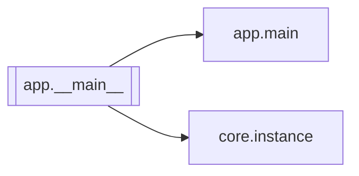

# `app.__main__`

[← Index](../generated/module-index.md) · [Brain home](../README.md)

<!-- AUTO:START — sinh bởi scripts/brain_build.py 2026-11-11 13:00. Đừng sửa tay khối này. -->
**File:** `app/__main__.py` · **Lớp:** `control` · **85 dòng** (65 code) · **3 hàm**, **0 class** · sha1 `3bf7542186`

> python -m app --instance v6

### Phụ thuộc

- **Gọi tới (import nội bộ):** [app.main](./app.main.md), [core.instance](./core.instance.md)
- **Được dùng bởi:** —
- **Test:** `tests/test_review1_f2f3.py`
- **Thư viện ngoài:** `uvicorn`

### Hàm & class top-level

| Tên | Dòng | Dài | Tham số | Docstring |
|---|---:|---:|---|---|
| `_work_lock_path` | 18 | 5 | `root, work_root` | Khoá theo work root (chuẩn hoá: tuyệt đối, chữ thường, '/') — cùng work = cùng file khoá. |
| `_single_instance_lock` | 25 | 15 | `path` |  |
| `main` | 42 | 40 | `` |  |

**Tín hiệu rủi ro (đếm tĩnh):** global_stmt=1

### Lịch sử (từ docs/)

- **Fix logs (1):**
  - [2026-11-11 — F2 (core/job_opts) + F3 tích hợp (1 tiến trình V5+V6, UI cũ hết polling)](../../fixes/2026-11-11-f2-f3-integration.md)
- **Reviews:** [2026-11-11-review-f2-f3](../../reviews/2026-11-11-review-f2-f3.md)
- Nhắc trong CHANGELOG: **0** lần · DECISIONS: **0** lần

<!-- AUTO:END -->

<!-- MANUAL:START -->
## Vai trò (viết tay)

_Chưa viết. 2–4 câu: module này chịu trách nhiệm gì trong pipeline, ai gọi nó, nó KHÔNG làm gì._

## Luồng chính

_Các hàm vào (entry) → bước chính → output/side effect. Ghi tên hàm thật._

## Bất biến & hợp đồng

_Điều luôn phải đúng (vd: chỉ ghi manifest qua `Manifest.update`; 1 job / ghế). Vi phạm = bug._

## Bẫy đã biết

_Lỗi từng gặp + link `docs/fixes/...`. Những chỗ dễ sửa sai._

## Ghi chú vận hành

_Config key quan trọng, cần restart gì khi sửa (:8801 / :8802 / hot-reload), cách test._
<!-- MANUAL:END -->
