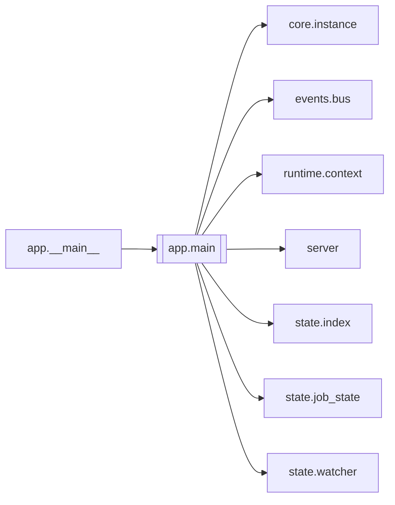

# `app.main`

[← Index](../generated/module-index.md) · [Brain home](../README.md)

<!-- AUTO:START — sinh bởi scripts/brain_build.py 2026-11-11 13:00. Đừng sửa tay khối này. -->
**File:** `app/main.py` · **Lớp:** `control` · **162 dòng** (127 code) · **4 hàm**, **0 class** · sha1 `f2c6d5a1bd`

> app/main.py — FastAPI app V6 (route mỏng; logic ở state/pipeline/services). F3 (tích hợp): MỘT tiến trình, MỘT cổng instance phục vụ: - toàn bộ route V5 của `server.py` (legacy: /api/jobs, /api/queue/…, /, /ui3 = index3.

### Phụ thuộc

- **Gọi tới (import nội bộ):** [core.instance](./core.instance.md), [events.bus](./events.bus.md), [runtime.context](./runtime.context.md), [server](./server.md), [state.index](./state.index.md), [state.job_state](./state.job_state.md), [state.watcher](./state.watcher.md)
- **Được dùng bởi:** [app.__main__](./app.__main__.md)
- **Test:** `tests/test_app_integration.py`
- **Thư viện ngoài:** `fastapi`, `state`

### API routes (5)

| Method | Path | Handler | Dòng |
|---|---|---|---:|
| GET | `/api/events` | `events` | 74 |
| GET | `/api/health` | `health` | 55 |
| GET | `/v6` | `_v6_slash` | 157 |
| GET | `?` | `jobs` | 60 |
| GET | `?` | `job` | 64 |

### Hàm & class top-level

| Tên | Dòng | Dài | Tham số | Docstring |
|---|---:|---:|---|---|
| `_import_legacy` | 37 | 12 | `inst` | Nạp server.py (V5) cho instance này. Env (WORK_DIR, PINELINE_FLAG_*, PINELINE_ROUTERS…) phải có |
| `_v6_router` | 51 | 39 | `inst` |  |
| `_install_lifecycle` | 92 | 33 | `app, inst, rt, legacy` |  |
| `create_app` | 127 | 36 | `inst, legacy` | App của instance. legacy=True (mặc định, F3): server.py + route V6 trên cùng app/cổng. |

### Config / env keys (1)

`PINELINE_INSTANCE`

**File/artifact nhắc tới:** `manifest.json`

**Tín hiệu rủi ro (đếm tĩnh):** threads=1

### Lịch sử (từ docs/)

- **Fix logs (2):**
  - [2026-11-11 — F2 (core/job_opts) + F3 tích hợp (1 tiến trình V5+V6, UI cũ hết polling)](../../fixes/2026-11-11-f2-f3-integration.md)
  - [2026-11-11 — F0: backend không lên + 1 test lỗi encoding](../../fixes/2026-11-11-f0-startup-encoding.md)
- **Reviews:** [2026-11-11-review-f2-f3](../../reviews/2026-11-11-review-f2-f3.md)
- Nhắc trong CHANGELOG: **0** lần · DECISIONS: **0** lần

<!-- AUTO:END -->

<!-- MANUAL:START -->
## Vai trò (viết tay)

_Chưa viết. 2–4 câu: module này chịu trách nhiệm gì trong pipeline, ai gọi nó, nó KHÔNG làm gì._

## Luồng chính

_Các hàm vào (entry) → bước chính → output/side effect. Ghi tên hàm thật._

## Bất biến & hợp đồng

_Điều luôn phải đúng (vd: chỉ ghi manifest qua `Manifest.update`; 1 job / ghế). Vi phạm = bug._

## Bẫy đã biết

_Lỗi từng gặp + link `docs/fixes/...`. Những chỗ dễ sửa sai._

## Ghi chú vận hành

_Config key quan trọng, cần restart gì khi sửa (:8801 / :8802 / hot-reload), cách test._
<!-- MANUAL:END -->
