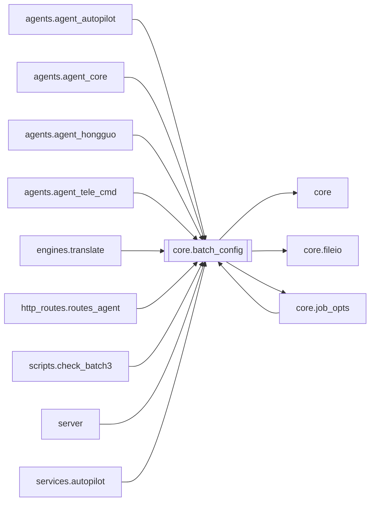

# `core.batch_config`

[← Index](../generated/module-index.md) · [Brain home](../README.md)

<!-- AUTO:START — sinh bởi scripts/brain_build.py 2026-11-11 13:00. Đừng sửa tay khối này. -->
**File:** `core/batch_config.py` · **Lớp:** `core` · **267 dòng** (228 code) · **14 hàm**, **0 class** · sha1 `61c9419383`

> Cấu hình batch dùng chung — 1 nguồn duy nhất cho Auto-pilot, Agent (queue_add), Telegram (/config /set) và UI (nút «Lưu làm config batch»). File: work/logs/batch_config.json

### Phụ thuộc

- **Gọi tới (import nội bộ):** [core](./core.md), [core.fileio](./core.fileio.md), [core.job_opts](./core.job_opts.md)
- **Được dùng bởi:** [agents.agent_autopilot](./agents.agent_autopilot.md), [agents.agent_core](./agents.agent_core.md), [agents.agent_hongguo](./agents.agent_hongguo.md), [agents.agent_tele_cmd](./agents.agent_tele_cmd.md), [core.job_opts](./core.job_opts.md), [engines.translate](./engines.translate.md), [http_routes.routes_agent](./http_routes.routes_agent.md), [scripts.check_batch3](./scripts.check_batch3.md), [server](./server.md), [services.autopilot](./services.autopilot.md)
- **Được nhắc tên file `.py` (subprocess/script) bởi:** [restart_server](./restart_server.md)
- **Test:** `tests/test_job_opts.py`, `tests/v5/test_hardsub_blur_toggle.py`

### Hàm & class top-level

| Tên | Dòng | Dài | Tham số | Docstring |
|---|---:|---:|---|---|
| `_now` | 84 | 2 | `` |  |
| `as_bool` | 88 | 12 | `val, default` | Parse bool an toàn — `bool("false")` là True nên không dùng raw bool(). |
| `_coerce` | 102 | 29 | `key, val` |  |
| `load` | 136 | 22 | `` | File hỏng/đang ghi dở → trả bản đọc tốt gần nhất (không rơi về DEFAULTS: Auto-pilot |
| `resolve_job_opts` | 160 | 8 | `*layers, fill_voice` | Opts của 1 job = config batch hiện tại ⊕ từng lớp (lớp sau đè lớp trước, bỏ None/pin_opts). |
| `_norm_zoom` | 170 | 11 | `v` |  |
| `render_kwargs` | 183 | 4 | `o` | Tham số render (_do_render / MuxReq) từ opts đã resolve. V6 F2: ủy quyền core.job_opts. |
| `meta` | 189 | 8 | `` |  |
| `_write` | 199 | 7 | `opts, by` |  |
| `update` | 208 | 18 | `patch, by` | Gộp patch vào config hiện tại. Key lạ / giá trị sai → ValueError. |
| `reset` | 228 | 4 | `by` |  |
| `parse_kv` | 234 | 10 | `text` | 'audio_mode=voice_bgm orig_vol=0.3 brand_text="Kênh A"' → dict. |
| `describe` | 246 | 11 | `opts` |  |
| `review_backup_mode` | 259 | 9 | `opts` | off / aurora_parallel — Aurora GPT làm REVIEW (qua REVIEW_MODEL / AURORA_REVIEW_MODEL). |

**File/artifact nhắc tới:** `batch_config.json`

**Tín hiệu rủi ro (đếm tĩnh):** broad_except=2 · global_stmt=2 · sleep=1

### Lịch sử (từ docs/)

- **Fix logs (1):**
  - [2026-11-11 — F2 (core/job_opts) + F3 tích hợp (1 tiến trình V5+V6, UI cũ hết polling)](../../fixes/2026-11-11-f2-f3-integration.md)
- **Reviews:** [2026-11-11-review-f2-f3](../../reviews/2026-11-11-review-f2-f3.md)
- Nhắc trong CHANGELOG: **0** lần · DECISIONS: **0** lần

<!-- AUTO:END -->

<!-- MANUAL:START -->
## Vai trò (viết tay)

_Chưa viết. 2–4 câu: module này chịu trách nhiệm gì trong pipeline, ai gọi nó, nó KHÔNG làm gì._

## Luồng chính

_Các hàm vào (entry) → bước chính → output/side effect. Ghi tên hàm thật._

## Bất biến & hợp đồng

_Điều luôn phải đúng (vd: chỉ ghi manifest qua `Manifest.update`; 1 job / ghế). Vi phạm = bug._

## Bẫy đã biết

_Lỗi từng gặp + link `docs/fixes/...`. Những chỗ dễ sửa sai._

## Ghi chú vận hành

_Config key quan trọng, cần restart gì khi sửa (:8801 / :8802 / hot-reload), cách test._
<!-- MANUAL:END -->
