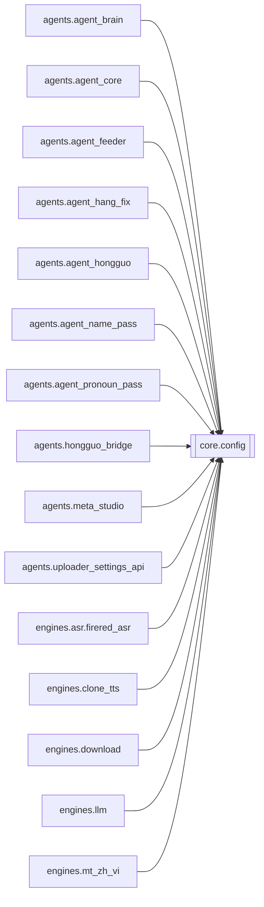

# `core.config`

[← Index](../generated/module-index.md) · [Brain home](../README.md)

<!-- AUTO:START — sinh bởi scripts/brain_build.py 2026-11-11 13:00. Đừng sửa tay khối này. -->
**File:** `core/config.py` · **Lớp:** `core` · **188 dòng** (148 code) · **8 hàm**, **0 class** · sha1 `fab052b2ad`

> config.py — Cấu hình/đường dẫn PORTABLE cho Pineline. Thứ tự ưu tiên khi lấy 1 giá trị: biến môi trường  >  pineline.config.json  >  mặc định. install.py sẽ ghi pineline.config.json với đường dẫn thật của máy (venv, HF c

### Phụ thuộc

- **Gọi tới (import nội bộ):** —
- **Được dùng bởi:** [agents.agent_brain](./agents.agent_brain.md), [agents.agent_core](./agents.agent_core.md), [agents.agent_feeder](./agents.agent_feeder.md), [agents.agent_hang_fix](./agents.agent_hang_fix.md), [agents.agent_hongguo](./agents.agent_hongguo.md), [agents.agent_name_pass](./agents.agent_name_pass.md), [agents.agent_pronoun_pass](./agents.agent_pronoun_pass.md), [agents.hongguo_bridge](./agents.hongguo_bridge.md), [agents.meta_studio](./agents.meta_studio.md), [agents.uploader_settings_api](./agents.uploader_settings_api.md), [engines.asr.firered_asr](./engines.asr.firered_asr.md), [engines.clone_tts](./engines.clone_tts.md), [engines.download](./engines.download.md), [engines.llm](./engines.llm.md), [engines.mt_zh_vi](./engines.mt_zh_vi.md), [engines.pronoun_consistency](./engines.pronoun_consistency.md), [engines.render](./engines.render.md), [engines.render_fx](./engines.render_fx.md), [engines.render_job](./engines.render_job.md), [engines.sfx_lib](./engines.sfx_lib.md), [engines.subs](./engines.subs.md), [engines.translate](./engines.translate.md), [http_routes.routes_uploader_settings](./http_routes.routes_uploader_settings.md), [scripts.check_batch2](./scripts.check_batch2.md), [scripts.check_batch3](./scripts.check_batch3.md), [server](./server.md)
- **Được nhắc tên file `.py` (subprocess/script) bởi:** [restart_server](./restart_server.md), [scripts.brain_build](./scripts.brain_build.md)
- **Test:** `tests/v5/test_chatgpt_route.py`, `tests/v5/test_layout_paths.py`

### Hàm & class top-level

| Tên | Dòng | Dài | Tham số | Docstring |
|---|---:|---:|---|---|
| `_load_cfg` | 20 | 19 | `force` | Nạp lại pineline.config.json khi file đổi (tránh setdefault env khóa giá trị cũ). |
| `_from_file_keys` | 73 | 2 | `` |  |
| `inject_env` | 77 | 24 | `` | Chép pineline.config.json (rồi config.json) vào os.environ để tiến trình con kế thừa. |
| `get` | 103 | 23 | `key, default` | env var  >  config.json  >  default. |
| `llm_settings` | 128 | 13 | `` | LLM cho job (dịch/review) — đọc lúc gọi để sửa pineline.config.json có hiệu lực không cần restart. |
| `pass_llm_model` | 143 | 14 | `kind` | Model cho pass ngắn (name/pronoun). Ưu tiên NAME_MODEL/PRONOUN_MODEL → CHATGPT_* → REVIEW → LLM. |
| `agent_llm` | 159 | 11 | `` | LLM cho agent chat / feeder: AGENT_* rồi LLM_* (cả hai file trước env). |
| `venv_python` | 172 | 4 | `venv_dir` | Đường dẫn python trong venv, đúng theo OS. |

### Config / env keys (2)

`HF_HUB_DISABLE_SYMLINKS`, `HF_HUB_DISABLE_SYMLINKS_WARNING`

**Cổng nhắc tới:** 8083

**File/artifact nhắc tới:** `config.json`, `pineline.config.json`

**Tín hiệu rủi ro (đếm tĩnh):** broad_except=2 · global_stmt=1

### Lịch sử (từ docs/)

- Fix logs: —
- Nhắc trong CHANGELOG: **0** lần · DECISIONS: **0** lần

<!-- AUTO:END -->

<!-- MANUAL:START -->
## Vai trò (viết tay)

_Chưa viết. 2–4 câu: module này chịu trách nhiệm gì trong pipeline, ai gọi nó, nó KHÔNG làm gì._

## Luồng chính

_Các hàm vào (entry) → bước chính → output/side effect. Ghi tên hàm thật._

## Bất biến & hợp đồng

_Điều luôn phải đúng (vd: chỉ ghi manifest qua `Manifest.update`; 1 job / ghế). Vi phạm = bug._

## Bẫy đã biết

_Lỗi từng gặp + link `docs/fixes/...`. Những chỗ dễ sửa sai._

## Ghi chú vận hành

_Config key quan trọng, cần restart gì khi sửa (:8801 / :8802 / hot-reload), cách test._
<!-- MANUAL:END -->
