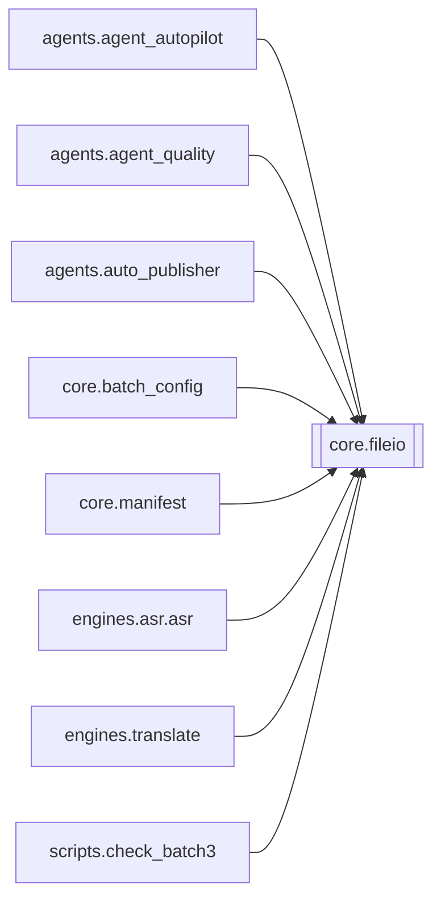

# `core.fileio`

[← Index](../generated/module-index.md) · [Brain home](../README.md)

<!-- AUTO:START — sinh bởi scripts/brain_build.py 2026-11-11 13:00. Đừng sửa tay khối này. -->
**File:** `core/fileio.py` · **Lớp:** `core` · **124 dòng** (105 code) · **4 hàm**, **0 class** · sha1 `01bd26edcf`

> Ghi file an toàn giữa nhiều tiến trình (server :8801, sidecar :8802, script). atomic_write_text: ghi temp riêng (pid+thread) rồi os.replace — người đọc không bao giờ thấy file dở. file_lock: khoá liên tiến trình bằng fil

### Phụ thuộc

- **Gọi tới (import nội bộ):** —
- **Được dùng bởi:** [agents.agent_autopilot](./agents.agent_autopilot.md), [agents.agent_quality](./agents.agent_quality.md), [agents.auto_publisher](./agents.auto_publisher.md), [core.batch_config](./core.batch_config.md), [core.manifest](./core.manifest.md), [engines.asr.asr](./engines.asr.asr.md), [engines.translate](./engines.translate.md), [scripts.check_batch3](./scripts.check_batch3.md)
- **Được nhắc tên file `.py` (subprocess/script) bởi:** [restart_server](./restart_server.md)
- **Test:** `tests/test_file_lock.py`

### Hàm & class top-level

| Tên | Dòng | Dài | Tham số | Docstring |
|---|---:|---:|---|---|
| `atomic_write_text` | 16 | 21 | `path, text, encoding, fsync` |  |
| `atomic_write_json` | 39 | 2 | `path, obj, indent, fsync` |  |
| `read_json_checkpoint` | 43 | 14 | `path, default` | Đọc checkpoint JSON. Hỏng → đổi tên thành .corrupt-<ts> (giữ để cứu) và trả default, |
| `file_lock` | 90 | 35 | `path, timeout, stale_sec` | Khoá liên tiến trình + liên luồng bằng khoá của HỆ ĐIỀU HÀNH trên file `<path>.lock`. |

**Tín hiệu rủi ro (đếm tĩnh):** sleep=2

### Lịch sử (từ docs/)

- **Fix logs (1):**
  - [2026-11-11 — core/fileio.file_lock: khoá rò → mất loại trừ / TimeoutError](../../fixes/2026-11-11-file-lock-leak.md)
- Nhắc trong CHANGELOG: **0** lần · DECISIONS: **0** lần

<!-- AUTO:END -->

<!-- MANUAL:START -->
## Vai trò (viết tay)

_Chưa viết. 2–4 câu: module này chịu trách nhiệm gì trong pipeline, ai gọi nó, nó KHÔNG làm gì._

## Luồng chính

_Các hàm vào (entry) → bước chính → output/side effect. Ghi tên hàm thật._

## Bất biến & hợp đồng

_Điều luôn phải đúng (vd: chỉ ghi manifest qua `Manifest.update`; 1 job / ghế). Vi phạm = bug._

## Bẫy đã biết

_Lỗi từng gặp + link `docs/fixes/...`. Những chỗ dễ sửa sai._

## Ghi chú vận hành

_Config key quan trọng, cần restart gì khi sửa (:8801 / :8802 / hot-reload), cách test._
<!-- MANUAL:END -->
