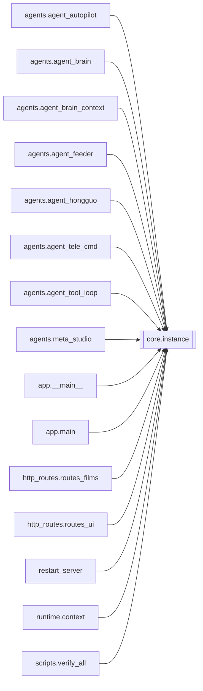

# `core.instance`

[← Index](../generated/module-index.md) · [Brain home](../README.md)

<!-- AUTO:START — sinh bởi scripts/brain_build.py 2026-11-11 13:00. Đừng sửa tay khối này. -->
**File:** `core/instance.py` · **Lớp:** `core` · **222 dòng** (170 code) · **9 hàm**, **1 class** · sha1 `481814d6a2`

> core/instance.py — Cấu hình 1 instance Pineline (thay cho việc giữ 3 cây V2/V4/V5). Một codebase, nhiều instance: mỗi instance là 1 file `instances/<tên>.json` (cổng, thư mục work, TEMP, router bật, desktop, agent). Serv

### Phụ thuộc

- **Gọi tới (import nội bộ):** —
- **Được dùng bởi:** [agents.agent_autopilot](./agents.agent_autopilot.md), [agents.agent_brain](./agents.agent_brain.md), [agents.agent_brain_context](./agents.agent_brain_context.md), [agents.agent_feeder](./agents.agent_feeder.md), [agents.agent_hongguo](./agents.agent_hongguo.md), [agents.agent_tele_cmd](./agents.agent_tele_cmd.md), [agents.agent_tool_loop](./agents.agent_tool_loop.md), [agents.meta_studio](./agents.meta_studio.md), [app.__main__](./app.__main__.md), [app.main](./app.main.md), [http_routes.routes_films](./http_routes.routes_films.md), [http_routes.routes_ui](./http_routes.routes_ui.md), [restart_server](./restart_server.md), [runtime.context](./runtime.context.md), [scripts.verify_all](./scripts.verify_all.md), [server](./server.md), [services.autopilot](./services.autopilot.md), [services.feeder](./services.feeder.md), [services.film_db_sync](./services.film_db_sync.md), [tools.migrate_work](./tools.migrate_work.md)
- **Test:** `tests/test_app_integration.py`, `tests/test_f3_static.py`, `tests/test_f4_services.py`, `tests/test_f5_render_subprocess.py`, `tests/test_f6_final_audit.py`, `tests/test_instance.py`, `tests/test_review1_f2f3.py`, `tests/test_review2_f4f5.py`, `tests/test_runtime.py`

### Hàm & class top-level

| Tên | Dòng | Dài | Tham số | Docstring |
|---|---:|---:|---|---|
| **class `Instance`** | 21 | 5 method | |  |
| `load` | 96 | 21 | `name, directory` |  |
| `_default_instance` | 125 | 5 | `` |  |
| `server_port` | 132 | 9 | `` |  |
| `server_base` | 143 | 6 | `` | URL server Pineline của instance hiện tại (thay mọi URL cổng V2 cứng làm mặc định). |
| `sidecar_port` | 151 | 8 | `` |  |
| `sidecar_url` | 161 | 3 | `` |  |
| `_arg_after` | 172 | 7 | `toks, flag` |  |
| `server_cmd_matches` | 181 | 24 | `cmdline, port, instance` | cmdline (list) có phải backend Pineline của ĐÚNG instance/cổng này không. |
| `localize_html` | 211 | 12 | `text, server, sidecar` | UI HTML cũ (index/index3/hongguo/films_ui) còn URL cứng V2 `:8801` (server) / `:8802` (sidecar). |

### Config / env keys (14)

`AGENT_BRAIN`, `AGENT_TELEGRAM`, `AGENT_WATCH`, `AUTOPILOT_PORT`, `AUTOPILOT_URL`, `PINELINE_BASE`, `PINELINE_INSTANCE`, `PINELINE_PORT`, `PINELINE_ROUTERS`, `PINELINE_WORK_ROOT`, `PORT`, `TEMP`, `TMP`, `WORK_DIR`

**Tín hiệu rủi ro (đếm tĩnh):** broad_except=2

### Lịch sử (từ docs/)

- **Fix logs (2):**
  - [2026-11-11 — F4 (services + sidecar thuần) + F5 (render tiến trình con)](../../fixes/2026-11-11-f4-f5.md)
  - [2026-11-11 — F2 (core/job_opts) + F3 tích hợp (1 tiến trình V5+V6, UI cũ hết polling)](../../fixes/2026-11-11-f2-f3-integration.md)
- **Reviews:** [2026-11-11-review-f4-f5](../../reviews/2026-11-11-review-f4-f5.md), [2026-11-11-review-f2-f3](../../reviews/2026-11-11-review-f2-f3.md)
- Nhắc trong CHANGELOG: **0** lần · DECISIONS: **0** lần

<!-- AUTO:END -->

<!-- MANUAL:START -->
## Vai trò (viết tay)

_Chưa viết. 2–4 câu: module này chịu trách nhiệm gì trong pipeline, ai gọi nó, nó KHÔNG làm gì._

## Luồng chính

_Các hàm vào (entry) → bước chính → output/side effect. Ghi tên hàm thật._

## Bất biến & hợp đồng

_Điều luôn phải đúng (vd: chỉ ghi manifest qua `Manifest.update`; 1 job / ghế). Vi phạm = bug._

## Bẫy đã biết

_Lỗi từng gặp + link `docs/fixes/...`. Những chỗ dễ sửa sai._

## Ghi chú vận hành

_Config key quan trọng, cần restart gì khi sửa (:8801 / :8802 / hot-reload), cách test._
<!-- MANUAL:END -->
