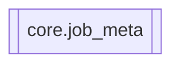

# `core.job_meta`

[← Index](../generated/module-index.md) · [Brain home](../README.md)

<!-- AUTO:START — sinh bởi scripts/brain_build.py 2026-11-11 13:00. Đừng sửa tay khối này. -->
**File:** `core/job_meta.py` · **Lớp:** `core` · **164 dòng** (146 code) · **5 hàm**, **0 class** · sha1 `d72619d52b`

> Parse metadata hàng chờ (series/season UI) — dùng chung film_db sync + job_queue.

### Phụ thuộc

- **Gọi tới (import nội bộ):** —
- **Được dùng bởi:** —
- **Được nhắc tên file `.py` (subprocess/script) bởi:** [restart_server](./restart_server.md)
- **Test:** `tests/v5/test_film_db_queue_meta.py`

### Hàm & class top-level

| Tên | Dòng | Dài | Tham số | Docstring |
|---|---:|---:|---|---|
| `parse_season_from_text` | 12 | 27 | `*texts` | Bóc số phần/mùa từ title (Phần N / P N / 第N季). |
| `norm_series_key` | 41 | 12 | `name` | Chuẩn hoá tên bộ để sort. |
| `extract_ui_meta` | 55 | 64 | `job_id, title_vi, req_title, title_zh, group_id, group_title, group…` | Trả title/series/season/group_* theo semantics hàng chờ (VI). |
| `info_from_manifest_dict` | 121 | 11 | `job_id, data` |  |
| `info_from_film_row` | 134 | 31 | `row` | Map films.db row → shape get_job_info. None nếu row thiếu title. |

### Lịch sử (từ docs/)

- Fix logs: —
- Nhắc trong CHANGELOG: **0** lần · DECISIONS: **0** lần

<!-- AUTO:END -->

<!-- MANUAL:START -->
## Vai trò (viết tay)

_Chưa viết. 2–4 câu: module này chịu trách nhiệm gì trong pipeline, ai gọi nó, nó KHÔNG làm gì._

## Luồng chính

_Các hàm vào (entry) → bước chính → output/side effect. Ghi tên hàm thật._

## Bất biến & hợp đồng

_Điều luôn phải đúng (vd: chỉ ghi manifest qua `Manifest.update`; 1 job / ghế). Vi phạm = bug._

## Bẫy đã biết

_Lỗi từng gặp + link `docs/fixes/...`. Những chỗ dễ sửa sai._

## Ghi chú vận hành

_Config key quan trọng, cần restart gì khi sửa (:8801 / :8802 / hot-reload), cách test._
<!-- MANUAL:END -->
