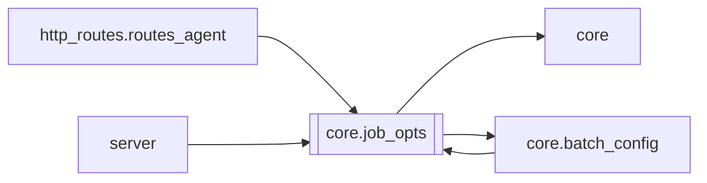

# `core.job_opts`

[← Index](../generated/module-index.md) · [Brain home](../README.md)

<!-- AUTO:START — sinh bởi scripts/brain_build.py 2026-11-11 13:00. Đừng sửa tay khối này. -->
**File:** `core/job_opts.py` · **Lớp:** `core` · **281 dòng** (221 code) · **17 hàm**, **0 class** · sha1 `7b472bdf82`

> core/job_opts.py — MỘT nguồn quyết định tuỳ chọn job (V6 F2). Trước F2 tuỳ chọn job (giọng, âm nền, zoom, brand…) được quyết ở 5 chỗ khác nhau (`batch_config.resolve_job_opts`, `server._req_audio`, đoạn stamp queue_opts 

### Phụ thuộc

- **Gọi tới (import nội bộ):** [core](./core.md), [core.batch_config](./core.batch_config.md)
- **Được dùng bởi:** [core.batch_config](./core.batch_config.md), [http_routes.routes_agent](./http_routes.routes_agent.md), [server](./server.md)
- **Test:** `tests/test_job_opts.py`, `tests/v5/test_hardsub_blur_toggle.py`

### Hàm & class top-level

| Tên | Dòng | Dài | Tham số | Docstring |
|---|---:|---:|---|---|
| `load_batch` | 44 | 3 | `` | Config batch hiện tại (DEFAULTS ⊕ work/logs/batch_config.json). |
| `read_pinned` | 49 | 8 | `work_dir` | queue_opts đã ghim trong manifest của job (chỉ đọc; lỗi/thiếu → {}). |
| `explicit_from_req` | 59 | 19 | `req, keys, exclude` | Trường người dùng GỬI THẬT trong request (pydantic `model_fields_set`), không lấy mặc định của model. |
| `_layer` | 82 | 5 | `out, src, skip` |  |
| `merge` | 89 | 10 | `*layers, batch, fill_voice` | DEFAULTS ⊕ batch ⊕ từng lớp theo thứ tự (lớp sau thắng). Ngữ nghĩa cũ của |
| `resolve` | 101 | 14 | `explicit, pinned, batch, fill_voice` | Opts THÔ của 1 lần chạy: explicit > pinned (trừ voice) > batch > DEFAULTS. None không đè. |
| `for_job` | 117 | 4 | `work_dir, explicit, fill_voice, batch` | resolve() với queue_opts đọc từ manifest của job + config batch hiện tại. |
| `clamp_zoom` | 125 | 20 | `zoom` | = engines.render_fx.clamp_zoom (chép để module này không phụ thuộc engines). |
| `_float` | 147 | 7 | `v, default` |  |
| `speed` | 156 | 3 | `o` |  |
| `normalize` | 161 | 35 | `o` | Opts đã resolve → kiểu chuẩn (bool/float/str). Khoá lạ giữ nguyên; pin_opts bỏ. |
| `pin_subset` | 207 | 2 | `o` |  |
| `audio` | 211 | 5 | `o` | (audio_mode, voice_vol, orig_vol) — mặc định duck_bgm / 0.2 / 0.22 như V5. |
| `brand_on` | 218 | 3 | `o` |  |
| `pipeline_render_kw` | 223 | 16 | `o` | dict `render_kw` mà run_all / hàng chờ truyền cho _auto_pipeline / auto-split (zoom đã clamp). |
| `_norm_zoom` | 241 | 11 | `v` |  |
| `render_kwargs` | 254 | 28 | `o` | Tham số _do_render / MuxReq từ opts đã resolve (= batch_config.render_kwargs của V5, nguyên văn). |

**File/artifact nhắc tới:** `manifest.json`

### Lịch sử (từ docs/)

- **Fix logs (1):**
  - [2026-11-11 — F2 (core/job_opts) + F3 tích hợp (1 tiến trình V5+V6, UI cũ hết polling)](../../fixes/2026-11-11-f2-f3-integration.md)
- **Reviews:** [2026-11-11-review-f2-f3](../../reviews/2026-11-11-review-f2-f3.md)
- Nhắc trong CHANGELOG: **1** lần · DECISIONS: **0** lần

<!-- AUTO:END -->

<!-- MANUAL:START -->
## Vai trò (viết tay)

_Chưa viết. 2–4 câu: module này chịu trách nhiệm gì trong pipeline, ai gọi nó, nó KHÔNG làm gì._

## Luồng chính

_Các hàm vào (entry) → bước chính → output/side effect. Ghi tên hàm thật._

## Bất biến & hợp đồng

_Điều luôn phải đúng (vd: chỉ ghi manifest qua `Manifest.update`; 1 job / ghế). Vi phạm = bug._

## Bẫy đã biết

_Lỗi từng gặp + link `docs/fixes/...`. Những chỗ dễ sửa sai._

## Ghi chú vận hành

_Config key quan trọng, cần restart gì khi sửa (:8801 / :8802 / hot-reload), cách test._
<!-- MANUAL:END -->
