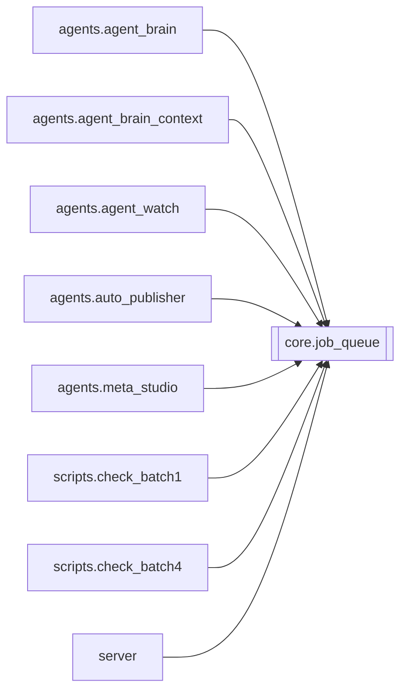

# `core.job_queue`

[← Index](../generated/module-index.md) · [Brain home](../README.md)

<!-- AUTO:START — sinh bởi scripts/brain_build.py 2026-11-11 13:00. Đừng sửa tay khối này. -->
**File:** `core/job_queue.py` · **Lớp:** `core` · **669 dòng** (575 code) · **32 hàm**, **0 class** · sha1 `833350dcfa`

### Phụ thuộc

- **Gọi tới (import nội bộ):** —
- **Được dùng bởi:** [agents.agent_brain](./agents.agent_brain.md), [agents.agent_brain_context](./agents.agent_brain_context.md), [agents.agent_watch](./agents.agent_watch.md), [agents.auto_publisher](./agents.auto_publisher.md), [agents.meta_studio](./agents.meta_studio.md), [scripts.check_batch1](./scripts.check_batch1.md), [scripts.check_batch4](./scripts.check_batch4.md), [server](./server.md)
- **Được nhắc tên file `.py` (subprocess/script) bởi:** [restart_server](./restart_server.md)
- **Test:** `tests/test_job_opts.py`, `tests/v5/test_film_db_queue_meta.py`, `tests/v5/test_job_queue.py`, `tests/v5/test_job_queue_worker.py`, `tests/v5/test_layout_paths.py`, `tests/v5/test_queue_http_state.py`

### Hàm & class top-level

| Tên | Dòng | Dài | Tham số | Docstring |
|---|---:|---:|---|---|
| `_parse_season_from_text` | 19 | 30 | `*texts` | Bóc số phần/mùa từ title (Phần N / P N / 第N季). Không dùng group_index. |
| `_norm_series_key` | 51 | 13 | `name` | Chuẩn hoá tên bộ để sort: gom biến thể ngàn/nghìn, bỏ dấu câu thừa. |
| `get_job_info` | 66 | 68 | `job_id` | Lấy thông tin tiêu đề, bộ phim (series), mùa/phần (season) từ manifest để sort và hiển thị. |
| `job_sort_key` | 136 | 5 | `job_id` | Khóa sắp xếp: (group_id/series_norm, season P1..Pn, title). |
| `_reset_for_tests` | 158 | 23 | `load_disk` | Chỉ dùng trong pytest. |
| `set_runner` | 183 | 3 | `fn` |  |
| `set_park_ready_hook` | 188 | 4 | `fn` | Server gắn hook: True = job HOLD/waiting có thể chạy tiếp (TTS/mux). |
| `is_park_status` | 194 | 2 | `status` |  |
| `_default_park_ready` | 198 | 36 | `job_id` | Fallback khi chưa wire hook: bỏ HOLD flags + (waiting_review → hết câu chưa rv). |
| `_park_ready` | 236 | 7 | `job_id` |  |
| `is_wired_done` | 245 | 11 | `work_dir` |  |
| `_persist_path` | 258 | 2 | `` |  |
| `_save` | 262 | 15 | `` |  |
| `_load` | 279 | 26 | `` |  |
| `_hist_push` | 307 | 5 | `job_id, status, detail` |  |
| `queue_busy` | 314 | 4 | `` | True nếu worker đang chạy hoặc còn job trong hàng — dùng GPU gate heal/watch. |
| `queue_state` | 320 | 13 | `` |  |
| `queue_add` | 335 | 60 | `job_ids, opts, skip_done, sort_first, opts_for` | opts_for(job_id) (V6 F2): opts riêng từng job (vd ⊕ queue_opts đã ghim của job, core.job_opts); |
| `queue_sort` | 397 | 15 | `by` | Sắp xếp lại các job đang chờ trong hàng: |
| `queue_move` | 414 | 28 | `job_id, action` | Di chuyển vị trí của 1 job trong hàng chờ: |
| `queue_reorder` | 444 | 10 | `new_order` | Gán lại toàn bộ thứ tự cho hàng chờ theo danh sách client gửi. |
| `queue_add_group` | 456 | 38 | `group_id, opts, skip_done, opts_for` | Enqueue mọi member của group theo group_index tăng dần. |
| `queue_front` | 496 | 6 | `job_id` |  |
| `queue_remove` | 504 | 11 | `job_ids` | Bỏ job khỏi hàng chờ (không stop current). |
| `queue_update_opts` | 517 | 10 | `updates` | Đổi opts của job ĐANG CHỜ tại chỗ (giữ thứ tự, không đụng current) — thay cho remove+add. |
| `queue_clear` | 529 | 6 | `` |  |
| `queue_stop` | 537 | 20 | `` | Clear queue + báo worker dừng; gọi _stop_job(current) nếu server đã wire. |
| `set_stop_hook` | 559 | 2 | `fn` |  |
| `set_clear_stop_hook` | 563 | 3 | `fn` |  |
| `_ensure_worker_unlocked` | 568 | 9 | `` |  |
| `_ensure_worker` | 579 | 3 | `` |  |
| `_worker_loop` | 584 | 80 | `` |  |

### Config / env keys (1)

`QUEUE_PARK_POLL_SEC`

**File/artifact nhắc tới:** `_job_queue.json`, `manifest.json`, `output.mp4`, `script.json`

**Tín hiệu rủi ro (đếm tĩnh):** broad_except=11 · global_stmt=10 · sleep=1 · swallow_except=2 · threads=1

### Lịch sử (từ docs/)

- Fix logs: —
- **Reviews:** [2026-11-11-review-f2-f3](../../reviews/2026-11-11-review-f2-f3.md)
- Nhắc trong CHANGELOG: **0** lần · DECISIONS: **0** lần

<!-- AUTO:END -->

<!-- MANUAL:START -->
## Vai trò (viết tay)

_Chưa viết. 2–4 câu: module này chịu trách nhiệm gì trong pipeline, ai gọi nó, nó KHÔNG làm gì._

## Luồng chính

_Các hàm vào (entry) → bước chính → output/side effect. Ghi tên hàm thật._

## Bất biến & hợp đồng

_Điều luôn phải đúng (vd: chỉ ghi manifest qua `Manifest.update`; 1 job / ghế). Vi phạm = bug._

## Bẫy đã biết

_Lỗi từng gặp + link `docs/fixes/...`. Những chỗ dễ sửa sai._

## Ghi chú vận hành

_Config key quan trọng, cần restart gì khi sửa (:8801 / :8802 / hot-reload), cách test._
<!-- MANUAL:END -->
