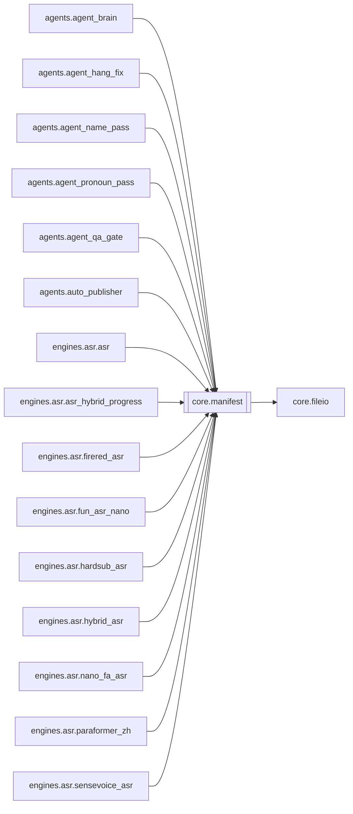

# `core.manifest`

[← Index](../generated/module-index.md) · [Brain home](../README.md)

<!-- AUTO:START — sinh bởi scripts/brain_build.py 2026-11-11 13:00. Đừng sửa tay khối này. -->
**File:** `core/manifest.py` · **Lớp:** `core` · **294 dòng** (230 code) · **7 hàm**, **1 class** · sha1 `064980b082`

> manifest.py — Trạng thái/checkpoint cho pipeline. Mỗi job (mỗi video) có một thư mục làm việc riêng chứa manifest.json. Mỗi stage ghi trạng thái vào đây; crash/mất điện thì resume từ stage cuối

### Phụ thuộc

- **Gọi tới (import nội bộ):** [core.fileio](./core.fileio.md)
- **Được dùng bởi:** [agents.agent_brain](./agents.agent_brain.md), [agents.agent_hang_fix](./agents.agent_hang_fix.md), [agents.agent_name_pass](./agents.agent_name_pass.md), [agents.agent_pronoun_pass](./agents.agent_pronoun_pass.md), [agents.agent_qa_gate](./agents.agent_qa_gate.md), [agents.auto_publisher](./agents.auto_publisher.md), [engines.asr.asr](./engines.asr.asr.md), [engines.asr.asr_hybrid_progress](./engines.asr.asr_hybrid_progress.md), [engines.asr.firered_asr](./engines.asr.firered_asr.md), [engines.asr.fun_asr_nano](./engines.asr.fun_asr_nano.md), [engines.asr.hardsub_asr](./engines.asr.hardsub_asr.md), [engines.asr.hybrid_asr](./engines.asr.hybrid_asr.md), [engines.asr.nano_fa_asr](./engines.asr.nano_fa_asr.md), [engines.asr.paraformer_zh](./engines.asr.paraformer_zh.md), [engines.asr.sensevoice_asr](./engines.asr.sensevoice_asr.md), [engines.clone_tts](./engines.clone_tts.md), [engines.download](./engines.download.md), [engines.ocr](./engines.ocr.md), [engines.pronoun_consistency](./engines.pronoun_consistency.md), [engines.render](./engines.render.md), [engines.render_job](./engines.render_job.md), [engines.separate](./engines.separate.md), [engines.split_parts](./engines.split_parts.md), [engines.translate](./engines.translate.md), [engines.translate_alts](./engines.translate_alts.md), [http_routes.routes_agent](./http_routes.routes_agent.md), [scripts.check_batch4](./scripts.check_batch4.md), [server](./server.md), [state.job_state](./state.job_state.md)
- **Được nhắc tên file `.py` (subprocess/script) bởi:** [restart_server](./restart_server.md)
- **Test:** `tests/test_f1_write_path.py`, `tests/test_review1_f2f3.py`, `tests/v5/test_agent_core_smoke.py`, `tests/v5/test_asr_demucs.py`

### Hàm & class top-level

| Tên | Dòng | Dài | Tham số | Docstring |
|---|---:|---:|---|---|
| **class `Manifest`** | 119 | 13 method | |  |
| `_now` | 26 | 2 | `` |  |
| `_lock_for` | 39 | 8 | `path` |  |
| `register_write_hook` | 56 | 4 | `fn` | fn(work_dir: Path, data: dict). Lỗi trong hook không làm hỏng lần ghi. |
| `unregister_write_hook` | 62 | 3 | `fn` |  |
| `_run_hooks` | 67 | 6 | `work_dir, data` |  |
| `_merge3` | 75 | 22 | `base, mine, theirs` | Gộp 3 chiều dict JSON. Key mình không đổi so với lúc load → lấy bản đĩa (người khác |
| `_xproc_lock` | 100 | 17 | `path` | Khoá liên tiến trình (server + subprocess asr/tts cùng ghi). Không lấy được thì vẫn ghi |

**File/artifact nhắc tới:** `manifest.json`

**Tín hiệu rủi ro (đếm tĩnh):** broad_except=3 · file_writes=2 · sleep=3

### Lịch sử (từ docs/)

- **Fix logs (1):**
  - [2026-11-11 — F1 (B9): mọi ghi manifest qua state/](../../fixes/2026-11-11-f1-b9-single-write-path.md)
- Nhắc trong CHANGELOG: **0** lần · DECISIONS: **0** lần

<!-- AUTO:END -->

<!-- MANUAL:START -->
## Vai trò (viết tay)

_Chưa viết. 2–4 câu: module này chịu trách nhiệm gì trong pipeline, ai gọi nó, nó KHÔNG làm gì._

## Luồng chính

_Các hàm vào (entry) → bước chính → output/side effect. Ghi tên hàm thật._

## Bất biến & hợp đồng

_Điều luôn phải đúng (vd: chỉ ghi manifest qua `Manifest.update`; 1 job / ghế). Vi phạm = bug._

## Bẫy đã biết

_Lỗi từng gặp + link `docs/fixes/...`. Những chỗ dễ sửa sai._

## Ghi chú vận hành

_Config key quan trọng, cần restart gì khi sửa (:8801 / :8802 / hot-reload), cách test._
<!-- MANUAL:END -->
