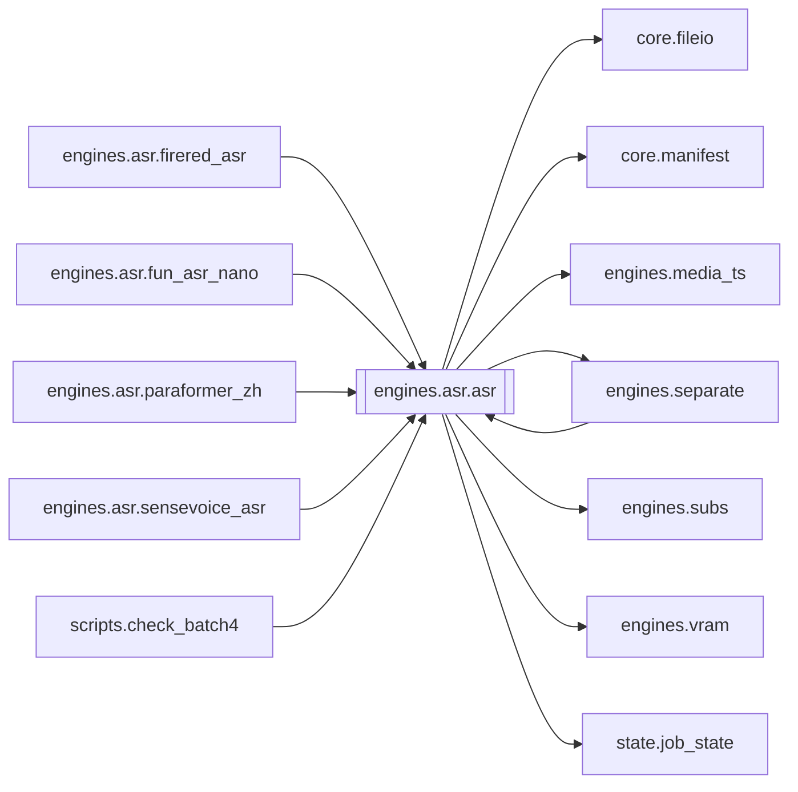

# `engines.asr.asr`

[← Index](../generated/module-index.md) · [Brain home](../README.md)

<!-- AUTO:START — sinh bởi scripts/brain_build.py 2026-11-11 13:00. Đừng sửa tay khối này. -->
**File:** `engines/asr/asr.py` · **Lớp:** `asr` · **448 dòng** (378 code) · **13 hàm**, **0 class** · sha1 `bf641a2ae4`

> asr.py — STAGE 2 (phần đầu): tách audio + nhận diện lời (Whisper). Đầu vào : work/<job>/source.mp4  (từ stage download) Đầu ra  : work/<job>/audio.wav   (16kHz mono — dùng lại cho TTS/Demucs sau)

### Phụ thuộc

- **Gọi tới (import nội bộ):** [core.fileio](./core.fileio.md), [core.manifest](./core.manifest.md), [engines.media_ts](./engines.media_ts.md), [engines.separate](./engines.separate.md), [engines.subs](./engines.subs.md), [engines.vram](./engines.vram.md), [state.job_state](./state.job_state.md)
- **Được dùng bởi:** [engines.asr.firered_asr](./engines.asr.firered_asr.md), [engines.asr.fun_asr_nano](./engines.asr.fun_asr_nano.md), [engines.asr.paraformer_zh](./engines.asr.paraformer_zh.md), [engines.asr.sensevoice_asr](./engines.asr.sensevoice_asr.md), [engines.separate](./engines.separate.md), [scripts.check_batch4](./scripts.check_batch4.md)
- **Được nhắc tên file `.py` (subprocess/script) bởi:** [engines.translate](./engines.translate.md), [restart_server](./restart_server.md), [scripts.check_batch4](./scripts.check_batch4.md), [server](./server.md)
- **Test:** `tests/v5/test_asr_demucs.py`
- **Thư viện ngoài:** `ctranslate2`, `faster_whisper`, `soundfile`, `state`

### Hàm & class top-level

| Tên | Dòng | Dài | Tham số | Docstring |
|---|---:|---:|---|---|
| `_audio_marker` | 52 | 2 | `wav` |  |
| `_src_id` | 56 | 4 | `src` |  |
| `extract_audio` | 62 | 20 | `src, out_wav` | Tách audio về 16kHz mono PCM — chuẩn đầu vào Whisper. Ghi .partial rồi replace + marker nguồn. |
| `_wav_seconds` | 84 | 11 | `p` |  |
| `_probe_seconds` | 97 | 7 | `p` |  |
| `audio_wav_stale` | 106 | 28 | `src, wav, keep_legacy` | audio.wav có sẵn không dùng được: rỗng, marker khác nguồn / khác filter mốc, hoặc (chưa có |
| `ensure_audio_wav` | 136 | 12 | `src, wav, force, keep_legacy` | Trích audio.wav khi thiếu / hỏng / khác nguồn (hoặc force). True nếu vừa trích. |
| `resolve_asr_source` | 150 | 51 | `work_dir, video_src, force_demucs, device` | Xác định nguồn audio sạch và chuẩn xác cho ASR. |
| `_cut_wav_from` | 203 | 7 | `src_wav, out_wav, start_sec` | Cắt phần còn lại từ start_sec (resume ASR giữa chừng). |
| `pick_device` | 212 | 11 | `device` | Chọn cuda nếu có GPU, không thì cpu. Trả (device, compute_type). |
| `_salvage_asr` | 225 | 26 | `m, asr_path, rows, wav, total, err` | Crash/treo: giữ asr.json đã có, status pending để bấm Tiếp tục. |
| `run_asr` | 253 | 172 ⚠️ | `work_dir, model_size, lang, device, compute_type, force` |  |
| `main` | 427 | 18 | `argv` |  |

**Hàm dài ≥120 dòng:** `run_asr` (172, L253)

**File/artifact nhắc tới:** `asr.json`, `audio.wav`, `audio_resume.wav`, `sub.zh.srt`, `vocals.wav`

**Tín hiệu rủi ro (đếm tĩnh):** broad_except=8 · file_writes=2 · subprocess=3 · swallow_except=2 · threads=1

### Lịch sử (từ docs/)

- Fix logs: —
- Nhắc trong CHANGELOG: **0** lần · DECISIONS: **0** lần

<!-- AUTO:END -->

<!-- MANUAL:START -->
## Vai trò (viết tay)

_Chưa viết. 2–4 câu: module này chịu trách nhiệm gì trong pipeline, ai gọi nó, nó KHÔNG làm gì._

## Luồng chính

_Các hàm vào (entry) → bước chính → output/side effect. Ghi tên hàm thật._

## Bất biến & hợp đồng

_Điều luôn phải đúng (vd: chỉ ghi manifest qua `Manifest.update`; 1 job / ghế). Vi phạm = bug._

## Bẫy đã biết

_Lỗi từng gặp + link `docs/fixes/...`. Những chỗ dễ sửa sai._

## Ghi chú vận hành

_Config key quan trọng, cần restart gì khi sửa (:8801 / :8802 / hot-reload), cách test._
<!-- MANUAL:END -->
