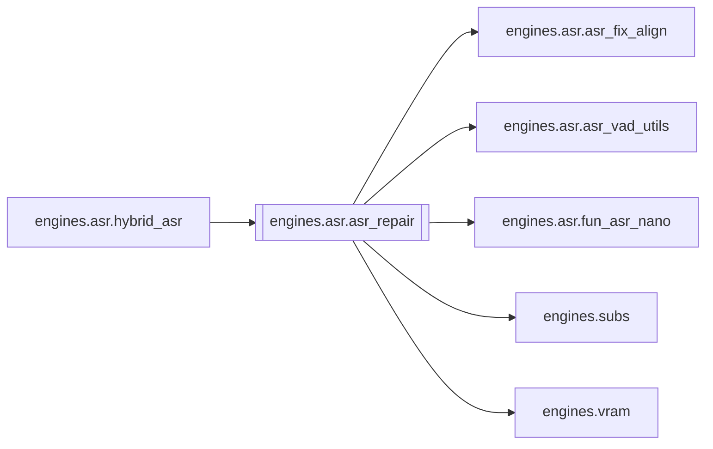

# `engines.asr.asr_repair`

[← Index](../generated/module-index.md) · [Brain home](../README.md)

<!-- AUTO:START — sinh bởi scripts/brain_build.py 2026-11-11 13:00. Đừng sửa tay khối này. -->
**File:** `engines/asr/asr_repair.py` · **Lớp:** `asr` · **551 dòng** (478 code) · **16 hàm**, **0 class** · sha1 `24152262c5`

> asr_repair.py — Hậu kỳ Hybrid: A lấp lỗ + B sửa nghe sai + FA. A) Gap: Para có thoại, bản hiện tại trống/ít phủ → Nano ASR lại → chèn câu B) CER: chữ Nano lệch Para mạnh quanh mốc → Nano ASR lại cửa sổ → thay chữ

### Phụ thuộc

- **Gọi tới (import nội bộ):** [engines.asr.asr_fix_align](./engines.asr.asr_fix_align.md), [engines.asr.asr_vad_utils](./engines.asr.asr_vad_utils.md), [engines.asr.fun_asr_nano](./engines.asr.fun_asr_nano.md), [engines.subs](./engines.subs.md), [engines.vram](./engines.vram.md)
- **Được dùng bởi:** [engines.asr.hybrid_asr](./engines.asr.hybrid_asr.md)
- **Test:** ❌ chưa có test import trực tiếp
- **Thư viện ngoài:** `funasr`, `soundfile`

### Hàm & class top-level

| Tên | Dòng | Dài | Tham số | Docstring |
|---|---:|---:|---|---|
| `_norm` | 55 | 2 | `s` |  |
| `_load` | 59 | 2 | `p` |  |
| `_overlap` | 63 | 2 | `a0, a1, b0, b1` |  |
| `_text_sim` | 67 | 18 | `a, b` | Độ giống 0..1 (containment + overlap tuần tự) trên chuỗi đã _norm. |
| `_mid` | 87 | 2 | `r` |  |
| `_already_has_similar` | 91 | 21 | `base, text, around_t, window_s, min_chars, min_sim` | True nếu base đã có câu gần nghĩa trong ±window_s (align lệch time). |
| `_para_cover` | 114 | 4 | `row, para` |  |
| `_align_rank` | 120 | 12 | `align` | Ưu tiên giữ khi dedupe (cao hơn = tốt hơn). |
| `dedupe_shifted_repeats` | 134 | 53 | `rows, para, window_s, min_chars, min_sim` | Xóa nhân bản lệch giờ: cùng/_gần text trong ±window_s → giữ 1 bản. |
| `_merge_windows` | 189 | 18 | `wins, gap_s` | wins: (start, end, reason) → merged {start,end,reasons}. |
| `detect_gaps` | 209 | 35 | `base, para, min_dur, max_cover_ratio, dup_window_s, dup_min_chars, …` | Para có đoạn mà base phủ < max_cover_ratio → nghi thiếu câu. |
| `detect_cer_mismatches` | 246 | 37 | `base, para_chars, miss_thr, min_chars` | Chữ base khó khớp Para char-stream quanh mốc → nghi nghe sai. |
| `_asr_nano_clip` | 285 | 26 | `asr_m, clip, sr, language` |  |
| `apply_repairs` | 313 | 106 | `base, windows, wav, device, hub, pad_s, language` | Nano ASR từng cửa sổ: |
| `run_repair` | 421 | 105 | `work_dir, src_name, para_name, chars_name, out_tag, device, hub, ma…` |  |
| `main` | 528 | 20 | `argv` |  |

### Config / env keys (1)

`HF_HUB_DISABLE_SYMLINKS`

**File/artifact nhắc tới:** `.meta.json`, `asr.aligned.json`, `asr.aligned_fa.json`, `asr.aligned_fix.json`, `asr.json`, `asr.paraformer_zh.chars.json`, `asr.paraformer_zh.json`, `audio.wav`

**Tín hiệu rủi ro (đếm tĩnh):** broad_except=2 · file_writes=3

### Lịch sử (từ docs/)

- Fix logs: —
- Nhắc trong CHANGELOG: **0** lần · DECISIONS: **0** lần

<!-- AUTO:END -->

<!-- MANUAL:START -->
## Vai trò (viết tay)

_Chưa viết. 2–4 câu: module này chịu trách nhiệm gì trong pipeline, ai gọi nó, nó KHÔNG làm gì._

## Luồng chính

_Các hàm vào (entry) → bước chính → output/side effect. Ghi tên hàm thật._

## Bất biến & hợp đồng

_Điều luôn phải đúng (vd: chỉ ghi manifest qua `Manifest.update`; 1 job / ghế). Vi phạm = bug._

## Bẫy đã biết

_Lỗi từng gặp + link `docs/fixes/...`. Những chỗ dễ sửa sai._

## Ghi chú vận hành

_Config key quan trọng, cần restart gì khi sửa (:8801 / :8802 / hot-reload), cách test._
<!-- MANUAL:END -->
