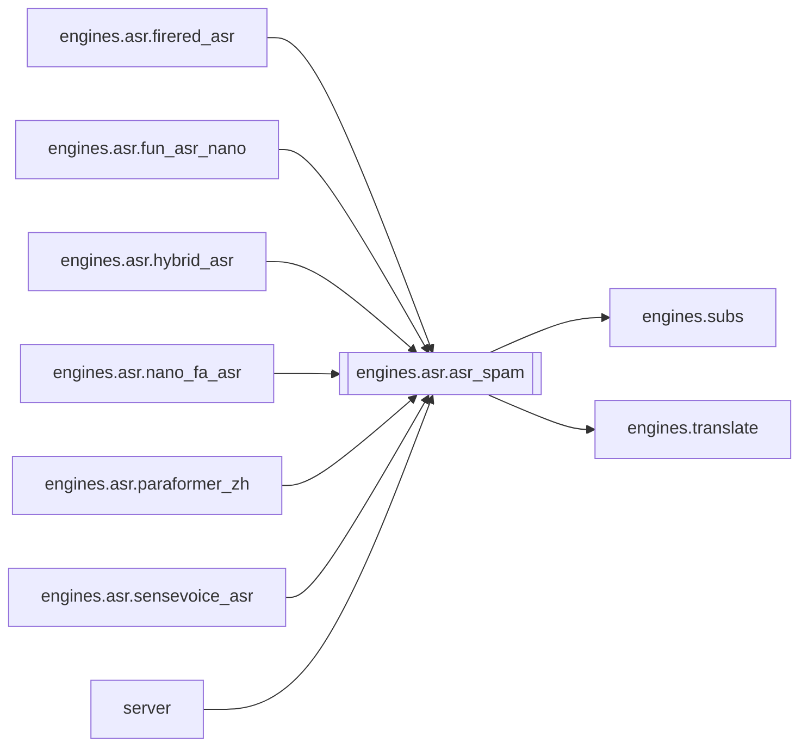

# `engines.asr.asr_spam`

[← Index](../generated/module-index.md) · [Brain home](../README.md)

<!-- AUTO:START — sinh bởi scripts/brain_build.py 2026-11-11 13:00. Đừng sửa tay khối này. -->
**File:** `engines/asr/asr_spam.py` · **Lớp:** `asr` · **469 dòng** (404 code) · **14 hàm**, **0 class** · sha1 `18017e5608`

> asr_spam.py — Chặn ASR nuốt tiếng nền (cười/rên 哈·啊·呃 lặp). Không dựa vào check tay: sau mỗi lần ghi ASR / promote / compare, tự detect + rút spam; nếu còn filler thuần thì mượn chữ từ sidecar khác

### Phụ thuộc

- **Gọi tới (import nội bộ):** [engines.subs](./engines.subs.md), [engines.translate](./engines.translate.md)
- **Được dùng bởi:** [engines.asr.firered_asr](./engines.asr.firered_asr.md), [engines.asr.fun_asr_nano](./engines.asr.fun_asr_nano.md), [engines.asr.hybrid_asr](./engines.asr.hybrid_asr.md), [engines.asr.nano_fa_asr](./engines.asr.nano_fa_asr.md), [engines.asr.paraformer_zh](./engines.asr.paraformer_zh.md), [engines.asr.sensevoice_asr](./engines.asr.sensevoice_asr.md), [server](./server.md)
- **Test:** ❌ chưa có test import trực tiếp

### Hàm & class top-level

| Tên | Dòng | Dài | Tham số | Docstring |
|---|---:|---:|---|---|
| `_strip_punct` | 36 | 2 | `t` |  |
| `filler_stats` | 40 | 16 | `text` |  |
| `is_phrase_loop_spam` | 58 | 15 | `text` | True nếu có cụm 2–12 chữ lặp ≥6 lần (vd «区域的»×200) — ASR kẹt loop. |
| `is_phrase_loop_remnant` | 82 | 25 | `text` | Sau clean_zh_spam giữ tối đa 2× unit — vẫn sót «…区域的区域». |
| `is_bg_filler_spam` | 109 | 13 | `text` | True nếu giống tiếng nền (cười/rên lặp), không phải thoại bình thường. |
| `is_filler_only` | 124 | 5 | `text` |  |
| `clean_filler_text` | 131 | 12 | `text, max_rep` | Rút chuỗi filler; giữ phần thoại thật nếu có. |
| `_load_heal_sources` | 145 | 31 | `work_dir, exclude` | Sidecar ASR khác để vá filler (ưu tiên nano → para → sense → firered). |
| `_overlap_iou` | 178 | 8 | `a0, a1, b0, b1` |  |
| `_heal_from_sources` | 188 | 81 | `start, end, sources` | Tìm câu thật overlap đủ (IoU) — tránh lấy câu kế cận lệch thời gian. |
| `sanitize_asr_rows` | 271 | 122 ⚠️ | `rows, work_dir, source_path, heal, drop_pure_filler` | Rút spam + (tuỳ chọn) vá từ sidecar khác. |
| `sanitize_asr_file` | 395 | 31 | `path, work_dir, heal, write_srt` | Đọc JSON ASR → sanitize → ghi đè (+ SRT nếu có cặp). |
| `prefer_non_spam` | 428 | 18 | `a, b, prefer_a` | Khi 2 bản lệch: ưu tiên bản không phải filler nền. |
| `main` | 448 | 18 | `argv` |  |

**Hàm dài ≥120 dòng:** `sanitize_asr_rows` (122, L271)

**File/artifact nhắc tới:** `asr.aligned.json`, `asr.aligned_fa.json`, `asr.aligned_repaired.json`, `asr.consensus.json`, `asr.firered.json`, `asr.fun_nano.json`, `asr.hardsub.json`, `asr.json`, `asr.paraformer_zh.json`, `asr.sensevoice.json`, `sub.zh.srt`

**Tín hiệu rủi ro (đếm tĩnh):** broad_except=3 · file_writes=2 · swallow_except=1

### Lịch sử (từ docs/)

- Fix logs: —
- Nhắc trong CHANGELOG: **0** lần · DECISIONS: **0** lần

<!-- AUTO:END -->

<!-- MANUAL:START -->
## Vai trò (viết tay)

_Chưa viết. 2–4 câu: module này chịu trách nhiệm gì trong pipeline, ai gọi nó, nó KHÔNG làm gì._

## Luồng chính

_Các hàm vào (entry) → bước chính → output/side effect. Ghi tên hàm thật._

## Bất biến & hợp đồng

_Điều luôn phải đúng (vd: chỉ ghi manifest qua `Manifest.update`; 1 job / ghế). Vi phạm = bug._

## Bẫy đã biết

_Lỗi từng gặp + link `docs/fixes/...`. Những chỗ dễ sửa sai._

## Ghi chú vận hành

_Config key quan trọng, cần restart gì khi sửa (:8801 / :8802 / hot-reload), cách test._
<!-- MANUAL:END -->
