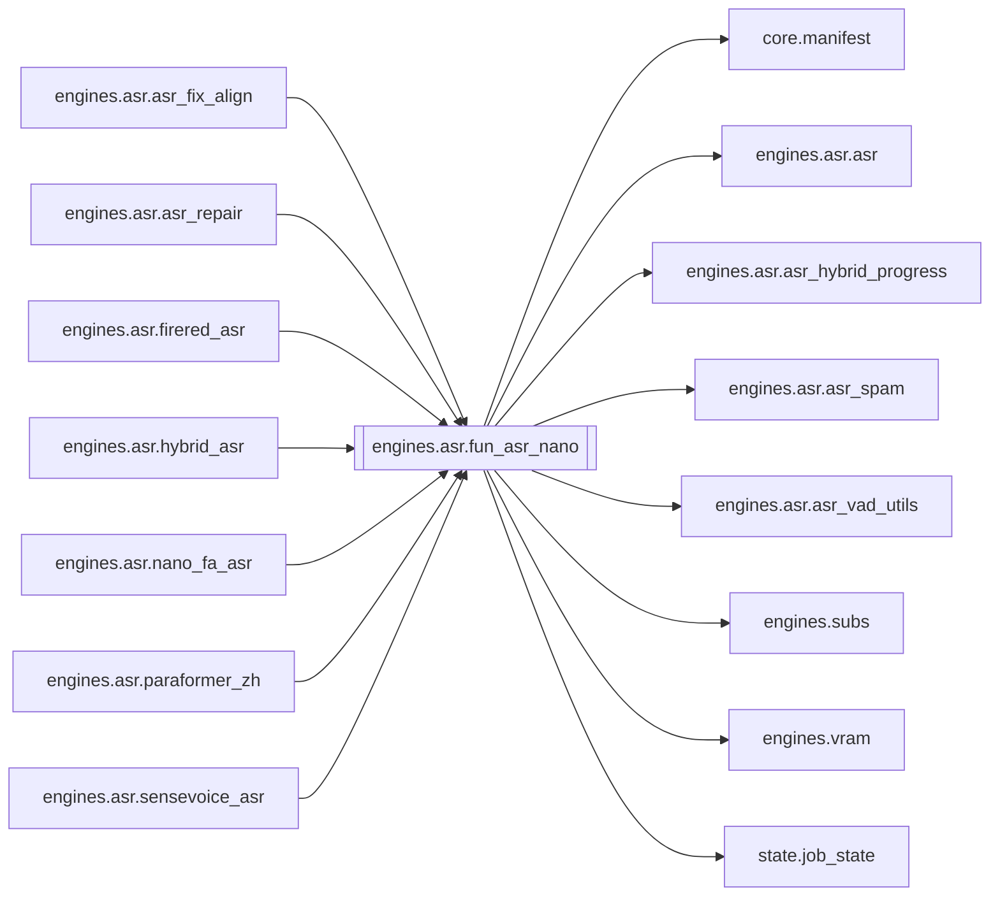

# `engines.asr.fun_asr_nano`

[← Index](../generated/module-index.md) · [Brain home](../README.md)

<!-- AUTO:START — sinh bởi scripts/brain_build.py 2026-11-11 13:00. Đừng sửa tay khối này. -->
**File:** `engines/asr/fun_asr_nano.py` · **Lớp:** `asr` · **603 dòng** (527 code) · **11 hàm**, **0 class** · sha1 `cd47fb6dc5`

> fun_asr_nano.py — STAGE ASR bằng Fun-ASR-Nano (chất lượng tiếng Trung cao nhất). Model : FunAudioLLM/Fun-ASR-Nano-2512 (+ fsmn-vad cắt đoạn dài) Đầu vào : work/<job>/source.mp4

### Phụ thuộc

- **Gọi tới (import nội bộ):** [core.manifest](./core.manifest.md), [engines.asr.asr](./engines.asr.asr.md), [engines.asr.asr_hybrid_progress](./engines.asr.asr_hybrid_progress.md), [engines.asr.asr_spam](./engines.asr.asr_spam.md), [engines.asr.asr_vad_utils](./engines.asr.asr_vad_utils.md), [engines.subs](./engines.subs.md), [engines.vram](./engines.vram.md), [state.job_state](./state.job_state.md)
- **Được dùng bởi:** [engines.asr.asr_fix_align](./engines.asr.asr_fix_align.md), [engines.asr.asr_repair](./engines.asr.asr_repair.md), [engines.asr.firered_asr](./engines.asr.firered_asr.md), [engines.asr.hybrid_asr](./engines.asr.hybrid_asr.md), [engines.asr.nano_fa_asr](./engines.asr.nano_fa_asr.md), [engines.asr.paraformer_zh](./engines.asr.paraformer_zh.md), [engines.asr.sensevoice_asr](./engines.asr.sensevoice_asr.md)
- **Được nhắc tên file `.py` (subprocess/script) bởi:** [restart_server](./restart_server.md), [server](./server.md)
- **Test:** ❌ chưa có test import trực tiếp
- **Thư viện ngoài:** `funasr`, `soundfile`, `state`, `torch`, `transformers`

### Hàm & class top-level

| Tên | Dòng | Dài | Tham số | Docstring |
|---|---:|---:|---|---|
| `_pick_device` | 50 | 10 | `device` |  |
| `_wav_dur` | 62 | 13 | `wav` |  |
| `_ms_to_s` | 77 | 6 | `v` | FunASR timestamp luôn là milliseconds. |
| `_split_text_by_punct` | 85 | 4 | `text` | Tách câu theo dấu câu (mỏng: gọi subs.split_text_by_punct). |
| `_spread_sentences` | 91 | 19 | `text, start, end` | Không có timestamp ký tự -> chia thời gian theo độ dài chữ. |
| `_parse_funasr_result` | 112 | 70 | `res, audio_dur` | Chuẩn hoá output FunASR -> [{start, end, text}, ...]. |
| `_split_by_punct` | 184 | 36 | `text, char_ts` | Gộp timestamp ký tự thành câu theo dấu câu Trung/Việt. |
| `_vad_ranges_chunked` | 222 | 77 | `vad_model, wav, audio_dur, vad_kw, chunk_s, overlap_s, on_progress` | VAD theo cửa sổ ~chunk_s — tránh treo generate() trên file dài. |
| `_vad_slice_asr` | 301 | 102 | `asr_model, vad_model, wav, language, on_progress, pad_s, overlap_s,…` | VAD cắt đoạn -> ASR từng đoạn có pad/overlap (Fun-ASR-Nano không có CTC ts). |
| `run_asr_nano` | 404 | 180 ⚠️ | `work_dir, device, force, language, hub, sidecar` | sidecar: ghi asr.<tag>.json + sub.zh.<tag>.srt, không đụng asr.json / manifest ASR chính. |
| `main` | 586 | 14 | `argv` |  |

**Hàm dài ≥120 dòng:** `run_asr_nano` (180, L404)

### Config / env keys (3)

`ASR_VAD_CHUNK_S`, `HF_HUB_DISABLE_SYMLINKS`, `HF_HUB_DISABLE_SYMLINKS_WARNING`

**File/artifact nhắc tới:** `.progress.json`, `asr.json`, `audio.wav`, `sub.zh.srt`

**Tín hiệu rủi ro (đếm tĩnh):** broad_except=12 · file_writes=7 · swallow_except=3

### Lịch sử (từ docs/)

- Fix logs: —
- Nhắc trong CHANGELOG: **0** lần · DECISIONS: **0** lần

<!-- AUTO:END -->

<!-- MANUAL:START -->
## Vai trò (viết tay)

_Chưa viết. 2–4 câu: module này chịu trách nhiệm gì trong pipeline, ai gọi nó, nó KHÔNG làm gì._

## Luồng chính

_Các hàm vào (entry) → bước chính → output/side effect. Ghi tên hàm thật._

## Bất biến & hợp đồng

_Điều luôn phải đúng (vd: chỉ ghi manifest qua `Manifest.update`; 1 job / ghế). Vi phạm = bug._

## Bẫy đã biết

_Lỗi từng gặp + link `docs/fixes/...`. Những chỗ dễ sửa sai._

## Ghi chú vận hành

_Config key quan trọng, cần restart gì khi sửa (:8801 / :8802 / hot-reload), cách test._
<!-- MANUAL:END -->
