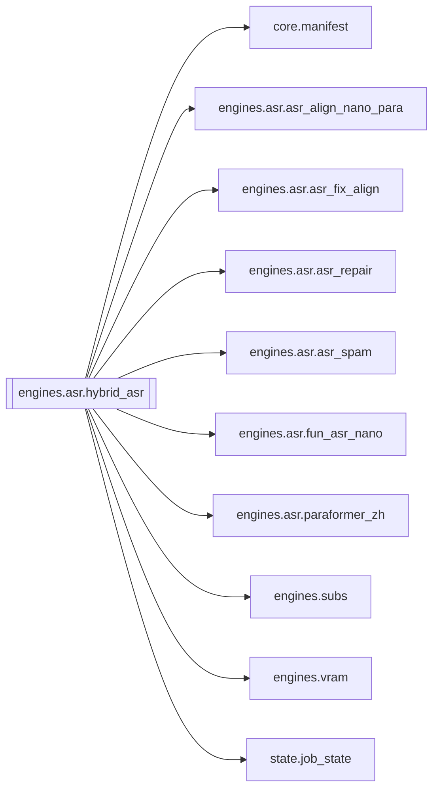

# `engines.asr.hybrid_asr`

[← Index](../generated/module-index.md) · [Brain home](../README.md)

<!-- AUTO:START — sinh bởi scripts/brain_build.py 2026-11-11 13:00. Đừng sửa tay khối này. -->
**File:** `engines/asr/hybrid_asr.py` · **Lớp:** `asr` · **208 dòng** (183 code) · **3 hàm**, **0 class** · sha1 `79616d4e91`

> hybrid_asr.py — ASR chốt: Nano chữ + Para timing + ForcedAlign + Repair. Pipeline (sidecar rồi promote → asr.json): 1) Fun-ASR-Nano     → asr.fun_nano.json

### Phụ thuộc

- **Gọi tới (import nội bộ):** [core.manifest](./core.manifest.md), [engines.asr.asr_align_nano_para](./engines.asr.asr_align_nano_para.md), [engines.asr.asr_fix_align](./engines.asr.asr_fix_align.md), [engines.asr.asr_repair](./engines.asr.asr_repair.md), [engines.asr.asr_spam](./engines.asr.asr_spam.md), [engines.asr.fun_asr_nano](./engines.asr.fun_asr_nano.md), [engines.asr.paraformer_zh](./engines.asr.paraformer_zh.md), [engines.subs](./engines.subs.md), [engines.vram](./engines.vram.md), [state.job_state](./state.job_state.md)
- **Được dùng bởi:** —
- **Được nhắc tên file `.py` (subprocess/script) bởi:** [restart_server](./restart_server.md), [server](./server.md)
- **Test:** ❌ chưa có test import trực tiếp
- **Thư viện ngoài:** `state`

### Hàm & class top-level

| Tên | Dòng | Dài | Tham số | Docstring |
|---|---:|---:|---|---|
| `_prog` | 51 | 8 | `m, **fields` |  |
| `run_hybrid_fa` | 61 | 123 ⚠️ | `work_dir, device, force, no_fa, no_repair, hub_nano, hub_para` |  |
| `main` | 186 | 19 | `argv` |  |

**Hàm dài ≥120 dòng:** `run_hybrid_fa` (123, L61)

### Config / env keys (2)

`HF_HUB_DISABLE_SYMLINKS`, `HF_HUB_DISABLE_SYMLINKS_WARNING`

**File/artifact nhắc tới:** `asr.aligned_fa.json`, `asr.aligned_fix.json`, `asr.aligned_repaired.json`, `asr.fun_nano.json`, `asr.json`, `asr.paraformer_zh.chars.json`, `asr.paraformer_zh.json`, `audio.wav`, `sub.zh.aligned_fa.srt`, `sub.zh.aligned_fix.srt`, `sub.zh.aligned_repaired.srt`, `sub.zh.srt`

**Tín hiệu rủi ro (đếm tĩnh):** broad_except=2 · file_writes=3

### Lịch sử (từ docs/)

- Fix logs: —
- Nhắc trong CHANGELOG: **0** lần · DECISIONS: **0** lần

<!-- AUTO:END -->

<!-- MANUAL:START -->
## Vai trò (viết tay)

_Chưa viết. 2–4 câu: module này chịu trách nhiệm gì trong pipeline, ai gọi nó, nó KHÔNG làm gì._

## Luồng chính

_Các hàm vào (entry) → bước chính → output/side effect. Ghi tên hàm thật._

## Bất biến & hợp đồng

_Điều luôn phải đúng (vd: chỉ ghi manifest qua `Manifest.update`; 1 job / ghế). Vi phạm = bug._

## Bẫy đã biết

_Lỗi từng gặp + link `docs/fixes/...`. Những chỗ dễ sửa sai._

## Ghi chú vận hành

_Config key quan trọng, cần restart gì khi sửa (:8801 / :8802 / hot-reload), cách test._
<!-- MANUAL:END -->
