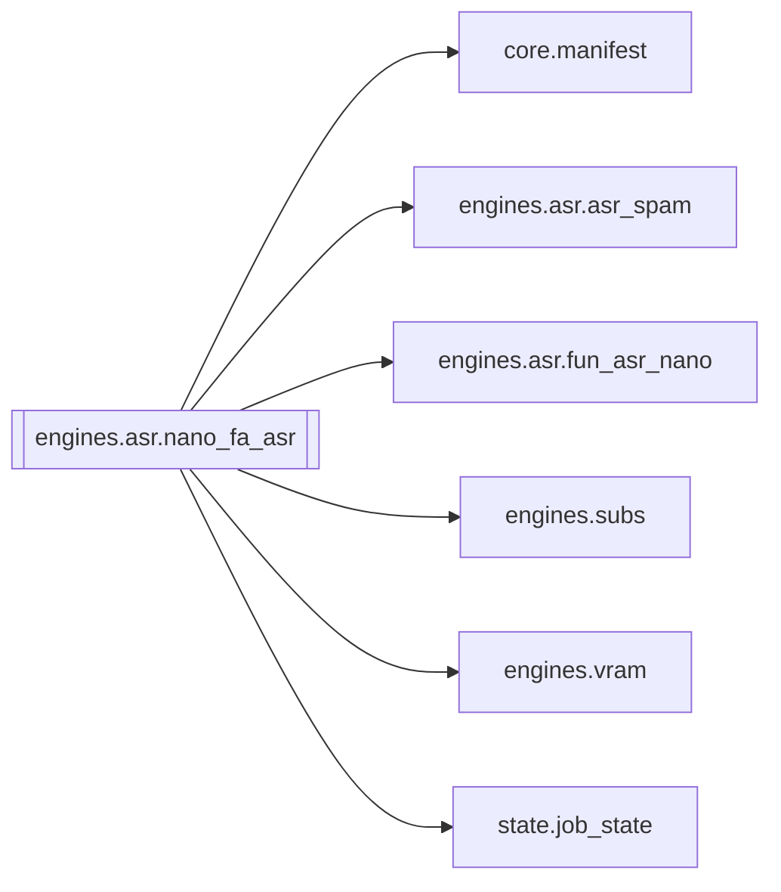

# `engines.asr.nano_fa_asr`

[← Index](../generated/module-index.md) · [Brain home](../README.md)

<!-- AUTO:START — sinh bởi scripts/brain_build.py 2026-11-11 13:00. Đừng sửa tay khối này. -->
**File:** `engines/asr/nano_fa_asr.py` · **Lớp:** `asr` · **343 dòng** (277 code) · **5 hàm**, **0 class** · sha1 `3c2502ed24`

> nano_fa_asr.py — SOTA ASR: Fun-ASR-Nano (Chữ chuẩn nhất) + Direct Qwen3-ForcedAligner (Mốc chuẩn từng chữ). Kiến trúc sạch, chuẩn công nghiệp: 1) Fun-ASR-Nano nhận diện văn bản (hiểu ngữ cảnh, ít sai chữ, chống lặp qua V

### Phụ thuộc

- **Gọi tới (import nội bộ):** [core.manifest](./core.manifest.md), [engines.asr.asr_spam](./engines.asr.asr_spam.md), [engines.asr.fun_asr_nano](./engines.asr.fun_asr_nano.md), [engines.subs](./engines.subs.md), [engines.vram](./engines.vram.md), [state.job_state](./state.job_state.md)
- **Được dùng bởi:** —
- **Được nhắc tên file `.py` (subprocess/script) bởi:** [restart_server](./restart_server.md), [server](./server.md)
- **Test:** ❌ chưa có test import trực tiếp
- **Thư viện ngoài:** `numpy`, `qwen_asr`, `soundfile`, `state`, `torch`

### Hàm & class top-level

| Tên | Dòng | Dài | Tham số | Docstring |
|---|---:|---:|---|---|
| `_merge_all_to_windows` | 45 | 34 | `rows, gap_s, max_win_s` | Gom các câu thoại gần nhau thành cửa sổ nhỏ (<=24s) để Forced Aligner xử lý tối ưu. |
| `align_nano_with_fa` | 81 | 121 ⚠️ | `rows, wav, device, pad_s, on_progress` | Căn mốc trực tiếp từng câu của Nano bằng Qwen3ForcedAligner. |
| `run_nano_fa` | 204 | 114 | `work_dir, device, force, hub_nano, sidecar` |  |
| `_torch_has_cuda` | 320 | 6 | `` |  |
| `main` | 328 | 11 | `argv` |  |

**Hàm dài ≥120 dòng:** `align_nano_with_fa` (121, L81)

### Config / env keys (4)

`ASR_FA_PAD_S`, `HF_HUB_DISABLE_SYMLINKS`, `HF_HUB_DISABLE_SYMLINKS_WARNING`, `QWEN3_FORCED_ALIGNER`

**File/artifact nhắc tới:** `asr.fun_nano.json`, `asr.json`, `asr.nano_fa.json`, `audio.wav`, `sub.zh.nano_fa.srt`, `sub.zh.srt`

**Tín hiệu rủi ro (đếm tĩnh):** broad_except=5 · file_writes=2

### Lịch sử (từ docs/)

- Fix logs: —
- Nhắc trong CHANGELOG: **0** lần · DECISIONS: **0** lần

<!-- AUTO:END -->

<!-- MANUAL:START -->
## Vai trò (viết tay)

_Chưa viết. 2–4 câu: module này chịu trách nhiệm gì trong pipeline, ai gọi nó, nó KHÔNG làm gì._

## Luồng chính

_Các hàm vào (entry) → bước chính → output/side effect. Ghi tên hàm thật._

## Bất biến & hợp đồng

_Điều luôn phải đúng (vd: chỉ ghi manifest qua `Manifest.update`; 1 job / ghế). Vi phạm = bug._

## Bẫy đã biết

_Lỗi từng gặp + link `docs/fixes/...`. Những chỗ dễ sửa sai._

## Ghi chú vận hành

_Config key quan trọng, cần restart gì khi sửa (:8801 / :8802 / hot-reload), cách test._
<!-- MANUAL:END -->
