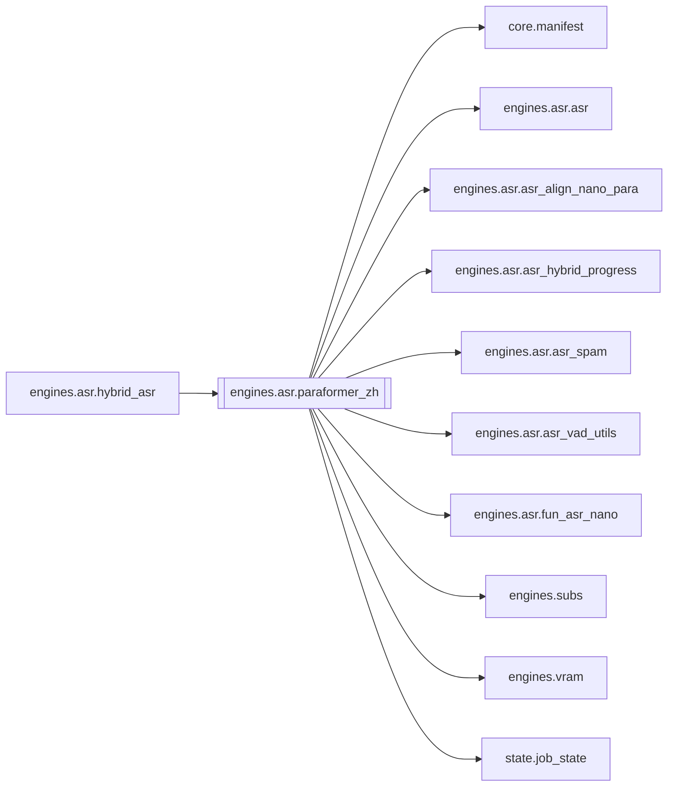

# `engines.asr.paraformer_zh`

[← Index](../generated/module-index.md) · [Brain home](../README.md)

<!-- AUTO:START — sinh bởi scripts/brain_build.py 2026-11-11 13:00. Đừng sửa tay khối này. -->
**File:** `engines/asr/paraformer_zh.py` · **Lớp:** `asr` · **315 dòng** (281 code) · **2 hàm**, **0 class** · sha1 `f5cb361bda`

> paraformer_zh.py — STAGE ASR bằng FunASR Paraformer-zh (timestamp tốt cho phụ đề/TTS). Model : paraformer-zh (+ fsmn-vad + ct-punc) Đầu vào : work/<job>/source.mp4

### Phụ thuộc

- **Gọi tới (import nội bộ):** [core.manifest](./core.manifest.md), [engines.asr.asr](./engines.asr.asr.md), [engines.asr.asr_align_nano_para](./engines.asr.asr_align_nano_para.md), [engines.asr.asr_hybrid_progress](./engines.asr.asr_hybrid_progress.md), [engines.asr.asr_spam](./engines.asr.asr_spam.md), [engines.asr.asr_vad_utils](./engines.asr.asr_vad_utils.md), [engines.asr.fun_asr_nano](./engines.asr.fun_asr_nano.md), [engines.subs](./engines.subs.md), [engines.vram](./engines.vram.md), [state.job_state](./state.job_state.md)
- **Được dùng bởi:** [engines.asr.hybrid_asr](./engines.asr.hybrid_asr.md)
- **Được nhắc tên file `.py` (subprocess/script) bởi:** [engines.asr.fun_asr_nano](./engines.asr.fun_asr_nano.md), [restart_server](./restart_server.md), [server](./server.md)
- **Test:** ❌ chưa có test import trực tiếp
- **Thư viện ngoài:** `funasr`, `soundfile`, `state`

### Hàm & class top-level

| Tên | Dòng | Dài | Tham số | Docstring |
|---|---:|---:|---|---|
| `run_asr_paraformer` | 51 | 245 ⚠️ | `work_dir, device, force, hub, sidecar, slice_mode` |  |
| `main` | 298 | 14 | `argv` |  |

**Hàm dài ≥120 dòng:** `run_asr_paraformer` (245, L51)

### Config / env keys (2)

`HF_HUB_DISABLE_SYMLINKS`, `HF_HUB_DISABLE_SYMLINKS_WARNING`

**File/artifact nhắc tới:** `.chars.json`, `.progress.json`, `asr.chars.json`, `asr.json`, `audio.wav`, `sub.zh.srt`

**Tín hiệu rủi ro (đếm tĩnh):** broad_except=3 · file_writes=8 · swallow_except=1

### Lịch sử (từ docs/)

- Fix logs: —
- Nhắc trong CHANGELOG: **0** lần · DECISIONS: **0** lần

<!-- AUTO:END -->

<!-- MANUAL:START -->
## Vai trò (viết tay)

_Chưa viết. 2–4 câu: module này chịu trách nhiệm gì trong pipeline, ai gọi nó, nó KHÔNG làm gì._

## Luồng chính

_Các hàm vào (entry) → bước chính → output/side effect. Ghi tên hàm thật._

## Bất biến & hợp đồng

_Điều luôn phải đúng (vd: chỉ ghi manifest qua `Manifest.update`; 1 job / ghế). Vi phạm = bug._

## Bẫy đã biết

_Lỗi từng gặp + link `docs/fixes/...`. Những chỗ dễ sửa sai._

## Ghi chú vận hành

_Config key quan trọng, cần restart gì khi sửa (:8801 / :8802 / hot-reload), cách test._
<!-- MANUAL:END -->
