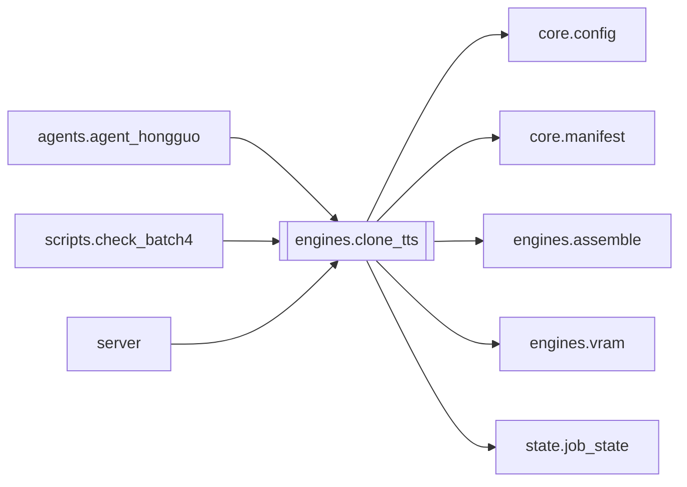

# `engines.clone_tts`

[← Index](../generated/module-index.md) · [Brain home](../README.md)

<!-- AUTO:START — sinh bởi scripts/brain_build.py 2026-11-11 13:00. Đừng sửa tay khối này. -->
**File:** `engines/clone_tts.py` · **Lớp:** `tts` · **1116 dòng** (969 code) · **38 hàm**, **0 class** · sha1 `cb96d75f3f`

> clone_tts.py — STAGE Lồng tiếng bằng TTS zero-shot clone tiếng Việt. Hai engine, cùng registry giọng (voices/f5_voices.json: name -> {ref, text}): - "vieneu"    : VieNeu-TTS v3-Turbo (G2P tiếng Việt riêng, chạy CPU/ONNX)

### Phụ thuộc

- **Gọi tới (import nội bộ):** [core.config](./core.config.md), [core.manifest](./core.manifest.md), [engines.assemble](./engines.assemble.md), [engines.vram](./engines.vram.md), [state.job_state](./state.job_state.md)
- **Được dùng bởi:** [agents.agent_hongguo](./agents.agent_hongguo.md), [scripts.check_batch4](./scripts.check_batch4.md), [server](./server.md)
- **Được nhắc tên file `.py` (subprocess/script) bởi:** [restart_server](./restart_server.md), [scripts.check_batch4](./scripts.check_batch4.md), [server](./server.md)
- **Test:** `tests/test_b11_risky_modules.py`, `tests/v5/test_layout_paths.py`
- **Thư viện ngoài:** `faster_whisper`, `numpy`, `soundfile`, `state`

### Hàm & class top-level

| Tên | Dòng | Dài | Tham số | Docstring |
|---|---:|---:|---|---|
| `resolve_engine_python` | 56 | 34 | `engine` | Tìm python.exe của engine. Config sai path (thường sau install) -> thử chỗ mặc định. |
| `_load_registry` | 92 | 4 | `` |  |
| `list_clone_voices` | 98 | 8 | `` | Tên các giọng clone đã có ref audio hợp lệ. |
| `_resolve_ref` | 108 | 7 | `ref` |  |
| `voice_ref_text` | 117 | 9 | `voice` | (ref_path, ref_text) của 1 giọng, hoặc None. |
| `enroll_voice` | 128 | 20 | `name, ref_path, ref_text` | Đăng ký giọng clone vào voices/f5_voices.json (VieNeu + OmniVoice dùng chung). |
| `_is_trivial_vi` | 150 | 4 | `text` | True nếu không có chữ thật (vd ',', '...', '!!!') — không nên gọi TTS. |
| `vi_for_tts` | 156 | 23 | `text` | Chuẩn bị chữ cho VieNeu/Omni: gộp số có dấu nghìn để đọc đúng. |
| `_write_silence_wav` | 181 | 13 | `path, dur_sec, sr` | Ghi wav im lặng đúng độ dài timeline (tối thiểu 0.15s để qua kiểm tra dur). |
| `_silence_entry` | 196 | 6 | `s, out_dir, engine` | Placeholder im lặng cho câu vô nghĩa / wav hỏng — đủ slot timeline, không báo thiếu. |
| `_dur` | 204 | 16 | `path` | Độ dài wav (giây). Ưu tiên wave; fallback ffprobe. |
| `_entry_from_wav` | 222 | 9 | `s, path, engine` | Tạo entry tts.json từ file wav đã có. None nếu file hỏng/quá ngắn. |
| `_unlink_quiet` | 233 | 5 | `path` |  |
| `_drop_runaway_from_done` | 240 | 17 | `segments, done, out_dir` | Resume/recheck: bỏ clip hú khỏi done + xóa wav → TTS sẽ đọc lại. |
| `_pack_clip` | 259 | 7 | `s, path, engine, speed, skip_pp` | Postprocess + entry. None nếu hỏng. Caller xử lý runaway. |
| `_recheck_pack_and_retry` | 268 | 70 | `engine, ref, ref_text, out_dir, speed, segments, done, packed_ids, …` | Đóng gói todo vừa TTS; runaway -> xóa -> retry tối đa N lần -> silence slot. |
| `_clip_key` | 343 | 3 | `vi, voice, engine, speed` |  |
| `_load_keys` | 348 | 6 | `out_dir` |  |
| `_save_keys` | 356 | 8 | `out_dir, keys` |  |
| `_stamp_keys` | 366 | 4 | `done, keys` |  |
| `_scan_done_from_disk` | 372 | 19 | `out_dir, segments, engine, done, disk_keys, keyof` | Resume: nhận diện seg_XXXX.wav đã ghi (sau khi Dừng) dù chưa kịp ghi tts.json. |
| `_postprocess_clip` | 393 | 9 | `path, engine, speed` |  |
| `_salvage_progress` | 404 | 57 | `m, segments, done, tts_path, out_dir, engine, voice, speed, pre_don…` | Khi dừng/crash: gom wav đã có -> tts.json, status pending (để bấm Tiếp tục). |
| `run_clone_tts` | 463 | 152 ⚠️ | `work_dir, engine, voice, speed, force` |  |
| `_cleanup_audio` | 617 | 28 | `path` | Làm sạch clip gen ra: |
| `_trim_onset` | 647 | 35 | `path` | Cắt 'âm rác đầu' của OmniVoice: nếu đoạn tiếng ĐẦU TIÊN ngắn (<0.45s) và có |
| `_apply_speed` | 684 | 26 | `path, speed` | Đổi tốc độ đọc bằng rubberband giữ formant (fallback atempo). speed>1 nhanh, <1 chậm. |
| `_run_worker` | 712 | 127 ⚠️ | `engine, ref, ref_text, out_dir, speed, lines, on_prog` | Chạy worker venv cho `lines`=[(i,text)], ghi out_dir/seg_XXXX.wav. Raise nếu lỗi. |
| `synth_one` | 841 | 23 | `engine, voice, text, out_path, speed` | Đọc 1 câu bằng engine+giọng -> ghi ra out_path (dùng cho nghe thử / đọc lại 1 clip). |
| `resynth_clip` | 866 | 18 | `work_dir, i, engine, voice, speed` | Đọc lại DUY NHẤT câu index i -> tts/seg_i.wav + vá tts.json. Trả entry. |
| `_norm_txt` | 886 | 6 | `s` | Chuẩn hoá để so khớp: thường hoá, bỏ dấu câu, gộp khoảng trắng. |
| `_similar` | 894 | 3 | `a, b` |  |
| `_asr_check` | 902 | 17 | `clips_texts, device` | Nghe ngược list [(wav_path, expected_vi)] -> [(score, transcript)]. Whisper small. |
| `verify_and_fix` | 921 | 53 | `work_dir, engine, voice, speed, min_score, max_retries` | TỰ KIỂM & SỬA: ASR nghe ngược từng clip, câu nào lệch nhiều so với bản dịch |
| `_roughness` | 976 | 26 | `path` | Độ 'nhám/méo' của clip: HF-ratio ở các khung CÓ CAO ĐỘ (voiced) — loại âm gió |
| `fix_glitches` | 1004 | 58 | `work_dir, engine, voice, speed, retries, abs_thresh, rel` | TỰ PHÁT HIỆN & SỬA câu bị vỡ/méo (âm): đo độ nhám voiced-frame, câu nào nhám |
| `_prog` | 1064 | 14 | `m, n_done, total, engine, phase, voice, speed` |  |
| `_finalize` | 1080 | 37 | `m, segments, done, tts_path, out_dir, engine, voice, speed, keys` |  |

**Hàm dài ≥120 dòng:** `run_clone_tts` (152, L463), `_run_worker` (127, L712)

### Config / env keys (10)

`CLONE_CLEANUP`, `CLONE_HISHELF`, `OMNI_GUIDANCE`, `OMNI_NUM_STEP`, `QA_ASR_DEVICE`, `QA_ASR_MODEL`, `TTS_RUNAWAY_RETRIES`, `VIENEU_BATCH`, `VIENEU_BOOT_SEC`, `VIENEU_STALL_SEC`

**File/artifact nhắc tới:** `.cl.wav`, `.sp.wav`, `_job.json`, `_keys.json`, `f5_voices.json`, `script.json`, `seg_0000.wav`, `tts.json`, `tts_config.json`

**Tín hiệu rủi ro (đếm tĩnh):** broad_except=19 · file_writes=10 · global_stmt=1 · subprocess=4 · swallow_except=10 · threads=1

### Lịch sử (từ docs/)

- Fix logs: —
- Nhắc trong CHANGELOG: **0** lần · DECISIONS: **0** lần

<!-- AUTO:END -->

<!-- MANUAL:START -->
## Vai trò (viết tay)

_Chưa viết. 2–4 câu: module này chịu trách nhiệm gì trong pipeline, ai gọi nó, nó KHÔNG làm gì._

## Luồng chính

_Các hàm vào (entry) → bước chính → output/side effect. Ghi tên hàm thật._

## Bất biến & hợp đồng

_Điều luôn phải đúng (vd: chỉ ghi manifest qua `Manifest.update`; 1 job / ghế). Vi phạm = bug._

## Bẫy đã biết

_Lỗi từng gặp + link `docs/fixes/...`. Những chỗ dễ sửa sai._

## Ghi chú vận hành

_Config key quan trọng, cần restart gì khi sửa (:8801 / :8802 / hot-reload), cách test._
<!-- MANUAL:END -->
