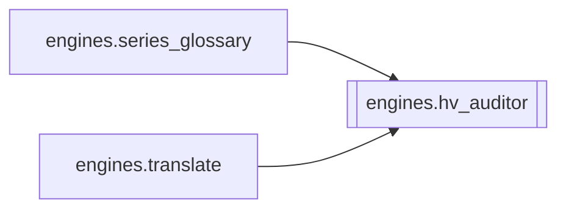

# `engines.hv_auditor`

[← Index](../generated/module-index.md) · [Brain home](../README.md)

<!-- AUTO:START — sinh bởi scripts/brain_build.py 2026-11-11 13:00. Đừng sửa tay khối này. -->
**File:** `engines/hv_auditor.py` · **Lớp:** `translate` · **475 dòng** (401 code) · **15 hàm**, **0 class** · sha1 `46878a6abb`

> Hán-Việt auditor — chống glossary khóa sai âm (vd 逆→Nghị thay vì Nghịch). 1) Unihan kVietnamese: đối chiếu từng chữ Hán với âm VI trong tên/thuật ngữ kiểu HV. 2) Consistency: cùng một chữ Hán trong glossary phải cùng một

### Phụ thuộc

- **Gọi tới (import nội bộ):** —
- **Được dùng bởi:** [engines.series_glossary](./engines.series_glossary.md), [engines.translate](./engines.translate.md)
- **Test:** ❌ chưa có test import trực tiếp

### Hàm & class top-level

| Tên | Dòng | Dài | Tham số | Docstring |
|---|---:|---:|---|---|
| `_fold` | 67 | 9 | `s` | Bỏ dấu để so âm (Nghịch≈nghich). đ→d; y/i cuối coi tương đương nhẹ. |
| `_title_vi` | 78 | 5 | `syl` |  |
| `load_k_vietnamese` | 86 | 37 | `` |  |
| `zh_chars` | 125 | 4 | `zh` | Chữ Hán chính (bỏ ngoặc chú thích / punctuation). |
| `vi_syllables` | 131 | 6 | `vi` | Tách âm tiết từ tên HV (bỏ dấu câu / · / /). |
| `looks_like_han_viet` | 139 | 13 | `zh, vi` | Đủ điều kiện audit: số âm == số chữ Hán (khớp 1-1), VI dạng Title HV. |
| `preferred_reading` | 154 | 4 | `ch` | Âm Unihan ưu tiên (đầu danh sách). |
| `readings_fold` | 160 | 2 | `ch` |  |
| `align_pairs` | 164 | 17 | `zh, vi` | Ghép chữ↔âm khi độ dài khớp hoặc lệch 1 (bỏ âm đệm nhi/mà/chi…). |
| `audit_entry` | 183 | 82 | `zh, vi` | Trả {ok, fixed_vi?, issues:[{ch, got, expect}], suspect:bool}. |
| `_iter_named_entries` | 267 | 7 | `plan` |  |
| `_replace_syllable_at` | 276 | 16 | `vi, idx, new_syl` | Thay âm tiết thứ idx (0-based) trong chuỗi VI, giữ khoảng trắng/dấu. |
| `enforce_char_consistency` | 294 | 75 | `plan` | Cùng chữ Hán → cùng âm VI (ưu tiên Unihan; nếu đã có âm đúng Unihan trong glossary thì dùng nó). |
| `audit_and_fix_plan` | 371 | 78 | `plan, fix` | Chạy auditor trên characters+terms. |
| `filter_series_entries` | 451 | 25 | `entries, drop_suspect` | Hygiene: auto-fix trap; bỏ mục hv_suspect cứng; giữ hv_warn (Unihan lệch tên riêng). |

**File/artifact nhắc tới:** `kVietnamese.json`

**Tín hiệu rủi ro (đếm tĩnh):** broad_except=1

### Lịch sử (từ docs/)

- Fix logs: —
- Nhắc trong CHANGELOG: **0** lần · DECISIONS: **0** lần

<!-- AUTO:END -->

<!-- MANUAL:START -->
## Vai trò (viết tay)

_Chưa viết. 2–4 câu: module này chịu trách nhiệm gì trong pipeline, ai gọi nó, nó KHÔNG làm gì._

## Luồng chính

_Các hàm vào (entry) → bước chính → output/side effect. Ghi tên hàm thật._

## Bất biến & hợp đồng

_Điều luôn phải đúng (vd: chỉ ghi manifest qua `Manifest.update`; 1 job / ghế). Vi phạm = bug._

## Bẫy đã biết

_Lỗi từng gặp + link `docs/fixes/...`. Những chỗ dễ sửa sai._

## Ghi chú vận hành

_Config key quan trọng, cần restart gì khi sửa (:8801 / :8802 / hot-reload), cách test._
<!-- MANUAL:END -->
