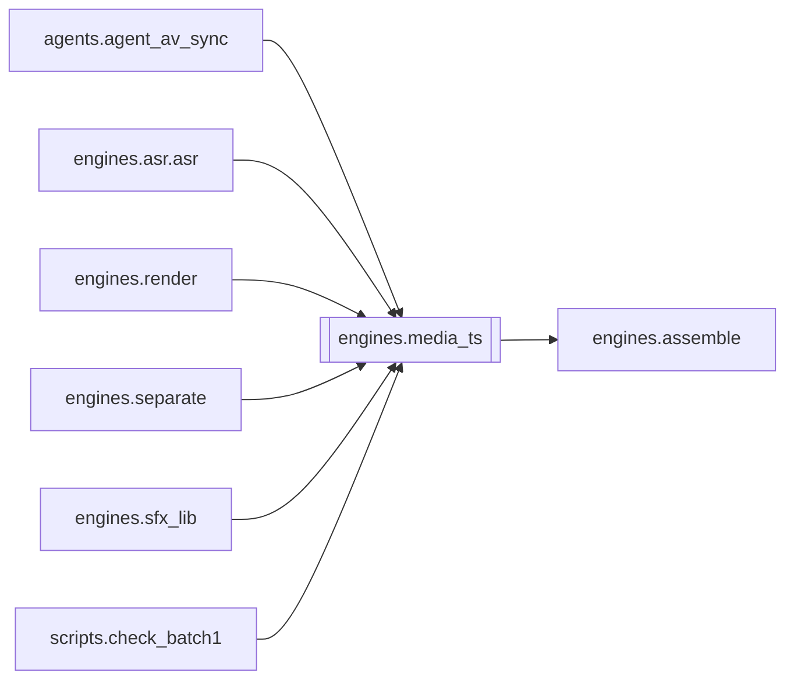

# `engines.media_ts`

[← Index](../generated/module-index.md) · [Brain home](../README.md)

<!-- AUTO:START — sinh bởi scripts/brain_build.py 2026-11-11 13:00. Đừng sửa tay khối này. -->
**File:** `engines/media_ts.py` · **Lớp:** `render` · **309 dòng** (270 code) · **14 hàm**, **0 class** · sha1 `bffebcfa44`

> Mốc thời gian tiếng của file nguồn — sửa tiếng "dồn mẫu" ở file ghép nhiều tập. File ghép copy nhiều tập AAC giữ lại 1024 mẫu mồi (priming) đầu mỗi tập: gói đó có mốc gần như trùng gói trước (stts ~0) nhưng vẫn chứa 23 m

### Phụ thuộc

- **Gọi tới (import nội bộ):** [engines.assemble](./engines.assemble.md)
- **Được dùng bởi:** [agents.agent_av_sync](./agents.agent_av_sync.md), [engines.asr.asr](./engines.asr.asr.md), [engines.render](./engines.render.md), [engines.separate](./engines.separate.md), [engines.sfx_lib](./engines.sfx_lib.md), [scripts.check_batch1](./scripts.check_batch1.md)
- **Được nhắc tên file `.py` (subprocess/script) bởi:** [restart_server](./restart_server.md)
- **Test:** ❌ chưa có test import trực tiếp

### Hàm & class top-level

| Tên | Dòng | Dài | Tham số | Docstring |
|---|---:|---:|---|---|
| `_boxes` | 37 | 15 | `f, start, end` |  |
| `_child` | 54 | 2 | `f, s, e, name` |  |
| `mp4_track_stts` | 58 | 37 | `video, kind` | (timescale, [(count, delta)]) của track đầu tiên loại `kind` (soun/vide). |
| `audio_drift_points` | 97 | 25 | `video` | Trục 'dồn mẫu' → trục mốc: (vị trí theo mẫu [s], tiếng dư tích luỹ tới đó [s]). |
| `audio_ts_drift` | 124 | 4 | `video` | Tổng tiếng dư so với mốc (s). 0 nếu không đọc được. |
| `make_retime` | 130 | 11 | `video` | Hàm t(trục dồn mẫu) → t(trục hình). None nếu lệch không đáng kể. |
| `_probe_dur` | 143 | 7 | `p` |  |
| `_retime_srt` | 152 | 9 | `text, f` |  |
| `ensure_job_audio_ts` | 163 | 69 | `work_dir, video` | Job đã ASR trên audio dồn mẫu → dời mốc về trục hình + ghép lại dub_fit. |
| `_tmp_of` | 234 | 2 | `p` |  |
| `_backup_once` | 238 | 4 | `p, bak` | Không bao giờ đè backup đã có — bản trong _pre_audio_ts luôn là bản gốc trước lần dời đầu. |
| `_atomic_write` | 244 | 4 | `p, text` |  |
| `_commit_retime` | 250 | 32 | `work_dir, info` | Pha thay file — chạy lại an toàn: mỗi bước kiểm tra trạng thái trước khi làm. |
| `main` | 284 | 22 | `argv` |  |

**File/artifact nhắc tới:** `.audio_ts_fixed.json`, `.audio_ts_pending.json`, `asr.json`, `audio.ts.wav`, `audio.wav`, `manifest.json`, `mixed_audio.partial.wav`, `mixed_audio.wav`, `no_vocals.wav`, `orig_audio.wav`, `script.display.json`, `script.json`, `script.pre_review.json`, `sub.vi.burn.srt`, `sub.vi.srt`, `sub.zh.srt`, `tts.json`, `vocals.wav`

**Tín hiệu rủi ro (đếm tĩnh):** file_writes=3 · subprocess=2

### Lịch sử (từ docs/)

- Fix logs: —
- Nhắc trong CHANGELOG: **0** lần · DECISIONS: **0** lần

<!-- AUTO:END -->

<!-- MANUAL:START -->
## Vai trò (viết tay)

_Chưa viết. 2–4 câu: module này chịu trách nhiệm gì trong pipeline, ai gọi nó, nó KHÔNG làm gì._

## Luồng chính

_Các hàm vào (entry) → bước chính → output/side effect. Ghi tên hàm thật._

## Bất biến & hợp đồng

_Điều luôn phải đúng (vd: chỉ ghi manifest qua `Manifest.update`; 1 job / ghế). Vi phạm = bug._

## Bẫy đã biết

_Lỗi từng gặp + link `docs/fixes/...`. Những chỗ dễ sửa sai._

## Ghi chú vận hành

_Config key quan trọng, cần restart gì khi sửa (:8801 / :8802 / hot-reload), cách test._
<!-- MANUAL:END -->
