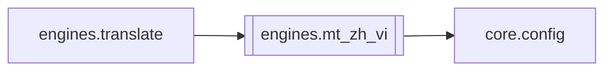

# `engines.mt_zh_vi`

[← Index](../generated/module-index.md) · [Brain home](../README.md)

<!-- AUTO:START — sinh bởi scripts/brain_build.py 2026-11-11 13:00. Đừng sửa tay khối này. -->
**File:** `engines/mt_zh_vi.py` · **Lớp:** `translate` · **302 dòng** (263 code) · **14 hàm**, **0 class** · sha1 `8fa07ccdde`

> NMT ZH→VI (HachimiMT) — DỊCH CHÍNH; LLM chỉ rà soát (run_review). Config: MT_ZH_VI=1                 bật NMT

### Phụ thuộc

- **Gọi tới (import nội bộ):** [core.config](./core.config.md)
- **Được dùng bởi:** [engines.translate](./engines.translate.md)
- **Test:** ❌ chưa có test import trực tiếp
- **Thư viện ngoài:** `ctranslate2`, `huggingface_hub`, `torch`, `transformers`

### Hàm & class top-level

| Tên | Dòng | Dài | Tham số | Docstring |
|---|---:|---:|---|---|
| `_cfg` | 43 | 6 | `key, default` |  |
| `enabled` | 51 | 3 | `` |  |
| `primary_mode` | 56 | 15 | `` | True = NMT ghi VI chính; False = chỉ gắn mt_vi cho LLM dịch (hint). |
| `draft_mode` | 73 | 3 | `` | Ngược primary_mode (tên cũ: gắn nháp, không ghi VI). |
| `device` | 78 | 3 | `` |  |
| `_flavor_from_plan` | 83 | 31 | `plan` | qt / base — chỉ QT khi xianxia/cổ THUẦN; mixed/đổi cảnh → base (linh hoạt). |
| `resolve_model_id` | 116 | 10 | `plan` | Repo HF sẽ load. `auto` → base/QT theo genre; repo cụ thể → ép. |
| `model_id` | 128 | 5 | `plan` | Repo đang chọn (có plan) hoặc config thô. |
| `_resolve_model_dir` | 135 | 33 | `repo` |  |
| `ensure_loaded` | 170 | 41 | `plan, repo` | Load (hoặc đổi) model. Trả repo đang active. |
| `unload` | 213 | 8 | `` |  |
| `_decode_opts` | 223 | 9 | `repo` |  |
| `translate_many` | 234 | 47 | `texts, max_tokens, batch_size, plan, repo` |  |
| `draft_rows` | 283 | 20 | `rows, text_key, plan` |  |

### Config / env keys (11)

`MT_ZH_VI`, `MT_ZH_VI_BATCH`, `MT_ZH_VI_BEAM`, `MT_ZH_VI_DEVICE`, `MT_ZH_VI_LOCAL`, `MT_ZH_VI_MAX_TOKENS`, `MT_ZH_VI_MODEL`, `MT_ZH_VI_MODEL_BASE`, `MT_ZH_VI_MODEL_QT`, `MT_ZH_VI_ONLY`, `MT_ZH_VI_ROLE`

**File/artifact nhắc tới:** `config.json`, `generation_config.json`, `tokenizer_config.json`, `vocab.json`

**Tín hiệu rủi ro (đếm tĩnh):** broad_except=3 · global_stmt=2

### Lịch sử (từ docs/)

- Fix logs: —
- Nhắc trong CHANGELOG: **0** lần · DECISIONS: **0** lần

<!-- AUTO:END -->

<!-- MANUAL:START -->
## Vai trò (viết tay)

_Chưa viết. 2–4 câu: module này chịu trách nhiệm gì trong pipeline, ai gọi nó, nó KHÔNG làm gì._

## Luồng chính

_Các hàm vào (entry) → bước chính → output/side effect. Ghi tên hàm thật._

## Bất biến & hợp đồng

_Điều luôn phải đúng (vd: chỉ ghi manifest qua `Manifest.update`; 1 job / ghế). Vi phạm = bug._

## Bẫy đã biết

_Lỗi từng gặp + link `docs/fixes/...`. Những chỗ dễ sửa sai._

## Ghi chú vận hành

_Config key quan trọng, cần restart gì khi sửa (:8801 / :8802 / hot-reload), cách test._
<!-- MANUAL:END -->
