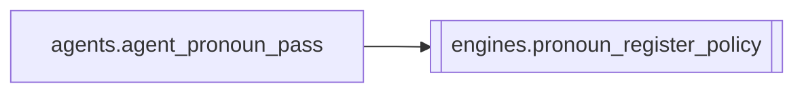

# `engines.pronoun_register_policy`

[← Index](../generated/module-index.md) · [Brain home](../README.md)

<!-- AUTO:START — sinh bởi scripts/brain_build.py 2026-11-11 13:00. Đừng sửa tay khối này. -->
**File:** `engines/pronoun_register_policy.py` · **Lớp:** `translate` · **243 dòng** (208 code) · **8 hàm**, **1 class** · sha1 `1c044b773e`

> Policy xưng hô tổng quát cho mix #1+#3 — không gắn 1 job/phim. Mục tiêu: - Phát hiện cửa sổ CÓ DANH XƯNG BẬC (title hierarchy) + ngôi 2 thân mật «cậu»

### Phụ thuộc

- **Gọi tới (import nội bộ):** —
- **Được dùng bởi:** [agents.agent_pronoun_pass](./agents.agent_pronoun_pass.md)
- **Test:** ❌ chưa có test import trực tiếp

### Hàm & class top-level

| Tên | Dòng | Dài | Tham số | Docstring |
|---|---:|---:|---|---|
| **class `RegisterPlan`** | 45 | 1 method | | Kế hoạch ngôi cho 1 job (suy từ style_lock, không từ job id). |
| `detect_mode` | 68 | 31 | `plan` |  |
| `build_register_plan` | 101 | 7 | `plan` |  |
| `window_has_title` | 110 | 3 | `texts` |  |
| `cue_has_intimate_2nd` | 115 | 2 | `vi` |  |
| `scan_title_intimate_issues` | 119 | 37 | `rows, window, existing_ids` | Thêm issue khi cue có «cậu» và cửa sổ ±window có title bậc. |
| `mechanical_cau_to_formal` | 158 | 17 | `vi, preferred` | Fallback máy: cậu → preferred; Các cậu → Các preferred / Các vị. |
| `normalize_ong_nguoi_in_title_window` | 177 | 35 | `rows, changed_ids, preferred, window` | Sau LLM: nếu cue vừa sửa còn ông+ngươi loạn quanh title → ép preferred. |
| `enforce_remaining_cau` | 214 | 30 | `rows, preferred, window` | Sau cùng: còn cậu trong title window → máy đổi (không chờ LLM). |

### Lịch sử (từ docs/)

- Fix logs: —
- Nhắc trong CHANGELOG: **0** lần · DECISIONS: **0** lần

<!-- AUTO:END -->

<!-- MANUAL:START -->
## Vai trò (viết tay)

_Chưa viết. 2–4 câu: module này chịu trách nhiệm gì trong pipeline, ai gọi nó, nó KHÔNG làm gì._

## Luồng chính

_Các hàm vào (entry) → bước chính → output/side effect. Ghi tên hàm thật._

## Bất biến & hợp đồng

_Điều luôn phải đúng (vd: chỉ ghi manifest qua `Manifest.update`; 1 job / ghế). Vi phạm = bug._

## Bẫy đã biết

_Lỗi từng gặp + link `docs/fixes/...`. Những chỗ dễ sửa sai._

## Ghi chú vận hành

_Config key quan trọng, cần restart gì khi sửa (:8801 / :8802 / hot-reload), cách test._
<!-- MANUAL:END -->
