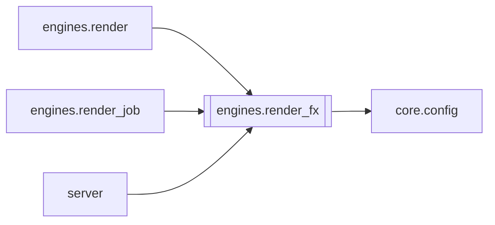

# `engines.render_fx`

[← Index](../generated/module-index.md) · [Brain home](../README.md)

<!-- AUTO:START — sinh bởi scripts/brain_build.py 2026-11-11 13:00. Đừng sửa tay khối này. -->
**File:** `engines/render_fx.py` · **Lớp:** `render` · **564 dòng** (477 code) · **32 hàm**, **0 class** · sha1 `1ec3767563`

> Helpers: uniqueness filters + library BGM paths (copyright-safe audio).

### Phụ thuộc

- **Gọi tới (import nội bộ):** [core.config](./core.config.md)
- **Được dùng bởi:** [engines.render](./engines.render.md), [engines.render_job](./engines.render_job.md), [server](./server.md)
- **Test:** `tests/test_job_opts.py`, `tests/v5/test_layout_paths.py`
- **Thư viện ngoài:** `PIL`

### Hàm & class top-level

| Tên | Dòng | Dài | Tham số | Docstring |
|---|---:|---:|---|---|
| `_esc_movie` | 21 | 4 | `path` | Escape path for ffmpeg movie= / lut3d= file=. |
| `resolve_lut_file` | 27 | 12 | `` |  |
| `resolve_grain_file` | 41 | 7 | `` |  |
| `list_bgm_files` | 50 | 11 | `` |  |
| `pick_bgm` | 63 | 10 | `job_key` |  |
| `default_audio_mode` | 75 | 3 | `` | voice_bgm nếu có thư viện BGM; không thì voice_only (không nhạc gốc). |
| `clamp_zoom` | 80 | 16 | `zoom` |  |
| `normalize_grain` | 98 | 9 | `level` |  |
| `_eq_fallback` | 109 | 5 | `` |  |
| `build_motion_zoompan` | 116 | 17 | `W, H, zoom, fps` | Ken Burns nhẹ + Drift: scale cố định theo zoom + crop sin(t). |
| `build_static_zoom` | 135 | 5 | `W, H, zoom` |  |
| `lut3d_filter_arg` | 142 | 19 | `lut, work_dir` | Đường dẫn LUT an toàn cho filtergraph Windows. |
| `_read_cube` | 163 | 15 | `path` |  |
| `separable_lutrgb` | 180 | 35 | `lut, tol` | LUT 3D mà mỗi kênh ra chỉ phụ thuộc kênh vào cùng tên → lutrgb 1D tương đương. |
| `append_lut_filters` | 217 | 15 | `parts, enabled, work_dir` | Thêm LUT hoặc eq. Trả nhãn dùng thực tế. |
| `grain_noise_alls` | 234 | 7 | `level` |  |
| `append_inline_noise_grain` | 243 | 10 | `parts, level` | Film grain qua noise= (ổn định). PNG trong assets dùng khi blend input riêng. |
| `grain_blend_fragment` | 255 | 4 | `vlabel, out_label, level, W, H` | PNG blend tắt mặc định (movie loop dễ treo). Giữ API cho phase sau. |
| `bgm_volume` | 261 | 5 | `` |  |
| `dub_volume` | 268 | 7 | `` | Âm lượng giọng Việt khi mix (VieNeu đã chuẩn hoá ~0.9 → boost vừa phải 1.25 tránh vỡ tiếng). |
| `list_frame_files` | 277 | 33 | `` | PNG/WebP khung trong assets/overlays/frames (+ overlays gốc). |
| `pick_frame` | 312 | 28 | `choice, job_key` | choice: off / auto / tên file / đường dẫn. |
| `prepare_frame_file` | 342 | 16 | `frame, work_dir` | Copy khung vào job → basename cho movie= (cwd=work_dir). |
| `brand_text_value` | 360 | 5 | `override` |  |
| `normalize_brand_mode` | 367 | 21 | `mode, enabled` | off / drift / corners / drift_seed. |
| `brand_enabled` | 390 | 5 | `flag` |  |
| `brand_xy_expr` | 397 | 31 | `mode, job_key` | Biểu thức ffmpeg x/y cho chữ/logo brand. |
| `list_brand_logo_files` | 430 | 30 | `` |  |
| `pick_brand_logo` | 462 | 23 | `choice, job_key` |  |
| `prepare_brand_logo` | 487 | 14 | `logo, work_dir` |  |
| `brand_drawtext_filter` | 503 | 22 | `text, H, fontfile, x_expr, y_expr` | Chữ kênh với x/y expression đã chọn. |
| `apply_brand_overlay` | 527 | 38 | `body, W, H, fontfile, work_dir, mode, enabled, text, logo, job_key` | Ghép brand (chữ ± logo) vào filter chain. Trả (body, meta). |

### Config / env keys (16)

`RENDER_BGM_FILE`, `RENDER_BGM_VOL`, `RENDER_BRAND`, `RENDER_BRAND_LOGO`, `RENDER_BRAND_LOGO_FILE`, `RENDER_BRAND_MODE`, `RENDER_BRAND_OPACITY`, `RENDER_BRAND_TEXT`, `RENDER_DUB_VOL`, `RENDER_EQ_BRIGHTNESS`, `RENDER_EQ_CONTRAST`, `RENDER_EQ_SATURATION`, `RENDER_FRAME`, `RENDER_FRAME_FILE`, `RENDER_GRAIN_FILE`, `RENDER_LUT_FILE`

**Tín hiệu rủi ro (đếm tĩnh):** file_writes=3

### Lịch sử (từ docs/)

- Fix logs: —
- Nhắc trong CHANGELOG: **0** lần · DECISIONS: **0** lần

<!-- AUTO:END -->

<!-- MANUAL:START -->
## Vai trò (viết tay)

_Chưa viết. 2–4 câu: module này chịu trách nhiệm gì trong pipeline, ai gọi nó, nó KHÔNG làm gì._

## Luồng chính

_Các hàm vào (entry) → bước chính → output/side effect. Ghi tên hàm thật._

## Bất biến & hợp đồng

_Điều luôn phải đúng (vd: chỉ ghi manifest qua `Manifest.update`; 1 job / ghế). Vi phạm = bug._

## Bẫy đã biết

_Lỗi từng gặp + link `docs/fixes/...`. Những chỗ dễ sửa sai._

## Ghi chú vận hành

_Config key quan trọng, cần restart gì khi sửa (:8801 / :8802 / hot-reload), cách test._
<!-- MANUAL:END -->
