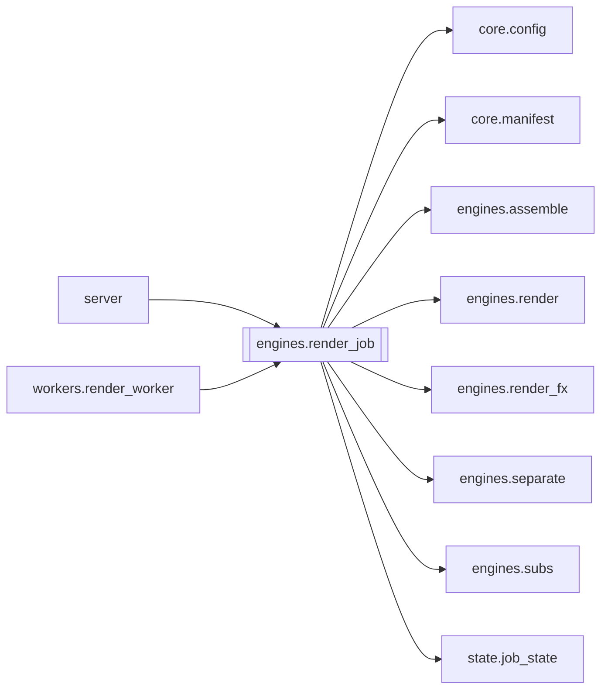

# `engines.render_job`

[← Index](../generated/module-index.md) · [Brain home](../README.md)

<!-- AUTO:START — sinh bởi scripts/brain_build.py 2026-11-11 13:00. Đừng sửa tay khối này. -->
**File:** `engines/render_job.py` · **Lớp:** `render` · **186 dòng** (156 code) · **3 hàm**, **0 class** · sha1 `3434eed009`

> engines/render_job.py — Điều phối render 1 job (assemble nếu cần → run_render) — V6 F5. Trước đây là thân `server._do_render` (V5), chạy TRONG tiến trình server và `importlib.reload` core.config / engines.subs / engines.

### Phụ thuộc

- **Gọi tới (import nội bộ):** [core.config](./core.config.md), [core.manifest](./core.manifest.md), [engines.assemble](./engines.assemble.md), [engines.render](./engines.render.md), [engines.render_fx](./engines.render_fx.md), [engines.separate](./engines.separate.md), [engines.subs](./engines.subs.md), [state.job_state](./state.job_state.md)
- **Được dùng bởi:** [server](./server.md), [workers.render_worker](./workers.render_worker.md)
- **Test:** `tests/test_f5_render_job.py`
- **Thư viện ngoài:** `state`

### Hàm & class top-level

| Tên | Dòng | Dài | Tham số | Docstring |
|---|---:|---:|---|---|
| `_phase` | 28 | 6 | `work_dir, **fields` | Cập nhật vài khoá stage mux; lỗi ghi không chặn render (như try/except cũ). |
| `_load_modules` | 36 | 13 | `hot_reload` | Trả (assemble_mod, render_mod). hot_reload=True: reload như V5 (đường in-process cũ). |
| `do_render` | 51 | 136 ⚠️ | `work_dir, force, audio_mode, voice_vol, orig_vol, add_sub, fit, res…` | Ghép giọng (assemble nếu chưa) rồi render video localize (che+sub+trộn nền). |

**Hàm dài ≥120 dòng:** `do_render` (136, L51)

**File/artifact nhắc tới:** `dub_fit.wav`, `dub_tts.wav`, `no_vocals.wav`, `output.mp4`, `tts.json`

**Tín hiệu rủi ro (đếm tĩnh):** broad_except=6 · swallow_except=4

### Lịch sử (từ docs/)

- **Fix logs (1):**
  - [2026-11-11 — F4 (services + sidecar thuần) + F5 (render tiến trình con)](../../fixes/2026-11-11-f4-f5.md)
- **Reviews:** [2026-11-11-review-f4-f5](../../reviews/2026-11-11-review-f4-f5.md)
- Nhắc trong CHANGELOG: **0** lần · DECISIONS: **0** lần

<!-- AUTO:END -->

<!-- MANUAL:START -->
## Vai trò (viết tay)

_Chưa viết. 2–4 câu: module này chịu trách nhiệm gì trong pipeline, ai gọi nó, nó KHÔNG làm gì._

## Luồng chính

_Các hàm vào (entry) → bước chính → output/side effect. Ghi tên hàm thật._

## Bất biến & hợp đồng

_Điều luôn phải đúng (vd: chỉ ghi manifest qua `Manifest.update`; 1 job / ghế). Vi phạm = bug._

## Bẫy đã biết

_Lỗi từng gặp + link `docs/fixes/...`. Những chỗ dễ sửa sai._

## Ghi chú vận hành

_Config key quan trọng, cần restart gì khi sửa (:8801 / :8802 / hot-reload), cách test._
<!-- MANUAL:END -->
