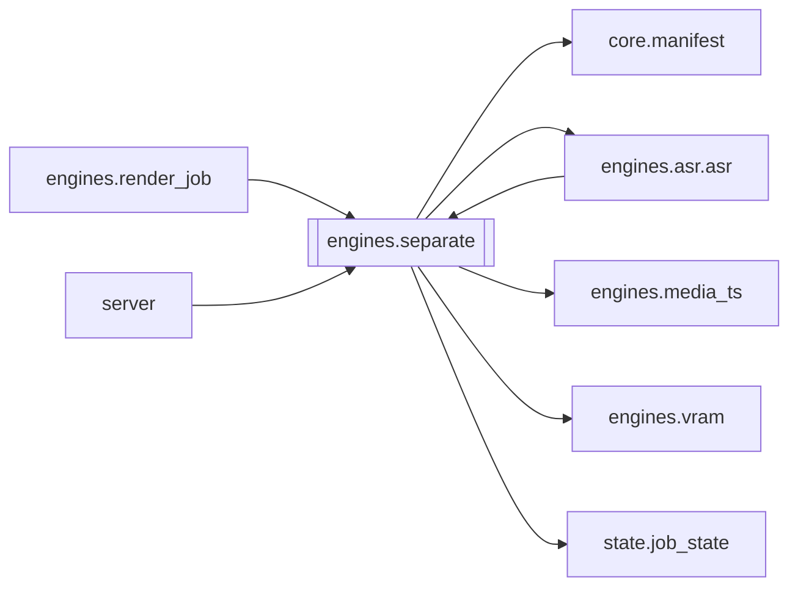

# `engines.separate`

[← Index](../generated/module-index.md) · [Brain home](../README.md)

<!-- AUTO:START — sinh bởi scripts/brain_build.py 2026-11-11 13:00. Đừng sửa tay khối này. -->
**File:** `engines/separate.py` · **Lớp:** `asr` · **376 dòng** (324 code) · **8 hàm**, **0 class** · sha1 `4e06c50bfd`

> separate.py — STAGE 6 (Tách nền): dùng Demucs bỏ GIỌNG NÓI (tiếng Trung) khỏi audio gốc, GIỮ lại nhạc nền + tiếng động. Bước render sẽ trộn nền này với giọng Việt (F5) -> không còn tiếng Trung lọt qua (hơn hẳn ducking).

### Phụ thuộc

- **Gọi tới (import nội bộ):** [core.manifest](./core.manifest.md), [engines.asr.asr](./engines.asr.asr.md), [engines.media_ts](./engines.media_ts.md), [engines.vram](./engines.vram.md), [state.job_state](./state.job_state.md)
- **Được dùng bởi:** [engines.asr.asr](./engines.asr.asr.md), [engines.render_job](./engines.render_job.md), [server](./server.md)
- **Được nhắc tên file `.py` (subprocess/script) bởi:** [restart_server](./restart_server.md)
- **Test:** `tests/v5/test_layout_paths.py`
- **Thư viện ngoài:** `state`

### Hàm & class top-level

| Tên | Dòng | Dài | Tham số | Docstring |
|---|---:|---:|---|---|
| `_find_video` | 45 | 9 | `work_dir` |  |
| `_probe_duration` | 56 | 11 | `path` | Lấy thời lượng file media (giây) qua ffprobe. |
| `_update_sep_progress` | 69 | 17 | `m, pct, cur_text` | Cập nhật tiến độ vào stage 'separate' VÀ đồng bộ sang stage 'asr' nếu ASR đang chờ tách giọng. |
| `_extract_audio` | 88 | 16 | `video, out_audio` | Tách audio GỐC chất lượng cao (stereo 44.1k) — khác audio.wav 16k mono của ASR. |
| `_run_demucs_on_file` | 106 | 68 | `src_audio, tmp_out, device, work_dir, m, chunk_idx, n_chunks` | Chạy Demucs trên 1 file audio (ngắn hoặc 1 chunk) và trả về (no_vocals_wav, vocals_wav). |
| `_concat_wav_chunks` | 176 | 22 | `chunk_files, out_wav, work_dir` | Ghép các chunk WAV thành 1 file WAV hoàn chỉnh (dùng -rf64 auto để hỗ trợ >4GB cho phim dài). |
| `run_separate` | 200 | 164 ⚠️ | `work_dir, device, force` |  |
| `main` | 366 | 7 | `argv` |  |

**Hàm dài ≥120 dòng:** `run_separate` (164, L200)

### Config / env keys (2)

`DEMUCS_CHUNK_SEC`, `DEMUCS_LONG_THRESHOLD_SEC`

**File/artifact nhắc tới:** `.partial.wav`, `audio.wav`, `chunks_meta.json`, `no_vocals.wav`, `orig_audio.wav`, `vocals.wav`

**Tín hiệu rủi ro (đếm tĩnh):** broad_except=5 · file_writes=2 · subprocess=5 · swallow_except=2

### Lịch sử (từ docs/)

- Fix logs: —
- Nhắc trong CHANGELOG: **0** lần · DECISIONS: **0** lần

<!-- AUTO:END -->

<!-- MANUAL:START -->
## Vai trò (viết tay)

_Chưa viết. 2–4 câu: module này chịu trách nhiệm gì trong pipeline, ai gọi nó, nó KHÔNG làm gì._

## Luồng chính

_Các hàm vào (entry) → bước chính → output/side effect. Ghi tên hàm thật._

## Bất biến & hợp đồng

_Điều luôn phải đúng (vd: chỉ ghi manifest qua `Manifest.update`; 1 job / ghế). Vi phạm = bug._

## Bẫy đã biết

_Lỗi từng gặp + link `docs/fixes/...`. Những chỗ dễ sửa sai._

## Ghi chú vận hành

_Config key quan trọng, cần restart gì khi sửa (:8801 / :8802 / hot-reload), cách test._
<!-- MANUAL:END -->
