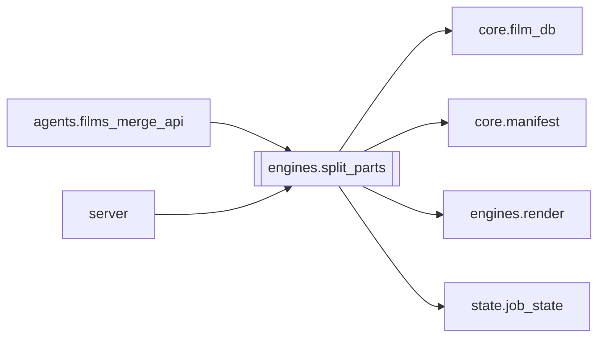

# `engines.split_parts`

[← Index](../generated/module-index.md) · [Brain home](../README.md)

<!-- AUTO:START — sinh bởi scripts/brain_build.py 2026-11-11 13:00. Đừng sửa tay khối này. -->
**File:** `engines/split_parts.py` · **Lớp:** `render` · **834 dòng** (699 code) · **17 hàm**, **1 class** · sha1 `91ebacd910`

> split_parts.py — Tự động tính toán và chia video dài (3h-12h+) thành các Part 2-2.5h để chạy ASR/TTS/Render độc lập chống lệch time, sau đó ghép concat lại thành bản Full.

### Phụ thuộc

- **Gọi tới (import nội bộ):** [core.film_db](./core.film_db.md), [core.manifest](./core.manifest.md), [engines.render](./engines.render.md), [state.job_state](./state.job_state.md)
- **Được dùng bởi:** [agents.films_merge_api](./agents.films_merge_api.md), [server](./server.md)
- **Được nhắc tên file `.py` (subprocess/script) bởi:** [restart_server](./restart_server.md)
- **Test:** `tests/v5/test_split_enospc_guard.py`
- **Thư viện ngoài:** `state`

### Hàm & class top-level

| Tên | Dòng | Dài | Tham số | Docstring |
|---|---:|---:|---|---|
| **class `DiskFullError`** | 38 | 0 method | | Ổ đầy — dừng split, không fallback re-encode. |
| `_is_disk_full_text` | 42 | 3 | `*chunks` |  |
| `free_bytes` | 47 | 7 | `path` | Dung lượng trống trên volume chứa `path` (tạo parent nếu chưa có). |
| `estimate_split_need_bytes` | 56 | 4 | `video_path` | Ước lượng chỗ cần cho split copy-mode (= gần bằng size nguồn + margin). |
| `assert_enough_space_for_split` | 62 | 8 | `video_path, out_dir` |  |
| `cleanup_split_parts_dir` | 72 | 10 | `parts_dir` | Xoá thư mục `_split_parts` dở (orphan GB sau fail / ENOSPC). |
| `_unlink_quiet` | 84 | 6 | `path` |  |
| `probe_duration` | 92 | 14 | `video_path` | Lấy thời lượng video tính bằng giây. |
| `calculate_part_plan` | 108 | 19 | `total_sec, target_hours` | Tính toán danh sách (start_sec, end_sec) cho từng part. |
| `find_best_cut_point` | 129 | 39 | `video_path, target_cut_sec, search_radius_sec` | Tìm điểm khoảng lặng (silence) gần nhất với target_cut_sec trong phạm vi ±search_radius_sec. |
| `compute_smart_plan` | 170 | 40 | `video_path, target_hours` | Tính plan hoàn chỉnh có điểm cắt thông minh (tránh đứt câu thoại). |
| `split_video_to_parts` | 212 | 135 ⚠️ | `video_path, out_dir, target_hours, prefix` | Cắt video thành các part theo smart plan (lossless copy). |
| `_hardlink_alias` | 349 | 28 | `primary, alias` | Tạo alias cùng inode với primary. Không bao giờ copy2 (tránh nhân đôi GB). |
| `merge_parts_to_full` | 379 | 37 | `part_videos, out_full_mp4` | Nối danh sách các part đã render hoàn chỉnh thành 1 file full (lossless copy 30s). |
| `split_job_to_subjobs` | 418 | 176 ⚠️ | `job_id, target_hours, work_root` | Tự động chia một job video dài thành các sub-jobs (Part 1, Part 2...). |
| `merge_job_parts` | 596 | 104 | `job_id, work_root` | Kiểm tra các sub-job của job_id, nếu tất cả đã render xong thì ghép thành output_full.mp4. |
| `merge_subjob_asr_to_parent` | 702 | 103 | `job_id, work_root` | Gộp kết quả ASR (asr.json và sub.zh.srt) của các sub-job về job cha. |
| `main` | 807 | 24 | `` |  |

**Hàm dài ≥120 dòng:** `split_job_to_subjobs` (176, L418), `split_video_to_parts` (135, L212)

**File/artifact nhắc tới:** `asr.json`, `output.mp4`, `output_full.mp4`, `split_manifest.json`, `sub.zh.srt`, `tts_config.json`

**Tín hiệu rủi ro (đếm tĩnh):** broad_except=8 · file_writes=4 · subprocess=5

### Lịch sử (từ docs/)

- Fix logs: —
- Nhắc trong CHANGELOG: **0** lần · DECISIONS: **0** lần

<!-- AUTO:END -->

<!-- MANUAL:START -->
## Vai trò (viết tay)

_Chưa viết. 2–4 câu: module này chịu trách nhiệm gì trong pipeline, ai gọi nó, nó KHÔNG làm gì._

## Luồng chính

_Các hàm vào (entry) → bước chính → output/side effect. Ghi tên hàm thật._

## Bất biến & hợp đồng

_Điều luôn phải đúng (vd: chỉ ghi manifest qua `Manifest.update`; 1 job / ghế). Vi phạm = bug._

## Bẫy đã biết

_Lỗi từng gặp + link `docs/fixes/...`. Những chỗ dễ sửa sai._

## Ghi chú vận hành

_Config key quan trọng, cần restart gì khi sửa (:8801 / :8802 / hot-reload), cách test._
<!-- MANUAL:END -->
