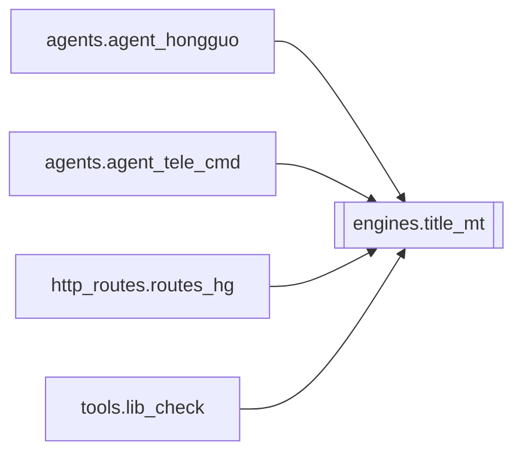

# `engines.title_mt`

[← Index](../generated/module-index.md) · [Brain home](../README.md)

<!-- AUTO:START — sinh bởi scripts/brain_build.py 2026-11-11 13:00. Đừng sửa tay khối này. -->
**File:** `engines/title_mt.py` · **Lớp:** `translate` · **172 dòng** (151 code) · **6 hàm**, **0 class** · sha1 `fc308867de`

> Dịch thô tiêu đề Trung → Việt (Google gtx, không cần API key). Chỉ để duyệt Hongguo cho biết nội dung — không phải bản dịch kênh. Cache theo series_id + theo chuỗi title gốc.

### Phụ thuộc

- **Gọi tới (import nội bộ):** —
- **Được dùng bởi:** [agents.agent_hongguo](./agents.agent_hongguo.md), [agents.agent_tele_cmd](./agents.agent_tele_cmd.md), [http_routes.routes_hg](./http_routes.routes_hg.md), [tools.lib_check](./tools.lib_check.md)
- **Test:** ❌ chưa có test import trực tiếp

### Hàm & class top-level

| Tên | Dòng | Dài | Tham số | Docstring |
|---|---:|---:|---|---|
| `_has_cjk` | 30 | 2 | `s` |  |
| `_load_cache` | 34 | 15 | `` |  |
| `_save_cache` | 51 | 11 | `` |  |
| `_gtx` | 64 | 21 | `text, sl, tl, timeout` |  |
| `translate_one` | 87 | 14 | `title` | Dịch 1 title; không CJK → trả nguyên. |
| `translate_titles` | 103 | 70 | `items, workers` | Dịch list {series_id?, title} → gắn title_vi. Dùng cache. |

**File/artifact nhắc tới:** `_hg_title_cache.json`

**Tín hiệu rủi ro (đếm tĩnh):** broad_except=4 · file_writes=1 · global_stmt=1 · pools=1 · swallow_except=1

### Lịch sử (từ docs/)

- Fix logs: —
- Nhắc trong CHANGELOG: **0** lần · DECISIONS: **0** lần

<!-- AUTO:END -->

<!-- MANUAL:START -->
## Vai trò (viết tay)

_Chưa viết. 2–4 câu: module này chịu trách nhiệm gì trong pipeline, ai gọi nó, nó KHÔNG làm gì._

## Luồng chính

_Các hàm vào (entry) → bước chính → output/side effect. Ghi tên hàm thật._

## Bất biến & hợp đồng

_Điều luôn phải đúng (vd: chỉ ghi manifest qua `Manifest.update`; 1 job / ghế). Vi phạm = bug._

## Bẫy đã biết

_Lỗi từng gặp + link `docs/fixes/...`. Những chỗ dễ sửa sai._

## Ghi chú vận hành

_Config key quan trọng, cần restart gì khi sửa (:8801 / :8802 / hot-reload), cách test._
<!-- MANUAL:END -->
