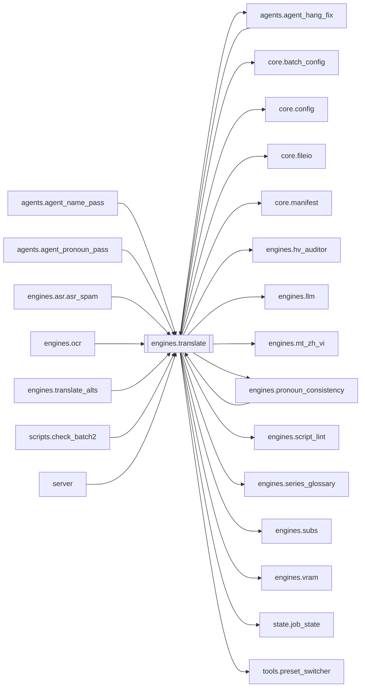

# `engines.translate`

[← Index](../generated/module-index.md) · [Brain home](../README.md)

<!-- AUTO:START — sinh bởi scripts/brain_build.py 2026-11-11 13:00. Đừng sửa tay khối này. -->
**File:** `engines/translate.py` · **Lớp:** `translate` · **4131 dòng** (3699 code) · **74 hàm**, **0 class** · sha1 `ecb2541e22`

> translate.py — STAGE dịch: "lập phương án" (hồ sơ nhân vật + XƯNG HÔ) rồi dịch CÓ NGỮ CẢNH, khớp độ dài. Nâng cấp so với bản cũ:

### Phụ thuộc

- **Gọi tới (import nội bộ):** [agents.agent_hang_fix](./agents.agent_hang_fix.md), [core.batch_config](./core.batch_config.md), [core.config](./core.config.md), [core.fileio](./core.fileio.md), [core.manifest](./core.manifest.md), [engines.hv_auditor](./engines.hv_auditor.md), [engines.llm](./engines.llm.md), [engines.mt_zh_vi](./engines.mt_zh_vi.md), [engines.pronoun_consistency](./engines.pronoun_consistency.md), [engines.script_lint](./engines.script_lint.md), [engines.series_glossary](./engines.series_glossary.md), [engines.subs](./engines.subs.md), [engines.vram](./engines.vram.md), [state.job_state](./state.job_state.md), [tools.preset_switcher](./tools.preset_switcher.md)
- **Được dùng bởi:** [agents.agent_hang_fix](./agents.agent_hang_fix.md), [agents.agent_name_pass](./agents.agent_name_pass.md), [agents.agent_pronoun_pass](./agents.agent_pronoun_pass.md), [engines.asr.asr_spam](./engines.asr.asr_spam.md), [engines.ocr](./engines.ocr.md), [engines.pronoun_consistency](./engines.pronoun_consistency.md), [engines.translate_alts](./engines.translate_alts.md), [scripts.check_batch2](./scripts.check_batch2.md), [server](./server.md)
- **Được nhắc tên file `.py` (subprocess/script) bởi:** [restart_server](./restart_server.md), [scripts.check_batch2](./scripts.check_batch2.md), [server](./server.md)
- **Test:** `tests/v5/test_layout_paths.py`, `tests/v5/test_optimize_b5_b6.py`, `tests/v5/test_pronoun_postpass.py`, `tests/v5/test_pronoun_qa_slim_plan.py`, `tests/v5/test_review_fail_not_rv.py`, `tests/v5/test_review_parallel_workers.py`, `tests/v5/test_review_pass1_upload.py`
- **Thư viện ngoài:** `context_studio`, `state`

### Hàm & class top-level

| Tên | Dòng | Dài | Tham số | Docstring |
|---|---:|---:|---|---|
| `_tmodel` | 67 | 3 | `` | TRANSLATE_MODEL đọc lúc gọi (server import module 1 lần — MODEL ở trên bị đóng băng). |
| `_rmodel` | 72 | 2 | `` |  |
| `_resolve_review_model` | 76 | 24 | `work_dir, model` | REVIEW model thật: arg → (queue_opts backup Aurora) → REVIEW_MODEL. |
| `_is_llama_local_model` | 102 | 9 | `m` |  |
| `_review_parallel_workers` | 113 | 36 | `work_dir, rmodel` | Số worker fan-out REVIEW. Local LLM = 1; aurora_parallel / REVIEW_PARALLEL>1 → N. |
| `_review_chunk_with_fallback` | 151 | 60 | `chunk_exp, chunk, plan_block, prev_ctx, target, rmodel, plan, exemp…` | Chạy 1 lô review_batch; cloud lỗi quota/timeout → fallback local 1 lần. |
| `_meaning_rules` | 218 | 62 | `` | Quy tắc chống dịch đen / lệch ngữ cảnh (lồng tiếng phim). |
| `_style_rules` | 282 | 33 | `` | Quy tắc Manhua / short-drama: cứng Hán Việt + mềm hiện đại + xưng hô. |
| `_character_rules` | 317 | 13 | `` | Chống nhầm nhân vật / sai giới tính khi dịch thoại. |
| `_is_ancient_fantasy_genre` | 339 | 22 | `plan` | True khi phương án/genre thuộc tu tiên·cổ trang·wuxia·xianxia (không mixed đô thị). |
| `_is_mixed_genre` | 363 | 12 | `plan` |  |
| `_mixed_address_rules` | 377 | 19 | `` | Đô thị dị năng + võ/KH: xưng hô hiện đại + cổ phong Hán Việt. |
| `_ancient_address_rules` | 398 | 19 | `` | Chỉ inject khi genre tu tiên/cổ — không áp cho đô thị hiện đại. |
| `_translate_rules` | 419 | 8 | `plan` | Gộp nghĩa + văn phong + nhân vật (+ xưng hô theo genre). |
| `_ocr_name_hints` | 428 | 25 | `work_dir` | Tên/chữ trên hình từ ocr.json (nếu có) — gợi ý cho PLAN. |
| `_resolve_translate_mode` | 455 | 26 | `mode, model, n_todo` | Trả 'oneshot' / 'batch'. |
| `_has_cjk` | 483 | 3 | `text` | Còn ký tự Hán trong bản dịch = model dịch sót/hỏng (đặc biệt model nhỏ local). |
| `_salvage_mixed_vi` | 511 | 45 | `vi, zh, plan` | Cứu VI lẫn Hán (vd «Đạt được 100% 增幅.») — không thì trả '' để vá lại. |
| `_plan_mode` | 558 | 3 | `` | file = upload full ZH SRT (Aurora); sample = mẫu cũ (head/mid/tail). |
| `_plan_json_schema` | 563 | 24 | `target` |  |
| `_plan_seed_blocks` | 589 | 52 | `name_hints, series_plan, soft_ocr` | OCR = seed mềm (có thể sai). Series characters = kế thừa mạnh. |
| `_normalize_plan_data` | 643 | 27 | `data` |  |
| `_remap_scenes_cue_to_i` | 672 | 33 | `plan, cue_to_i` | Nếu GPT trả range theo số thứ tự cue SRT (1..N) → map về segment i. |
| `_build_plan_from_file` | 707 | 86 | `work_dir, segments, target, model, name_hints, series_plan` | Upload full ZH SRT → GPT đọc file (Aurora) → glossary. OCR chỉ seed mềm. |
| `_build_plan_sample` | 795 | 80 | `segments, target, model, name_hints, series_plan` | Fallback: mẫu head/mid/tail (plan cũ). |
| `build_plan` | 877 | 39 | `segments, target, model, name_hints, series_plan, work_dir` | Lập glossary: mặc định upload full ZH SRT (PLAN_MODE=file); fallback sample. |
| `_plan_block` | 918 | 110 | `p` | Đổ plan ra text nhét vào mọi prompt dịch. CHỐNG LỖI: model đôi khi trả |
| `_plan_block_for_qa` | 1030 | 72 | `p` | Plan block gọn cho pronoun-QA / GPT vá đỏ — chỉ genre+style+pronouns. |
| `_resolve_scene_context` | 1104 | 62 | `plan, rows` | Xác định phân cảnh hiện tại của lô câu thoại (Scene-based context injection). |
| `_norm_zh_cue` | 1205 | 6 | `zh` | Chuẩn hóa cue ZH để khớp lock (bỏ dấu câu/space). |
| `ensure_hard_terms` | 1213 | 81 | `plan` | Gắn seed chengyu/taunt vào glossary.terms (không đè bản tay đã có). |
| `hard_term_lock_map` | 1296 | 30 | `plan` | zh_norm → vi bắt buộc — CHỈ type=lock (+ seed lock). Chengyu/idiom = mềm trong prompt. |
| `apply_hard_term_locks` | 1328 | 39 | `rows, plan` | Post-pass: cue ZH khớp lock → ghi đè VI (chuẩn, không phụ thuộc LLM). |
| `normalize_vi_thousands` | 1375 | 14 | `text` | Dấu nghìn chuẩn Việt: 31 000 / 31,000 → 31.000. |
| `heal_obvious_internal_stutter` | 1391 | 46 | `text` | Gỡ một nhịp lặp ASR rõ ràng, không diễn giải hay viết lại câu. |
| `apply_asr_stutter_heal` | 1439 | 18 | `rows` | Heal only deterministic internal ASR repeats; preserve manual rows. |
| `apply_halfcue_dangling_heal` | 1459 | 33 | `rows` | Gỡ đuôi treo VI khi ASR cắt ý sang cue sau (之前。 / trước đó.). |
| `apply_style_polish` | 1494 | 282 ⚠️ | `rows, plan` | Post-pass deterministic: sửa calque / văn mẫu thường gặp (mixed short-drama). |
| `_is_modernish_genre` | 1778 | 28 | `plan` | Chỉ đô thị THUẦN — không ép detox khi mixed (phim có thể sang tu tiên). |
| `_char_aliases` | 1808 | 16 | `plan` | vi_name_lower → {zh, vi, aliases…} để khớp tên trong câu. |
| `_pronoun_pairs` | 1826 | 14 | `plan` |  |
| `_detox_modern_pronouns` | 1842 | 24 | `vi, zh` | Ép Ta/Ngươi → Tôi/Cậu cho thoại đô thị (giữ «ông ta/cô ta/chúng ta»). |
| `apply_pronoun_postpass` | 1868 | 64 | `rows, plan` | Post-pass deterministic xưng hô — không phụ thuộc LLM nhớ ma trận. |
| `_salvage_items` | 1934 | 23 | `text` | Vớt từng object {"i":.., "vi":..} kể cả khi JSON TỔNG THỂ hỏng (model |
| `translate_oneshot` | 1959 | 66 | `rows, plan_block, target, model, plan` | Dịch TOÀN BỘ danh sách câu trong 1 lần gọi LLM (llama-server ctx lớn). |
| `translate_batch` | 2027 | 85 | `rows, plan_block, prev_ctx, target, model, plan` | LƯỢT 1 — DỊCH NGHĨA KỊCH BẢN CHUẨN XÁC (Semantic Accuracy) theo Phân Cảnh (Scene) + Series Glossary. Trả {i: vi}. |
| `_translate_safe` | 2114 | 26 | `rows, plan_block, prev_ctx, target, model, plan` | Dịch 1 lô CÓ CHỐNG LỖI: nếu parse hỏng hoặc LLM nuốt câu, CHIA ĐÔI lô rồi thử lại. |
| `_style_voice_banner` | 2142 | 36 | `plan` | Gợi ý văn phong linh hoạt — KHÔNG khóa modern↔cổ (phim có thể đổi cảnh). |
| `_ts_srt` | 2180 | 11 | `sec` |  |
| `write_review_pair_srt` | 2193 | 27 | `work_dir, rows, name` | SRT ZH+VI có tag [i=N] để Pass1 đọc full mạch thoại. |
| `_heuristic_nonsense_flags` | 2222 | 38 | `rows` | Bắt đuôi treo / nửa câu VI rõ (bổ sung Pass1). |
| `_pass1_max_upload_bytes` | 2262 | 9 | `` | Trần 1 file upload Pass1 (mặc định 5MB). Lớn hơn → chia chunk upload full. |
| `_pass1_chunk_cues` | 2273 | 6 | `` | Số cue / chunk khi chia file (đọc full bằng nhiều upload). |
| `_pass1_chat_model` | 2281 | 4 | `use_model` |  |
| `_pass1_merge_chunk_results` | 2287 | 48 | `parts` | Gộp JSON Pass1 từ nhiều chunk file — phủ đủ toàn phim. |
| `_pass1_upload_one_srt` | 2337 | 29 | `srt_path, prompt, use_model, timeout, label` | Upload 1 SRT + hỏi GPT đọc file. Trả dict JSON hoặc {}. |
| `_pass1_upload_full_via_chunks` | 2368 | 43 | `work_dir, rows, prompt, use_model, timeout` | Chia full script thành nhiều SRT → upload từng phần → GPT đọc hết (không chat sample). |
| `run_review_pass1_full_vi` | 2413 | 172 ⚠️ | `work_dir, rows, plan, model` | Pass1: GPT đọc FULL pair SRT qua upload file (không thay bằng chat mẫu). |
| `_style_exemplars` | 2587 | 36 | `plan, rows_pool, limit` | 3–5 câu mẫu giữ giọng (ưu tiên có tên NV glossary). |
| `_review_pronoun_mask_on` | 2634 | 7 | `` |  |
| `_mask_pronouns_vi` | 2643 | 8 | `vi` |  |
| `_unmask_pronouns_vi` | 2653 | 5 | `text, toks` |  |
| `_pronoun_forms` | 2660 | 7 | `vi` |  |
| `review_batch` | 2669 | 157 ⚠️ | `rows, plan_block, prev_ctx, target, model, plan, exemplars_pool` | LƯỢT 2 — BẢN ĐỊA HÓA LỜI THOẠI LỒNG TIẾNG & KHỚP NHỊP PHỤ ĐỀ (Voice Dubbing Localization). |
| `_filter_cosmetic_nmt_fixes` | 2828 | 179 ⚠️ | `fixes, rows, plan` | Chỉ giữ A/C/D/E/F cứng; mặc định GIỮ NMT (bỏ polish GPT). |
| `run_review` | 3010 | 339 ⚠️ | `work_dir, batch, target, model, force` | LƯỢT 2: soát bản dịch nháp (script.json) bằng model chính xác (minimax) rồi |
| `count_script_missing` | 3351 | 10 | `work_dir` | Đếm câu trống trong script.json (nguồn sự thật cho UI / auto-vá). |
| `translate_coverage_gap` | 3363 | 35 | `work_dir` | Số câu ASR chưa có trong script (salvage lúc Dừng hay ghi thiếu). |
| `translate_ready_for_tts` | 3400 | 13 | `work_dir` | True chỉ khi dịch đủ coverage ASR + không còn VI trống. |
| `_trivial_vi` | 3415 | 39 | `zh` | Câu chỉ cười/thán từ — không cần LLM (model hay trả lại chữ Hán → _has_cjk xoá). |
| `_compress_zh_for_llm` | 3456 | 3 | `zh` | Rút chuỗi cười/spam trước khi gửi LLM (tránh timeout / trả Hán). |
| `clean_zh_spam` | 3461 | 35 | `zh, max_rep, max_len` | Rút 哈/呃/嗯/啊 spam + cụm chữ lặp (区域的区域的…) từ ASR. |
| `run_translate` | 3498 | 610 ⚠️ | `work_dir, batch, target, force, model, mode, auto_review` |  |
| `main` | 4110 | 18 | `argv` |  |

**Hàm dài ≥120 dòng:** `run_translate` (610, L3498), `run_review` (339, L3010), `apply_style_polish` (282, L1494), `_filter_cosmetic_nmt_fixes` (179, L2828), `run_review_pass1_full_vi` (172, L2413), `review_batch` (157, L2669)

### Config / env keys (6)

`REVIEW_MODEL`, `TRANSLATE_BATCH`, `TRANSLATE_FILL_ROUNDS`, `TRANSLATE_MODE`, `TRANSLATE_MODEL`, `TRANSLATE_ONESHOT_MAX`

**File/artifact nhắc tới:** `asr.json`, `context_pack.json`, `glossary.json`, `ocr.json`, `review_pass1.json`, `script.display.json`, `script.json`, `style_lock.json`, `sub.review_pair.srt`, `sub.vi.srt`

**Tín hiệu rủi ro (đếm tĩnh):** broad_except=60 · file_writes=4 · pools=1 · sleep=1 · swallow_except=12

### Lịch sử (từ docs/)

- Fix logs: —
- Nhắc trong CHANGELOG: **0** lần · DECISIONS: **0** lần

<!-- AUTO:END -->

<!-- MANUAL:START -->
## Vai trò (viết tay)

_Chưa viết. 2–4 câu: module này chịu trách nhiệm gì trong pipeline, ai gọi nó, nó KHÔNG làm gì._

## Luồng chính

_Các hàm vào (entry) → bước chính → output/side effect. Ghi tên hàm thật._

## Bất biến & hợp đồng

_Điều luôn phải đúng (vd: chỉ ghi manifest qua `Manifest.update`; 1 job / ghế). Vi phạm = bug._

## Bẫy đã biết

_Lỗi từng gặp + link `docs/fixes/...`. Những chỗ dễ sửa sai._

## Ghi chú vận hành

_Config key quan trọng, cần restart gì khi sửa (:8801 / :8802 / hot-reload), cách test._
<!-- MANUAL:END -->
