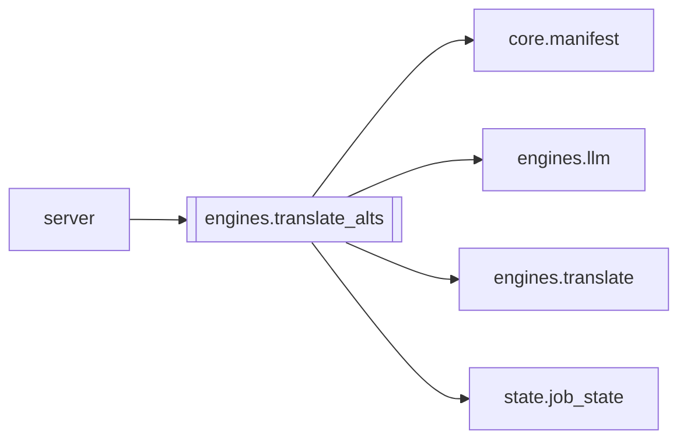

# `engines.translate_alts`

[← Index](../generated/module-index.md) · [Brain home](../README.md)

<!-- AUTO:START — sinh bởi scripts/brain_build.py 2026-11-11 13:00. Đừng sửa tay khối này. -->
**File:** `engines/translate_alts.py` · **Lớp:** `translate` · **383 dòng** (358 code) · **5 hàm**, **0 class** · sha1 `7225234f90`

> Phương án dịch tối ưu — ngữ cảnh + văn phong (trọng tâm Pineline). Quét câu dễ lệch / đa nghĩa → 2–3 bản VI xếp hạng (pick = tối ưu đề xuất). Bám Context Studio pack (genre · style_lock · xưng hô · terms). Chunk + ngữ cả

### Phụ thuộc

- **Gọi tới (import nội bộ):** [core.manifest](./core.manifest.md), [engines.llm](./engines.llm.md), [engines.translate](./engines.translate.md), [state.job_state](./state.job_state.md)
- **Được dùng bởi:** [server](./server.md)
- **Được nhắc tên file `.py` (subprocess/script) bởi:** [restart_server](./restart_server.md)
- **Test:** ❌ chưa có test import trực tiếp
- **Thư viện ngoài:** `state`

### Hàm & class top-level

| Tên | Dòng | Dài | Tham số | Docstring |
|---|---:|---:|---|---|
| `_heuristic_ambiguous` | 41 | 28 | `row` | Trả lý do ngắn nếu câu nên đưa phương án; None = bỏ qua. |
| `_alts_batch` | 71 | 97 | `rows, plan_block, prev_ctx, next_ctx, model, plan` | Trả {i: {alts[], pick, reason}} — tối ưu theo ngữ cảnh + văn phong. |
| `run_ambiguous_alts` | 170 | 139 ⚠️ | `work_dir, batch, model, force, limit, apply_pick` | Quét script → vi_alts.json (phương án tối ưu theo ngữ cảnh + văn phong). |
| `analyze_pack_report` | 311 | 46 | `work_dir` | Checklist pack Context Studio có đủ để dịch chunk không. |
| `main` | 359 | 21 | `argv` |  |

**Hàm dài ≥120 dòng:** `run_ambiguous_alts` (139, L170)

**File/artifact nhắc tới:** `context_pack.json`, `glossary.json`, `script.json`, `vi_alts.json`

**Tín hiệu rủi ro (đếm tĩnh):** broad_except=4 · file_writes=2

### Lịch sử (từ docs/)

- Fix logs: —
- Nhắc trong CHANGELOG: **0** lần · DECISIONS: **0** lần

<!-- AUTO:END -->

<!-- MANUAL:START -->
## Vai trò (viết tay)

_Chưa viết. 2–4 câu: module này chịu trách nhiệm gì trong pipeline, ai gọi nó, nó KHÔNG làm gì._

## Luồng chính

_Các hàm vào (entry) → bước chính → output/side effect. Ghi tên hàm thật._

## Bất biến & hợp đồng

_Điều luôn phải đúng (vd: chỉ ghi manifest qua `Manifest.update`; 1 job / ghế). Vi phạm = bug._

## Bẫy đã biết

_Lỗi từng gặp + link `docs/fixes/...`. Những chỗ dễ sửa sai._

## Ghi chú vận hành

_Config key quan trọng, cần restart gì khi sửa (:8801 / :8802 / hot-reload), cách test._
<!-- MANUAL:END -->
