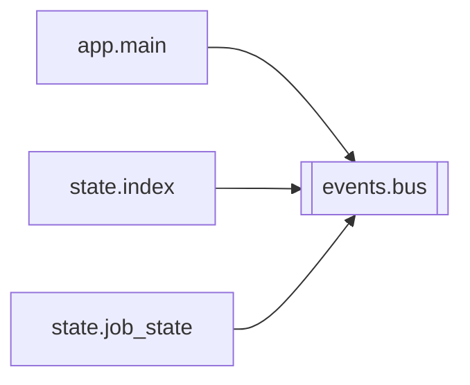

# `events.bus`

[← Index](../generated/module-index.md) · [Brain home](../README.md)

<!-- AUTO:START — sinh bởi scripts/brain_build.py 2026-11-11 13:00. Đừng sửa tay khối này. -->
**File:** `events/bus.py` · **Lớp:** `misc` · **143 dòng** (119 code) · **0 hàm**, **3 class** · sha1 `49b308099a`

> events/bus.py — Bus sự kiện trong tiến trình + luồng SSE cho UI (thay polling 2 s). from events.bus import bus bus.publish("job.updated", {"job_id": jid, ...})

### Phụ thuộc

- **Gọi tới (import nội bộ):** —
- **Được dùng bởi:** [app.main](./app.main.md), [state.index](./state.index.md), [state.job_state](./state.job_state.md)
- **Test:** `tests/test_events_bus.py`, `tests/test_f3_static.py`

### Hàm & class top-level

| Tên | Dòng | Dài | Tham số | Docstring |
|---|---:|---:|---|---|
| **class `Event`** | 24 | 1 method | |  |
| **class `Subscription`** | 35 | 3 method | |  |
| **class `EventBus`** | 61 | 8 method | |  |

### Lịch sử (từ docs/)

- **Fix logs (1):**
  - [2026-11-11 — F0: backend không lên + 1 test lỗi encoding](../../fixes/2026-11-11-f0-startup-encoding.md)
- Nhắc trong CHANGELOG: **0** lần · DECISIONS: **0** lần

<!-- AUTO:END -->

<!-- MANUAL:START -->
## Vai trò (viết tay)

_Chưa viết. 2–4 câu: module này chịu trách nhiệm gì trong pipeline, ai gọi nó, nó KHÔNG làm gì._

## Luồng chính

_Các hàm vào (entry) → bước chính → output/side effect. Ghi tên hàm thật._

## Bất biến & hợp đồng

_Điều luôn phải đúng (vd: chỉ ghi manifest qua `Manifest.update`; 1 job / ghế). Vi phạm = bug._

## Bẫy đã biết

_Lỗi từng gặp + link `docs/fixes/...`. Những chỗ dễ sửa sai._

## Ghi chú vận hành

_Config key quan trọng, cần restart gì khi sửa (:8801 / :8802 / hot-reload), cách test._
<!-- MANUAL:END -->
