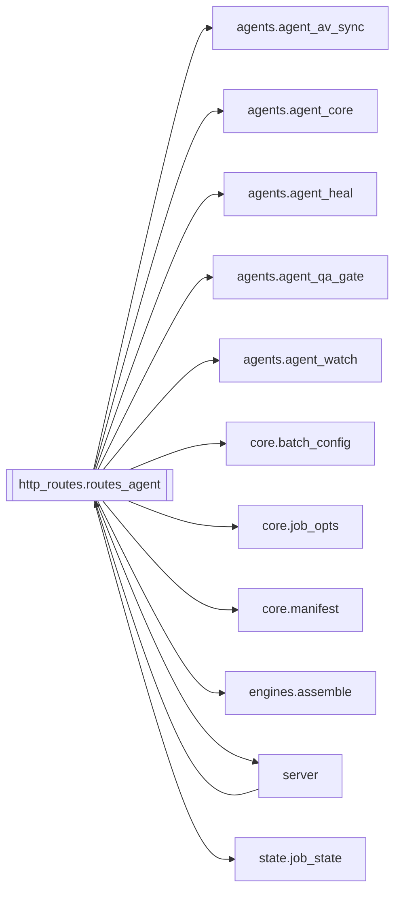

# `http_routes.routes_agent`

[← Index](../generated/module-index.md) · [Brain home](../README.md)

<!-- AUTO:START — sinh bởi scripts/brain_build.py 2026-11-11 13:00. Đừng sửa tay khối này. -->
**File:** `http_routes/routes_agent.py` · **Lớp:** `control` · **644 dòng** (534 code) · **40 hàm**, **5 class** · sha1 `a8ed18d649`

> AI Agent nhúng (agent_core): hook cho Runtime + /api/agent/*. Tách từ server.py (đợt 7). Chỉ được nạp từ cuối server.py (sau khi mọi hàm/model lõi đã định nghĩa): truy cập server qua `S.<tên>` để patch `server.<tên>` tro

### Phụ thuộc

- **Gọi tới (import nội bộ):** [agents.agent_av_sync](./agents.agent_av_sync.md), [agents.agent_core](./agents.agent_core.md), [agents.agent_heal](./agents.agent_heal.md), [agents.agent_qa_gate](./agents.agent_qa_gate.md), [agents.agent_watch](./agents.agent_watch.md), [core.batch_config](./core.batch_config.md), [core.job_opts](./core.job_opts.md), [core.manifest](./core.manifest.md), [engines.assemble](./engines.assemble.md), [server](./server.md), [state.job_state](./state.job_state.md)
- **Được dùng bởi:** [server](./server.md)
- **Được nhắc tên file `.py` (subprocess/script) bởi:** [restart_server](./restart_server.md)
- **Test:** `tests/v5/test_server_split.py`
- **Thư viện ngoài:** `fastapi`, `pydantic`, `state`

### API routes (16)

| Method | Path | Handler | Dòng |
|---|---|---|---:|
| POST | `/api/agent/av-sync/heal-batch` | `api_agent_av_sync_heal_batch` | 632 |
| POST | `/api/agent/av-sync/scan` | `api_agent_av_sync_scan` | 621 |
| POST | `/api/agent/chat` | `api_agent_chat` | 449 |
| POST | `/api/agent/confirm` | `api_agent_confirm` | 481 |
| POST | `/api/agent/heal-failed` | `api_agent_heal_failed` | 512 |
| GET | `/api/agent/jobs/{job_id}/av-sync` | `api_agent_av_sync` | 594 |
| POST | `/api/agent/jobs/{job_id}/av-sync-heal` | `api_agent_av_sync_heal` | 603 |
| POST | `/api/agent/jobs/{job_id}/qa-gate` | `api_agent_qa_gate` | 546 |
| POST | `/api/agent/jobs/{job_id}/reset-state` | `api_agent_reset_state` | 565 |
| GET | `/api/agent/jobs/{job_id}/review-diff` | `api_agent_review_diff` | 537 |
| GET | `/api/agent/pending` | `api_agent_pending` | 476 |
| POST | `/api/agent/resume/{job_id}` | `api_agent_resume` | 307 |
| POST | `/api/agent/review/{job_id}` | `api_agent_review` | 302 |
| GET | `/api/agent/scan-failed` | `api_agent_scan_failed` | 502 |
| GET | `/api/agent/status` | `api_agent_status` | 440 |
| POST | `/api/agent/watch-once` | `api_agent_watch_once` | 575 |

### Hàm & class top-level

| Tên | Dòng | Dài | Tham số | Docstring |
|---|---:|---:|---|---|
| **class `AgentHealBatchReq`** | 490 | 0 method | |  |
| **class `AgentQaGateReq`** | 496 | 0 method | |  |
| **class `AgentResetStateReq`** | 558 | 0 method | |  |
| **class `AgentAvSyncHealReq`** | 589 | 0 method | |  |
| **class `AgentAvSyncScanReq`** | 613 | 0 method | |  |
| `_agent_get_job` | 79 | 5 | `job_id` |  |
| `_agent_queue_add` | 86 | 4 | `job_ids, opts` |  |
| `_agent_edit_line` | 92 | 9 | `job_id, i, vi, zh` |  |
| `_agent_set_hold` | 103 | 25 | `job_id, enabled` |  |
| `_agent_get_hold` | 130 | 6 | `job_id` |  |
| `_agent_run_stage` | 138 | 23 | `job_id, stage, opts` | Chạy 1 stage qua API nội bộ (vd tts sau duyệt). |
| `_agent_stop_job` | 163 | 8 | `job_id` |  |
| `_agent_tts_set_voice` | 173 | 12 | `job_id, opts` |  |
| `_agent_mux_run` | 187 | 17 | `job_id, opts` | Render lại theo đúng opts job đã chạy (queue_opts) ⊕ config batch, chỉ đè key agent truyền. |
| `_agent_asr_set_engine` | 206 | 8 | `job_id, engine` |  |
| `_job_in_pipeline` | 216 | 5 | `job_id` |  |
| `_agent_script_review` | 223 | 45 | `job_id, review_model` | Rà soát tên nhân vật + văn phong trước lồng tiếng. |
| `_agent_resume` | 270 | 29 | `job_id` | Duyệt xong → bỏ HOLD/QA block và xếp lại job lên ĐẦU hàng chờ: pipeline bỏ qua bước đã xong, |
| `api_agent_review` | 302 | 2 | `job_id, body` |  |
| `api_agent_resume` | 307 | 2 | `job_id` |  |
| `_agent_script_review_legacy` | 311 | 12 | `job_id, review_model` | Rà soát văn phong = translate API review_only (run_review). |
| `_agent_heal_stale` | 325 | 7 | `job_id` |  |
| `_agent_translate_fill` | 334 | 8 | `job_id` |  |
| `_agent_translate_rerun` | 344 | 8 | `job_id` |  |
| `_agent_tts_run_simple` | 354 | 2 | `job_id` |  |
| `_agent_mux_retry` | 358 | 2 | `job_id` |  |
| `_agent_asr_force` | 362 | 2 | `job_id` |  |
| `_agent_assemble_fit` | 366 | 6 | `job_id, max_speed` |  |
| `_agent_mux_force_av` | 374 | 8 | `job_id, audio_mode` |  |
| `_agent_reset_state` | 384 | 3 | `job_id, stages, keep_asr, restart` |  |
| `_agent_notify` | 408 | 4 | `text` |  |
| `api_agent_status` | 440 | 6 | `` | Snapshot jobs cho panel Agent (không cần LLM). |
| `api_agent_chat` | 449 | 24 | `req` | Chat với AI Agent — tools gọi hàm nội bộ (queue/manifest), không HTTP self. |
| `api_agent_pending` | 476 | 2 | `` |  |
| `api_agent_confirm` | 481 | 7 | `req` | Chạy (approve) hoặc huỷ thao tác agent đã đỗ lại chờ xác nhận. |
| `api_agent_scan_failed` | 502 | 7 | `` | Quét mọi job lỗi/kẹt (không sửa). |
| `api_agent_heal_failed` | 512 | 22 | `req` | Heal hàng loạt job lỗi. apply=false chỉ plan. |
| `api_agent_review_diff` | 537 | 6 | `job_id` |  |
| `api_agent_qa_gate` | 546 | 10 | `job_id, req` |  |
| `api_agent_reset_state` | 565 | 7 | `job_id, req` | Reset sạch trạng thái các stage bị kẹt/lỗi của job (xóa artifact dở, gỡ .stop, đưa manifest về pending). |
| `api_agent_watch_once` | 575 | 12 | `` | Chạy 1 vòng watcher ngay (scan→heal safe nếu GPU rảnh). |
| `api_agent_av_sync` | 594 | 6 | `job_id` |  |
| `api_agent_av_sync_heal` | 603 | 8 | `job_id, req` |  |
| `api_agent_av_sync_scan` | 621 | 8 | `req` |  |
| `api_agent_av_sync_heal_batch` | 632 | 13 | `req` |  |

### Config / env keys (1)

`AGENT_WATCH_MAX_JOBS`

**File/artifact nhắc tới:** `manifest.json`, `script.json`, `tts.json`

**Tín hiệu rủi ro (đếm tĩnh):** broad_except=23

### Lịch sử (từ docs/)

- Fix logs: —
- **Reviews:** [2026-11-11-review-f2-f3](../../reviews/2026-11-11-review-f2-f3.md)
- Nhắc trong CHANGELOG: **0** lần · DECISIONS: **0** lần

<!-- AUTO:END -->

<!-- MANUAL:START -->
## Vai trò (viết tay)

_Chưa viết. 2–4 câu: module này chịu trách nhiệm gì trong pipeline, ai gọi nó, nó KHÔNG làm gì._

## Luồng chính

_Các hàm vào (entry) → bước chính → output/side effect. Ghi tên hàm thật._

## Bất biến & hợp đồng

_Điều luôn phải đúng (vd: chỉ ghi manifest qua `Manifest.update`; 1 job / ghế). Vi phạm = bug._

## Bẫy đã biết

_Lỗi từng gặp + link `docs/fixes/...`. Những chỗ dễ sửa sai._

## Ghi chú vận hành

_Config key quan trọng, cần restart gì khi sửa (:8801 / :8802 / hot-reload), cách test._
<!-- MANUAL:END -->
