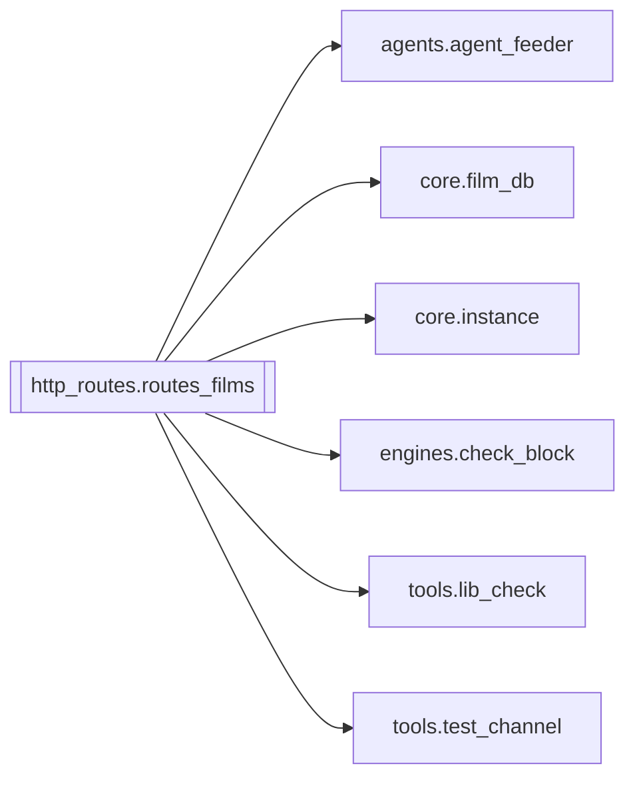

# `http_routes.routes_films`

[← Index](../generated/module-index.md) · [Brain home](../README.md)

<!-- AUTO:START — sinh bởi scripts/brain_build.py 2026-11-11 13:00. Đừng sửa tay khối này. -->
**File:** `http_routes/routes_films.py` · **Lớp:** `control` · **381 dòng** (300 code) · **32 hàm**, **0 class** · sha1 `8cb21fd406`

> FastAPI Router cho Thư viện Phim & Database (đồng bộ trực tiếp trong Pineline V4). Thay vì phải chạy sidecar :8802 riêng mới dùng được films_ui.html, router này gắn trực tiếp vào server.py (port 8804).

### Phụ thuộc

- **Gọi tới (import nội bộ):** [agents.agent_feeder](./agents.agent_feeder.md), [core.film_db](./core.film_db.md), [core.instance](./core.instance.md), [engines.check_block](./engines.check_block.md), [tools.lib_check](./tools.lib_check.md), [tools.test_channel](./tools.test_channel.md)
- **Được dùng bởi:** —
- **Được nhắc tên file `.py` (subprocess/script) bởi:** [restart_server](./restart_server.md)
- **Test:** `tests/v5/test_layout_paths.py`
- **Thư viện ngoài:** `fastapi`

### API routes (31)

| Method | Path | Handler | Dòng |
|---|---|---|---:|
| GET | `/films` | `list_films` | 46 |
| GET | `/films.csv` | `export_films_csv` | 75 |
| POST | `/films/check-block` | `check_block_films` | 140 |
| POST | `/films/check-block-all` | `check_block_all` | 153 |
| POST | `/films/delete` | `delete_films` | 117 |
| POST | `/films/purge-missing` | `purge_missing` | 133 |
| POST | `/films/sync` | `sync_films` | 108 |
| GET | `/films/ui` | `films_ui` | 37 |
| GET | `/films/{job_id}` | `get_film` | 100 |
| GET | `/library` | `get_library` | 167 |
| GET | `/library/accounts` | `library_accounts` | 176 |
| POST | `/library/action` | `library_action` | 185 |
| POST | `/library/clear-samples` | `library_clear_samples` | 218 |
| POST | `/library/cut-sample` | `library_cut_sample` | 227 |
| POST | `/library/enqueue-test` | `library_enqueue_test` | 238 |
| POST | `/library/scan-queue` | `library_scan_queue` | 260 |
| POST | `/library/set-block-status` | `library_set_block_status` | 209 |
| POST | `/library/test-url` | `library_test_url` | 250 |
| GET | `/library/ui` | `films_ui` | 37 |
| GET | `/test-channel/auth-url` | `tc_auth_url` | 289 |
| GET | `/test-channel/batch-progress` | `tc_batch_progress` | 365 |
| POST | `/test-channel/batch-start` | `tc_batch_start` | 355 |
| GET | `/test-channel/callback` | `tc_callback` | 300 |
| POST | `/test-channel/disconnect` | `tc_disconnect` | 334 |
| POST | `/test-channel/finish-auth` | `tc_finish_auth` | 322 |
| GET | `/test-channel/recheck-health` | `tc_recheck_health` | 283 |
| POST | `/test-channel/recheck-one` | `tc_recheck_one` | 370 |
| POST | `/test-channel/recheck-pending` | `tc_recheck_pending` | 377 |
| GET | `/test-channel/reset-quota` | `tc_reset_quota` | 278 |
| GET | `/test-channel/status` | `tc_status` | 273 |
| POST | `/test-channel/test-one` | `tc_test_one` | 340 |

### Hàm & class top-level

| Tên | Dòng | Dài | Tham số | Docstring |
|---|---:|---:|---|---|
| `_host_fallback` | 25 | 4 | `` | V6 F4: thiếu header Host → host:cổng của instance (không cứng 8804). |
| `_get_base_url` | 31 | 2 | `req` |  |
| `films_ui` | 37 | 6 | `` |  |
| `list_films` | 46 | 26 | `q, status, limit, order, work_exists, block_status` |  |
| `export_films_csv` | 75 | 22 | `q, status, limit, order, work_exists, block_status` |  |
| `get_film` | 100 | 5 | `job_id` |  |
| `sync_films` | 108 | 6 | `` |  |
| `delete_films` | 117 | 13 | `payload, req` |  |
| `purge_missing` | 133 | 4 | `payload` |  |
| `check_block_films` | 140 | 10 | `payload` |  |
| `check_block_all` | 153 | 7 | `` |  |
| `get_library` | 167 | 6 | `req` |  |
| `library_accounts` | 176 | 6 | `` |  |
| `library_action` | 185 | 21 | `payload, req` | Ủy thác feeder (skip/priority/add/merge/…) — không gọi film_db.mark_library_* (API không tồn tại). |
| `library_set_block_status` | 209 | 6 | `payload` |  |
| `library_clear_samples` | 218 | 6 | `` |  |
| `library_cut_sample` | 227 | 8 | `payload` |  |
| `library_enqueue_test` | 238 | 9 | `payload` |  |
| `library_test_url` | 250 | 7 | `payload` |  |
| `library_scan_queue` | 260 | 6 | `` |  |
| `tc_status` | 273 | 2 | `` |  |
| `tc_reset_quota` | 278 | 2 | `project_id` |  |
| `tc_recheck_health` | 283 | 3 | `` |  |
| `tc_auth_url` | 289 | 8 | `req, redirect_uri, project_id` |  |
| `tc_callback` | 300 | 19 | `req, code, state` |  |
| `tc_finish_auth` | 322 | 9 | `req, payload` |  |
| `tc_disconnect` | 334 | 3 | `` |  |
| `tc_test_one` | 340 | 12 | `payload` |  |
| `tc_batch_start` | 355 | 7 | `payload` |  |
| `tc_batch_progress` | 365 | 2 | `` |  |
| `tc_recheck_one` | 370 | 4 | `payload` |  |
| `tc_recheck_pending` | 377 | 4 | `payload` |  |

**Tín hiệu rủi ro (đếm tĩnh):** broad_except=17 · swallow_except=2

### Lịch sử (từ docs/)

- **Fix logs (1):**
  - [2026-11-11 — F4 (services + sidecar thuần) + F5 (render tiến trình con)](../../fixes/2026-11-11-f4-f5.md)
- **Reviews:** [2026-11-11-review-f4-f5](../../reviews/2026-11-11-review-f4-f5.md)
- Nhắc trong CHANGELOG: **0** lần · DECISIONS: **0** lần

<!-- AUTO:END -->

<!-- MANUAL:START -->
## Vai trò (viết tay)

_Chưa viết. 2–4 câu: module này chịu trách nhiệm gì trong pipeline, ai gọi nó, nó KHÔNG làm gì._

## Luồng chính

_Các hàm vào (entry) → bước chính → output/side effect. Ghi tên hàm thật._

## Bất biến & hợp đồng

_Điều luôn phải đúng (vd: chỉ ghi manifest qua `Manifest.update`; 1 job / ghế). Vi phạm = bug._

## Bẫy đã biết

_Lỗi từng gặp + link `docs/fixes/...`. Những chỗ dễ sửa sai._

## Ghi chú vận hành

_Config key quan trọng, cần restart gì khi sửa (:8801 / :8802 / hot-reload), cách test._
<!-- MANUAL:END -->
